# Introducción al trading

Esta guía explica desde cero qué es el trading, cómo funciona un mercado por dentro y qué conceptos hay que dominar antes de dejar que un bot opere por nosotros. Los gráficos usan datos **simulados**: sirven para entender las ideas, no muestran precios reales. Se generan desde [graficos/graficos.html](graficos/graficos.html).

Cuando termines esta guía, el documento [matematica-del-bot.md](matematica-del-bot.md) explica en detalle las fórmulas que usa este proyecto.

**Contenido**

1. [¿Qué es el trading?](#1-qué-es-el-trading)
2. [¿Qué se compra y qué se vende?](#2-qué-se-compra-y-qué-se-vende)
3. [¿Quién decide el precio? El libro de órdenes](#3-quién-decide-el-precio-el-libro-de-órdenes)
4. [Tipos de órdenes](#4-tipos-de-órdenes)
5. [Cómo leer el precio: velas japonesas](#5-cómo-leer-el-precio-velas-japonesas)
6. [Temporalidades: el mismo mercado con distinto zoom](#6-temporalidades-el-mismo-mercado-con-distinto-zoom)
7. [Tendencias, rangos, soportes y resistencias](#7-tendencias-rangos-soportes-y-resistencias)
8. [Volumen y volatilidad](#8-volumen-y-volatilidad)
9. [Indicadores técnicos](#9-indicadores-técnicos)
10. [Las tres escuelas de análisis](#10-las-tres-escuelas-de-análisis)
11. [Comprar, vender en corto y apalancamiento](#11-comprar-vender-en-corto-y-apalancamiento)
12. [Gestión del riesgo: la parte más importante](#12-gestión-del-riesgo-la-parte-más-importante)
13. [Esperanza matemática: por qué se puede ganar perdiendo muchas veces](#13-esperanza-matemática-por-qué-se-puede-ganar-perdiendo-muchas-veces)
14. [Los costos invisibles](#14-los-costos-invisibles)
15. [Psicología y errores comunes](#15-psicología-y-errores-comunes)
16. [Trading algorítmico: dónde encaja este bot](#16-trading-algorítmico-dónde-encaja-este-bot)
17. [Glosario rápido](#17-glosario-rápido)

---

## 1. ¿Qué es el trading?

**Hacer trading es comprar y vender un activo con el objetivo de ganar con la diferencia de precio.** Si compras bitcoin a 60 000 USDT y lo vendes a 61 000 USDT, ganas 1 000 USDT por cada bitcoin, menos las comisiones. No importa si crees que bitcoin "vale" algo a largo plazo: lo que importa es acertar en el movimiento del precio durante el tiempo que mantienes la posición.

La diferencia con **invertir** está en el horizonte y en el motivo. El inversor compra porque cree que el activo valdrá más dentro de años y tolera caídas por el camino. El trader busca movimientos más cortos, entra y sale muchas veces y sale rápido cuando se equivoca.

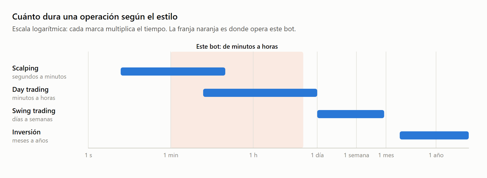

| Estilo | Duración típica de una operación | Qué busca |
|---|---|---|
| **Scalping** | Segundos a minutos | Movimientos diminutos, muchas veces al día. Las comisiones pesan muchísimo. |
| **Day trading** | Minutos a horas, sin dejar posiciones abiertas de un día para otro | Los movimientos del día. |
| **Swing trading** | Días a semanas | Las "olas" dentro de una tendencia. |
| **Position / inversión** | Meses a años | Las grandes tendencias o el valor de fondo del activo. |

---

## 2. ¿Qué se compra y qué se vende?

En un *exchange* como Binance todo se negocia en **pares**. Un par indica qué activo compras y con qué lo pagas.

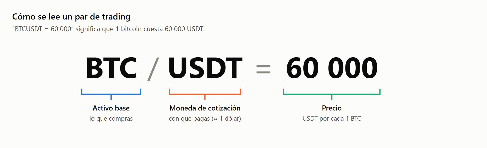

- **USDT (Tether)** es una *stablecoin*, una criptomoneda diseñada para valer siempre alrededor de 1 dólar. Se usa como "efectivo" dentro del exchange.
- **Comprar BTCUSDT** es entregar USDT y recibir BTC; **venderlo** es lo contrario.
- Este bot opera cuatro pares: `BTCUSDT`, `ETHUSDT`, `SOLUSDT` y `DOGEUSDT`.

Hay dos grandes tipos de mercado:

| Mercado | Qué recibes | Riesgo máximo |
|---|---|---|
| **Spot** (contado) | La moneda real, que queda en tu cuenta. | Que la moneda valga cero: pierdes lo que pusiste. |
| **Futuros / derivados** | Un contrato que sigue el precio, sin la moneda real. Permite apostar a la baja y usar apalancamiento. | Puedes perder todo tu margen muy rápido (sección 11). |

Este bot opera en **spot** y solo compra para luego vender más caro.

---

## 3. ¿Quién decide el precio? El libro de órdenes

Nadie "fija" el precio. El precio es simplemente **el último acuerdo** entre alguien que quería comprar y alguien que quería vender. Todas las intenciones pendientes se acumulan en el **libro de órdenes** (*order book*).

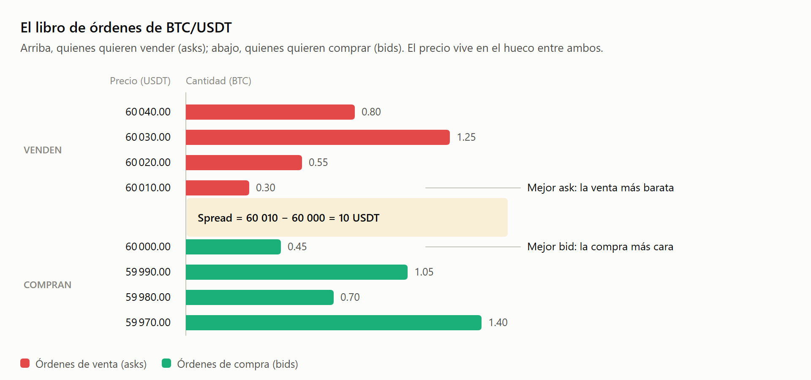

- **Bid** es el precio más alto que alguien está dispuesto a pagar ahora mismo.
- **Ask** es el precio más bajo al que alguien está dispuesto a vender ahora mismo.
- **Spread** es la distancia entre ambos. En monedas muy negociadas, como BTC, es mínimo; en monedas pequeñas puede ser grande.
- La **profundidad** es cuánta cantidad hay en cada nivel. Un libro "delgado" se mueve mucho con poco dinero.

### Ejemplo: qué pasa cuando compras "a mercado"

Supón que quieres comprar **0.5 BTC ya mismo**, al precio que haya. El exchange va "comiéndose" las ventas del libro desde la más barata:

| Paso | Cantidad | Precio | Total |
|---|---|---|---|
| Se agota el nivel más barato | 0.30 BTC | 60 010 | 18 003 USDT |
| Se toma parte del siguiente nivel | 0.20 BTC | 60 020 | 12 004 USDT |
| **Total** | **0.50 BTC** | **60 014 (promedio)** | **30 007 USDT** |

Pagaste en promedio 60 014 y no 60 010, que era el mejor precio visible. Esa diferencia se llama **deslizamiento** (*slippage*), y crece cuanto más grande es la orden y más delgado es el libro.

---

## 4. Tipos de órdenes

| Orden | Qué le dices al exchange | Ventaja | Desventaja |
|---|---|---|---|
| **Market** (a mercado) | "Compra o vende ya, al precio que haya." | Se ejecuta al instante. | No controlas el precio exacto (deslizamiento). |
| **Limit** (límite) | "Compra solo a este precio o más barato" (o "vende a este precio o más caro"). | Controlas el precio. | Puede que nunca se ejecute. |
| **Stop loss** | "Si el precio cae hasta X, vende para cortar la pérdida." | Limita cuánto puedes perder. | En caídas bruscas puede ejecutarse peor de lo esperado. |
| **Take profit** | "Si el precio sube hasta Y, vende para asegurar la ganancia." | Asegura el beneficio sin estar mirando. | Si el precio sigue subiendo, te lo pierdes. |
| **OCO** (*one cancels the other*) | Un take profit y un stop loss a la vez: cuando uno se ejecuta, el otro se cancela. | Automatiza la salida completa. | — |

Así se ve una operación completa en una "escalera" de precios:

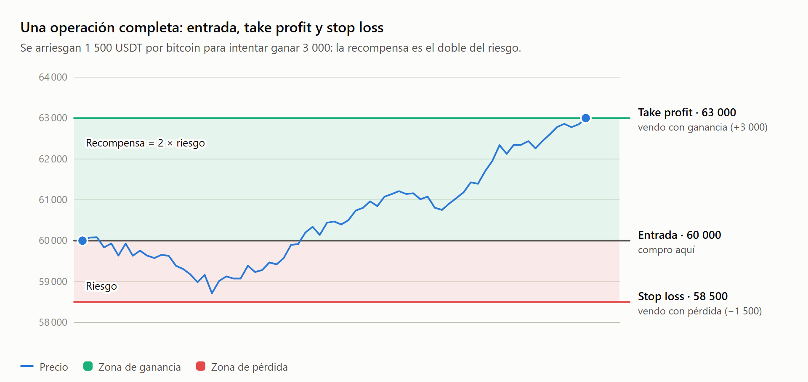

**Maker y taker.** Si tu orden queda esperando en el libro (una orden límite que no se ejecuta al instante), **aportas liquidez** y eres *maker*. Si tu orden se cruza con una que ya estaba (una orden a mercado), **tomas liquidez** y eres *taker*. Los exchanges suelen cobrar menos a los makers. En Binance spot la comisión estándar ronda el **0.1 %** por operación.

> **En este bot:** Node.js coloca órdenes *limit* al precio actual, tanto para entrar como para salir. El take profit y el stop loss no se envían a Binance: el bot los vigila él mismo y vende cuando el precio los cruza.

---

## 5. Cómo leer el precio: velas japonesas

Un gráfico de líneas solo muestra un precio por periodo. Las **velas japonesas** resumen cuatro datos de cada periodo, conocidos como **OHLC**:

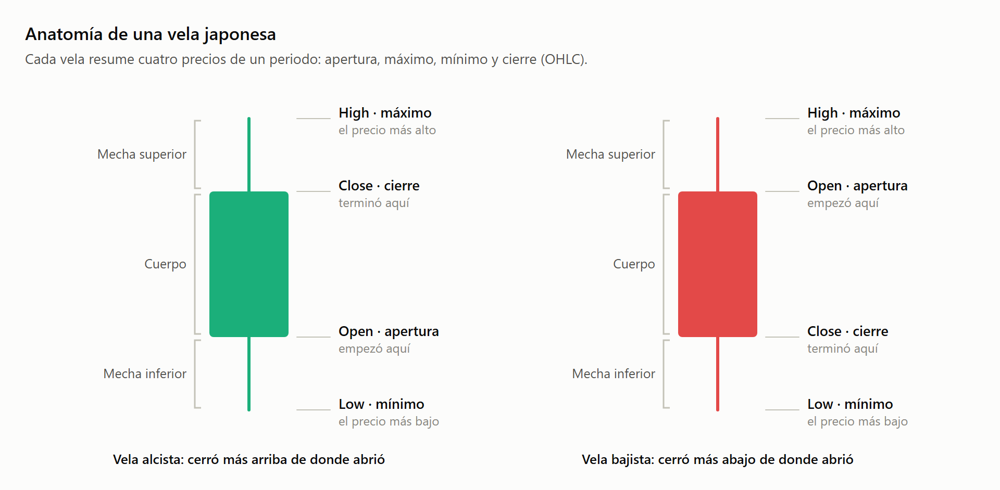

| Dato | Significado |
|---|---|
| **Open** | Precio al empezar el periodo. |
| **High** | Precio más alto alcanzado durante el periodo. |
| **Low** | Precio más bajo alcanzado durante el periodo. |
| **Close** | Precio al terminar el periodo. Es el dato que más usan los indicadores. |
| **Volume** | Cuánto se negoció durante el periodo (se muestra aparte, normalmente en barras debajo del gráfico). |

**Cómo "leer" una vela:**

- Un **cuerpo grande** indica que un bando (compradores o vendedores) dominó claramente el periodo.
- Una **mecha inferior larga** indica que el precio bajó, pero los compradores lo empujaron de vuelta hacia arriba: hubo rechazo de precios bajos.
- Una **mecha superior larga** indica lo contrario: hubo rechazo de precios altos.
- Un **cuerpo diminuto** con mechas a ambos lados (*doji*) indica indecisión.

Así se ve una serie de velas (verde = alcista, rojo = bajista): primero una subida y luego un retroceso.

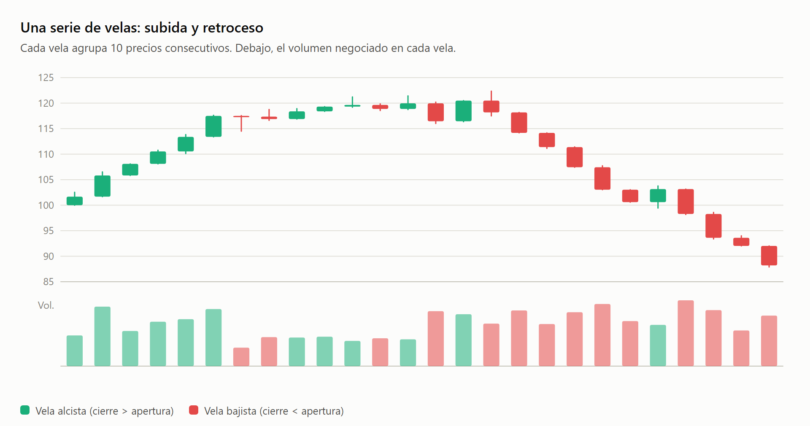

---

## 6. Temporalidades: el mismo mercado con distinto zoom

Cada vela puede representar 1 minuto, 15 minutos, 1 hora, 1 día, etc. Es la **temporalidad** (*timeframe*). Los dos paneles siguientes muestran **exactamente las mismas 6 horas de precio** (de 09:00 a 15:00), agrupadas de dos formas: a la izquierda en velas de **15 minutos** (24 velas) y a la derecha en velas de **1 hora** (6 velas).

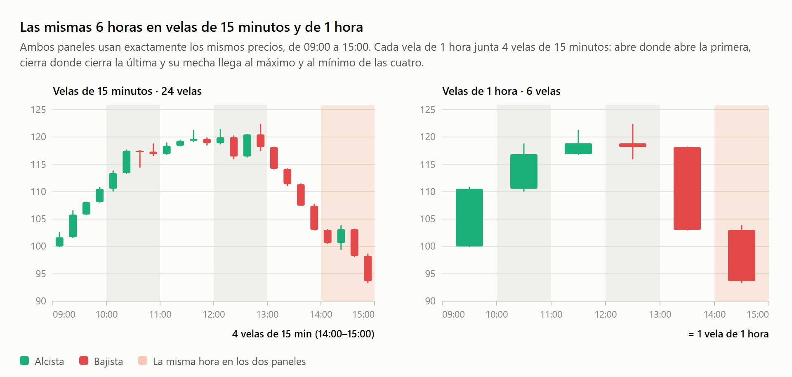

**Cómo se juntan las velas.** Una hora tiene 4 periodos de 15 minutos, así que cada vela de 1 hora resume 4 velas de 15 minutos:

| Dato de la vela de 1 hora | Se toma de las 4 velas de 15 minutos |
|---|---|
| **Open** | La apertura de la primera vela (la de :00). |
| **High** | El máximo más alto de las cuatro. |
| **Low** | El mínimo más bajo de las cuatro. |
| **Close** | El cierre de la última vela (la de :45). |
| **Volume** | La suma del volumen de las cuatro. |

La franja naranja (14:00–15:00) lo muestra: las cuatro velas de 15 minutos son roja, verde, roja y roja, pero juntas forman **una sola vela roja** de 1 hora. El pequeño rebote verde desaparece al cambiar de temporalidad. La misma regla vale para cualquier combinación: 15 velas de 1 minuto forman una de 15 minutos, 24 velas de 1 hora forman una diaria, etc.

- En temporalidades cortas se ve mucho **ruido**: pequeñas subidas y bajadas que no significan nada.
- En temporalidades largas el ruido se "promedia" y la **dirección general** es más clara, pero las señales llegan más tarde.
- Un patrón que funciona en una temporalidad puede no funcionar en otra.

> **En este bot:** las estrategias se optimizan con velas de **15 minutos**, pero en vivo reciben velas de **1 minuto**. Por lo que muestra este gráfico, una ventana de 20 velas no significa lo mismo en ambas temporalidades: en 15 minutos son 5 horas y en 1 minuto son 20 minutos.

---

## 7. Tendencias, rangos, soportes y resistencias

El precio casi nunca va en línea recta: avanza en "olas". Según cómo sean esas olas, el mercado está en uno de tres estados.

### Tendencia alcista: máximos y mínimos cada vez más altos

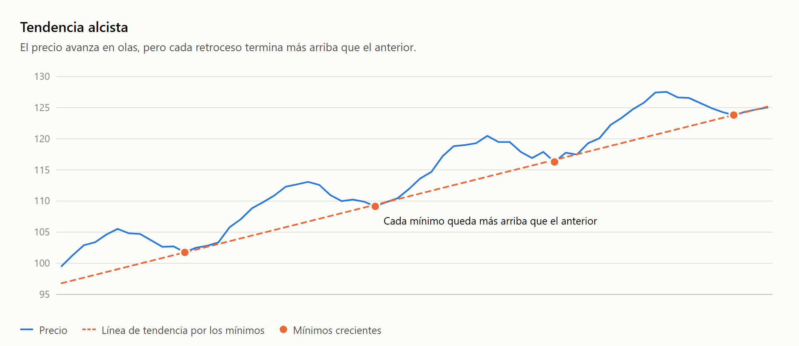

### Tendencia bajista: máximos y mínimos cada vez más bajos

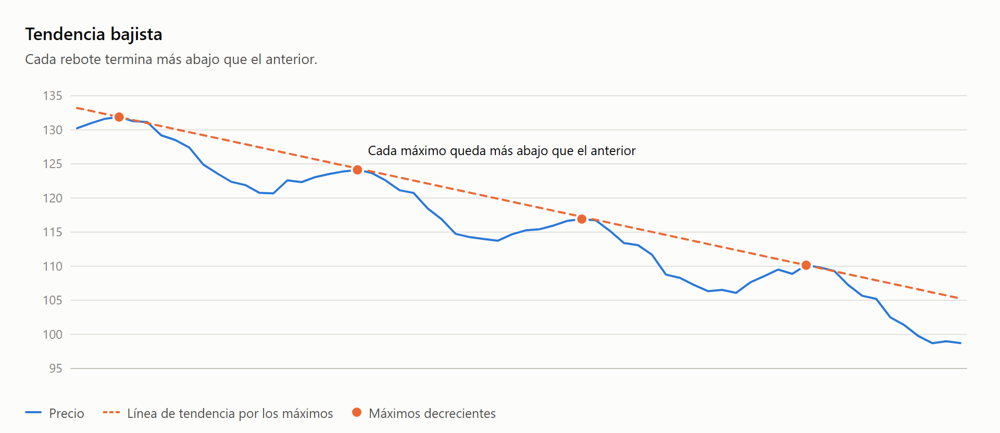

### Rango lateral: el precio rebota entre un piso y un techo

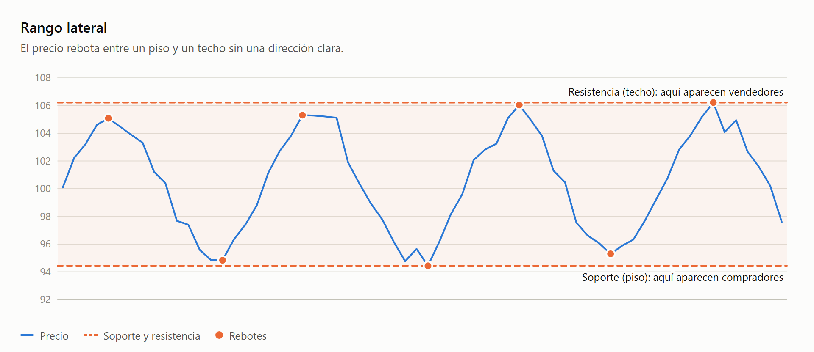

- Un **soporte** es una zona de precio donde históricamente aparecieron muchos compradores y el precio dejó de bajar.
- Una **resistencia** es una zona donde aparecieron muchos vendedores y el precio dejó de subir.
- Cuando el precio **rompe** un soporte o una resistencia con fuerza, a menudo ese nivel cambia de papel: un techo roto pasa a funcionar como piso.

**Por qué importa:** cada estado pide una estrategia distinta.

| Estado del mercado | Estrategia que suele funcionar | Estrategia que suele fracasar |
|---|---|---|
| Tendencia | Seguir la tendencia: comprar en las rupturas y "dejar correr" la ganancia. | Comprar "porque ya bajó mucho" en una tendencia bajista. |
| Rango | Reversión a la media: comprar cerca del soporte y vender cerca de la resistencia. | Comprar rupturas que vuelven a caer dentro del rango (rupturas falsas). |

> **En este bot:** `MeanReversion` y `VWAP` son estrategias de **rango**; `TrendFollowing` y `VolatilitySqueeze` son estrategias de **tendencia**. Hoy el bot elige una por moneda y la usa siempre, sin detectar en qué estado está el mercado.

---

## 8. Volumen y volatilidad

**Volumen** es cuánto se negoció en un periodo. Un movimiento de precio con **mucho volumen** indica que mucha gente participó y suele ser más confiable. Un movimiento con **poco volumen** puede ser una ilusión que se deshace fácilmente.

**Volatilidad** es cuánto se mueve el precio. Se mide habitualmente con la desviación estándar de los retornos (la fórmula está en [matematica-del-bot.md](matematica-del-bot.md), sección 2).

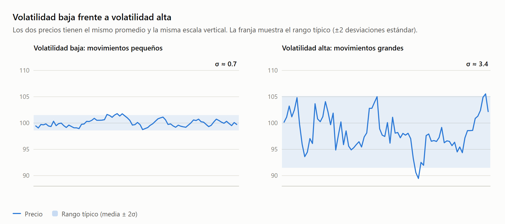

- Las criptomonedas son mucho más volátiles que las acciones o las divisas tradicionales, y las monedas pequeñas (como DOGE) suelen serlo más que BTC.
- La volatilidad **viene en racimos**: después de un periodo agitado suele venir otro agitado, y después de uno tranquilo, otro tranquilo.
- Mayor volatilidad significa más oportunidades, pero también stops que se tocan más fácilmente.

---

## 9. Indicadores técnicos

Un **indicador** es un cálculo matemático sobre el precio y/o el volumen que intenta resumir algo útil: la tendencia, el impulso, la volatilidad o si el precio está "estirado".

| Indicador | Qué mide | Lectura típica |
|---|---|---|
| **Media móvil (SMA/EMA)** | El precio promedio de las últimas *n* velas. | Precio por encima de la media: sesgo alcista. Por debajo: sesgo bajista. |
| **Bandas de Bollinger** | Un canal de ±*k* desviaciones estándar alrededor de la media. | Tocar la banda inferior: precio "barato" respecto a lo normal. |
| **RSI** | La fuerza de las subidas frente a la de las bajadas, en una escala de 0 a 100. | Mayor que 70: sobrecompra. Menor que 30: sobreventa. |
| **VWAP** | El precio promedio ponderado por volumen. | Referencia de "precio justo" del periodo. |
| **ATR** | El tamaño promedio de las velas. | Sirve para colocar stops proporcionales a la volatilidad. |

### Ejemplo: Bandas de Bollinger (el corazón de este bot)

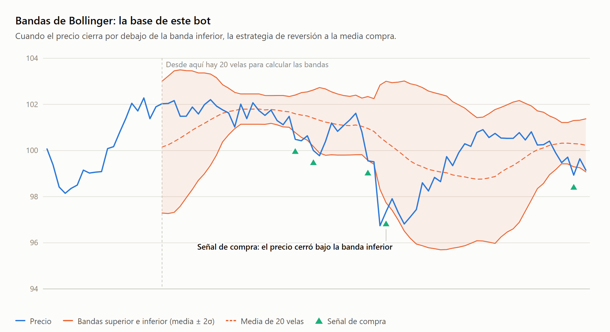

Cuando el precio se sale por debajo de la banda inferior, la estrategia de **reversión a la media** compra, apostando a que el precio volverá hacia la línea central. Fíjate en el gráfico: a veces el precio rebota pronto y a veces sigue cayendo un buen rato antes de volver. Por eso ningún indicador es una garantía, y siempre hace falta un stop loss.

---

## 10. Las tres escuelas de análisis

| Escuela | Pregunta que se hace | Herramientas | Ejemplo |
|---|---|---|---|
| **Fundamental** | "¿Cuánto vale realmente este activo?" | Adopción, uso de la red, regulación, noticias, flujos de entrada a ETFs. | "Bitcoin está barato porque cada vez más instituciones lo compran." |
| **Técnica** | "¿Qué patrón está dibujando el precio?" | Gráficos, velas, soportes, indicadores. | "El precio rebotó tres veces en 58 000: es un soporte fuerte." |
| **Cuantitativa** | "¿Qué regla, comprobada con datos, tiene ventaja estadística?" | Estadística, backtesting, *machine learning*, programación. | "Cuando el precio cae 2σ bajo su media, el 58 % de las veces vuelve a ella en menos de 3 horas." |

Este proyecto es **cuantitativo**: usa ideas del análisis técnico (bandas, RSI), pero las convierte en reglas exactas, las prueba con datos históricos y deja que un programa las ejecute sin emociones.

---

## 11. Comprar, vender en corto y apalancamiento

Hay dos direcciones posibles para una operación, y una forma de "agrandarla" con dinero prestado.

### Long y short: en qué dirección apuestas

- **Long (ir en largo):** compras primero y vendes después. Ganas si el precio **sube**.
- **Short (ir en corto):** vendes primero algo prestado y lo recompras después. Ganas si el precio **baja**. Solo es posible en futuros o con margen.

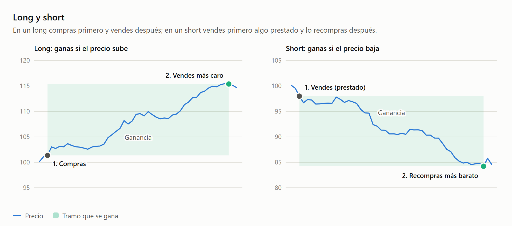

El short parece extraño porque vendes algo que no tienes. Paso a paso:

1. El exchange te **presta** 1 BTC cuando vale 60 000 USDT.
2. Lo vendes enseguida y recibes 60 000 USDT.
3. El precio baja a 57 000 USDT.
4. Recompras 1 BTC por 57 000 USDT y se lo **devuelves** al exchange.
5. Te quedan 3 000 USDT de ganancia (menos comisiones e intereses por el préstamo).

Si el precio hubiera **subido** a 63 000, tendrías que recomprar más caro y perderías 3 000. En un long lo máximo que puedes perder es lo que pagaste (el precio no baja de cero); en un short, en teoría, la pérdida no tiene límite, porque el precio puede subir sin techo.

### Apalancamiento: operar con más dinero del que tienes

**Apalancamiento** es operar con dinero prestado por el exchange. El número (2x, 10x, 50x…) indica **cuántas veces más grande es la posición que el dinero que pones tú**:

$$
\text{Tamaño de la posición} = \text{tu dinero (margen)} \times \text{apalancamiento}
$$

Por ejemplo, si pones **10 USDT con 10x**:

| Concepto | Monto |
|---|---|
| Tu dinero (el **margen**, la garantía) | 10 USDT |
| Prestado por el exchange | 90 USDT |
| **Posición total** | **100 USDT** |

Es decir, **no** son 10 tuyos más 100 del exchange: la posición total es 10 veces tu dinero, y el préstamo es la diferencia (100 − 10 = 90). Ese préstamo nunca llega a tus manos: solo sirve para que tu posición sea más grande. Al cerrar, el exchange recupera sus 90 USDT y tú te quedas con lo que sobre.

**Qué pasa con el precio.** La ganancia o la pérdida se calcula sobre los 100 USDT de la posición, pero sale entera de tus 10 USDT:

| El precio se mueve | La posición de 100 USDT vale | Resultado | Sobre tus 10 USDT |
|---|---|---|---|
| +5 % | 105 USDT | +5 USDT | **+50 %** |
| +1 % | 101 USDT | +1 USDT | +10 % |
| −1 % | 99 USDT | −1 USDT | −10 % |
| −5 % | 95 USDT | −5 USDT | **−50 %** |
| −10 % | 90 USDT | −10 USDT | **−100 %: liquidado** |

El mercado se mueve igual que sin apalancamiento; lo que cambia es que cada 1 % de movimiento del precio es un 10 % de **tu** dinero. Las ganancias **y las pérdidas** se multiplican por 10.

**Liquidación.** Cuando la pérdida se acerca a tu margen, el exchange cierra la posición a la fuerza para no perder el dinero que te prestó. Eso es la **liquidación**: pierdes el margen completo aunque después el precio se recupere. En la práctica ocurre un poco **antes** de perder el 100 %, porque el exchange exige mantener un mínimo de garantía (el **margen de mantenimiento**) y cobra una comisión de liquidación. Con 10x, una caída de alrededor del 9.5 % (no del 10 %) ya puede liquidarte.

**Lo que el apalancamiento no cambia.** Una posición de 100 USDT con 10x gana o pierde exactamente los mismos dólares que comprar 100 USDT en spot. La diferencia es que en spot, si el precio cae 10 %, sigues teniendo 90 USDT de moneda y puedes esperar a que se recupere; con 10x, esa misma caída te saca del mercado y pierdes los 10 USDT para siempre. El apalancamiento sirve para inmovilizar menos dinero, no para ganar "más" con la misma idea: el riesgo de la operación lo deciden el tamaño de la posición y el stop loss (sección 12).

**Costos extra.** El dinero prestado no es gratis. En futuros perpetuos se paga (o se cobra) cada 8 horas una tasa llamada *funding*, y en margen se pagan intereses por hora. Mantener una posición apalancada por días puede costar más que la comisión de entrada y salida.

La tabla siguiente muestra qué caída del precio te liquida en un long según el apalancamiento:

| Apalancamiento | Caída aproximada del precio que te liquida (en un long) |
|---|---|
| 1x (spot) | 100 % (la moneda tendría que valer cero) |
| 2x | ~50 % |
| 5x | ~20 % |
| 10x | ~10 % |
| 20x | ~5 % |
| 50x | ~2 % |
| 100x | ~1 % |

La regla aproximada es $\text{caída que liquida} \approx 100\% / \text{apalancamiento}$, porque con apalancamiento $L$ tu margen es $1/L$ de la posición. En la práctica es algo menor, por el margen de mantenimiento y las comisiones. En un short es igual, pero con una **subida** del precio. En cripto, una caída del 5 % en un día es frecuente, así que con 20x una posición puede desaparecer en horas.

> **En este bot:** opera en **spot sin apalancamiento** y solo en largo. Es la forma más segura de empezar.

---

## 12. Gestión del riesgo: la parte más importante

La mayoría de los traders no pierde por elegir mal las entradas, sino por **arriesgar demasiado** en cada operación. La gestión del riesgo responde dos preguntas: **cuánto puedo perder en una operación** y **cuánto compro para que esa pérdida sea la que acepté**.

### El concepto de "R"

$R$ (de **riesgo**) es la cantidad de dinero que pierdes si la operación toca el stop loss. Es tu "unidad de medida": en lugar de hablar de dólares, los resultados se cuentan en múltiplos de lo que arriesgaste.

**Ejemplo.** Compras con el stop loss puesto de forma que, si se toca, pierdes 10 USDT. Entonces, en esa operación, $1R = 10$ USDT:

| Resultado de la operación | En USDT | En R |
|---|---|---|
| Toca el stop loss | −10 USDT | $-1R$ |
| Toca un take profit puesto al doble de distancia que el stop | +20 USDT | $+2R$ |
| Toca un take profit puesto a la misma distancia que el stop | +10 USDT | $+1R$ |
| La cierras a mitad de camino hacia el stop | −5 USDT | $-0.5R$ |

Así, "ganar $2R$" significa ganar **el doble de lo que estabas dispuesto a perder**, sea cual sea el monto. Medir en $R$ permite comparar operaciones y estrategias aunque cada una use montos distintos: $+2R$ es el mismo resultado si arriesgaste 10 USDT o 1 000.

### Tamaño de la posición

La regla profesional más común es arriesgar un **porcentaje fijo y pequeño del capital** (entre 0.5 % y 2 %) en cada operación:

$$
\text{Cantidad a comprar} = \frac{\text{Capital} \times \%\text{ de riesgo}}{\text{Precio de entrada} - \text{Stop loss}}
$$

**Ejemplo:** con 1 000 USDT de capital y un riesgo del 1 %, puedes perder 10 USDT. Si compras BTC a 60 000 con el stop en 58 500 (1 500 de distancia), la cantidad es $10 / 1500 = 0.00667$ BTC, es decir, una posición de unos 400 USDT. Si el stop se toca, pierdes exactamente 10 USDT, el 1 % acordado.

### Por qué las pérdidas grandes son tan peligrosas

Las pérdidas y las ganancias **no son simétricas**: después de perder, el capital es menor, así que hace falta un porcentaje mayor para volver al punto de partida.

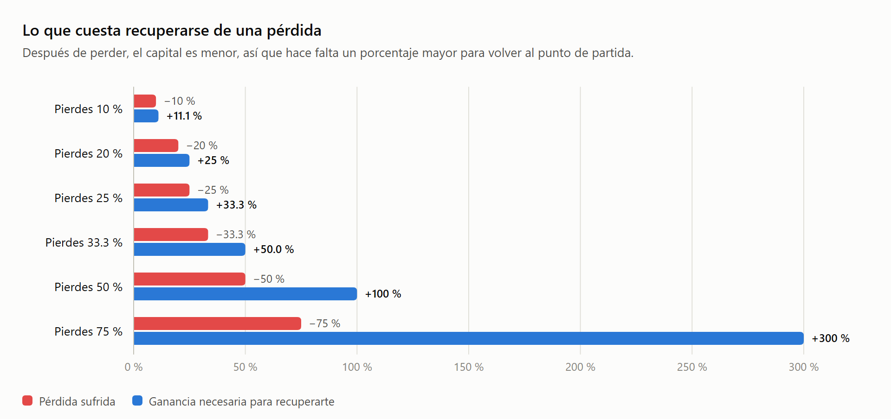

Perder el 50 % exige **duplicar** lo que queda solo para volver a empezar. Por eso la prioridad número uno no es ganar mucho, sino **no perder mucho**.

---

## 13. Esperanza matemática: por qué se puede ganar perdiendo muchas veces

No hace falta acertar la mayoría de las veces. Lo que importa es la **esperanza matemática**: cuánto ganas en promedio por operación, combinando la tasa de acierto con el tamaño de las ganancias y las pérdidas.

$$
E = (\text{\% de aciertos} \times \text{ganancia media}) - (\text{\% de fallos} \times \text{pérdida media})
$$

El gráfico compara dos traders con la **misma** regla de salida durante 100 operaciones, empezando con 100 unidades de capital. Los dos arriesgan siempre **1 unidad** por operación, así que aquí $1R = 1$ unidad (el 1 % del capital inicial):

- Si la operación toca el stop loss, pierden $1R$: el capital baja 1 unidad.
- Si toca el take profit, que está al doble de distancia que el stop, ganan $2R$: el capital sube 2 unidades.

Lo único que cambia entre los dos es **cuántas veces aciertan**:

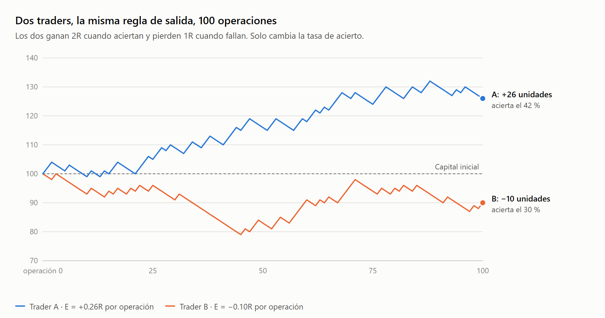

- **Trader A** acierta el 42 %: $E = 0.42 \times 2 - 0.58 \times 1 = +0.26R$ por operación.
- **Trader B** acierta el 30 %: $E = 0.30 \times 2 - 0.70 \times 1 = -0.10R$ por operación.

Tres lecciones de este gráfico:

1. **El trader A pierde el 58 % de sus operaciones y aun así gana**, porque sus ganancias duplican a sus pérdidas.
2. **Incluso con ventaja hay rachas malas.** Con un 42 % de aciertos, encadenar 5 pérdidas seguidas tiene una probabilidad de $0.58^5 \approx 6.6\%$ en cada tramo de cinco operaciones, así que en 100 operaciones es casi seguro que pasará. Hay que soportarlas sin cambiar la estrategia por desesperación.
3. **La ventaja solo aparece con muchas operaciones** (la ley de los grandes números). Juzgar una estrategia por 5 o 10 operaciones es como juzgar una moneda por 5 lanzamientos.

### La esperanza con muchas operaciones

La fórmula de arriba da la esperanza de **una** operación cuando ya conoces la tasa de acierto. En la práctica pasa al revés: tienes un historial de $N$ operaciones y quieres saber qué esperar de las siguientes. Para eso hacen falta cuatro cálculos.

**1. Estimar la esperanza a partir del historial.** Se anota el resultado de cada operación en $R$ ($r_1, r_2, \dots, r_N$) y se promedia:

$$
\hat E = \frac{1}{N}\sum_{i=1}^{N} r_i
$$

El sombrero en $\hat E$ indica que es una **estimación**: sale de las operaciones que ya ocurrieron, no de la tasa de acierto "verdadera", que nadie conoce.

*Ejemplo.* Diez operaciones con resultados $+2, -1, -1, +2, -1, +2, -1, -1, +2, -1$. La suma es $4 \times 2 - 6 \times 1 = +2R$, así que $\hat E = 2/10 = +0.2R$ por operación. Es lo mismo que da la fórmula de arriba con 40 % de aciertos: $0.4 \times 2 - 0.6 \times 1 = 0.2$. Promediar los resultados sirve también cuando las ganancias y las pérdidas no son siempre del mismo tamaño.

**2. El resultado total esperado crece en línea recta.** Si cada operación vale $E$ en promedio, $N$ operaciones valen en promedio:

$$
\text{Resultado total esperado} = N \times E
$$

Con 100 operaciones, el trader A espera $100 \times 0.26 = +26R$ y el trader B, $100 \times (-0.10) = -10R$. Es lo que muestra el gráfico: con $1R = 1$ unidad, A termina cerca de 126 y B cerca de 90.

**3. La suerte también crece, pero más despacio.** Cada operación tiene una dispersión alrededor de $E$, que se mide con la desviación estándar $\sigma$:

$$
\sigma^2 = \frac{1}{N}\sum_{i=1}^{N}\left(r_i - \hat E\right)^2
\qquad\text{o, con solo dos resultados posibles,}\qquad
\sigma^2 = p\,G^2 + (1-p)\,P^2 - E^2
$$

donde $p$ es la tasa de acierto, $G$ la ganancia y $P$ la pérdida, ambas en $R$. Para el trader A, $\sigma^2 = 0.42 \times 4 + 0.58 \times 1 - 0.26^2 \approx 2.19$, así que $\sigma \approx 1.48R$: **la suerte de una sola operación es casi seis veces más grande que la ventaja** ($1.48$ frente a $0.26$).

Al sumar $N$ operaciones independientes, la dispersión del total no crece con $N$, sino con $\sqrt N$:

$$
\text{Dispersión del total} = \sigma\sqrt N
\qquad\Longrightarrow\qquad
\frac{\text{ventaja}}{\text{suerte}} = \frac{N\,E}{\sigma\sqrt N} = \frac{E\sqrt N}{\sigma}
$$

Esa última razón es la clave: la ventaja crece $N$ veces y la suerte solo $\sqrt N$ veces, así que con suficientes operaciones la ventaja termina dominando. Así se ve con los dos traders:

| Operaciones | A: total esperado | A: dispersión ($\pm\sigma\sqrt N$) | A: probabilidad de terminar ganando | B: probabilidad de terminar ganando |
|---|---|---|---|---|
| 10 | $+2.6R$ | $\pm 4.7R$ | 67 % | 35 % |
| 100 | $+26R$ | $\pm 14.8R$ | 96 % | 22 % |
| 1 000 | $+260R$ | $\pm 46.8R$ | ≈ 100 % | 1 % |

Con 10 operaciones, el trader B, que **pierde** dinero en promedio, termina ganando una de cada tres veces; con 100, todavía una de cada cinco. Por eso unas pocas operaciones buenas no prueban nada.

**4. Cuántas operaciones hacen falta para confiar en el resultado.** Una regla habitual es pedir que la ventaja supere al doble de la suerte ($E\sqrt N / \sigma \ge 2$, aproximadamente un 95 % de confianza). Despejando $N$:

$$
N \ge \left(\frac{2\,\sigma}{E}\right)^2
$$

Para el trader A, $N \ge (2 \times 1.48 / 0.26)^2 \approx 130$ operaciones; para detectar que el trader B pierde, $N \ge (2 \times 1.375 / 0.10)^2 \approx 756$. Cuanto más pequeña es la ventaja, muchas más operaciones hacen falta para distinguirla de la suerte. Con un historial real se usa la misma idea con los valores estimados: si $\hat E\sqrt N / \sigma$ es menor que 2, todavía no se sabe si la estrategia tiene ventaja.

**Si $R$ es un porcentaje del capital (interés compuesto).** Hasta aquí $R$ era un monto fijo. Si en cambio se arriesga siempre una fracción $f$ del capital **actual** (como en la sección 12), cada resultado multiplica el capital en lugar de sumarle:

$$
C_N = C_0 \prod_{i=1}^{N}\left(1 + f\,r_i\right)
\qquad\qquad
g = p\,\ln(1 + f\,G) + (1-p)\,\ln(1 - f\,P)
$$

$\prod$ significa "multiplicar todos los términos", y $g$ es el crecimiento promedio por operación (en escala logarítmica), de modo que $C_N \approx C_0\,e^{N g}$. Para el trader A, arriesgando $f = 1\,\%$, $g \approx 0.0025$, y en 100 operaciones el capital crece un 28 %, un poco más que el 26 % lineal. Pero arriesgar más no siempre es mejor: con $f = 13\,\%$ el capital se multiplica por 5; con $f = 25\,\%$, solo por 1.4, y con $f = 30\,\%$, $g$ es negativo y el capital **cae** un 61 %, **aunque la esperanza por operación siga siendo positiva**. Las rachas de pérdidas con un riesgo tan alto destruyen más de lo que reconstruyen las ganancias. Es otra razón para arriesgar porcentajes pequeños.

---

## 14. Los costos invisibles

Cada operación paga costos que se comen parte del margen:

| Costo | Qué es | Orden de magnitud en Binance spot |
|---|---|---|
| **Comisión** | Lo que cobra el exchange por ejecutar. | ~0.1 % al entrar y ~0.1 % al salir. |
| **Spread** | La diferencia entre el bid y el ask: se compra un poco más caro y se vende un poco más barato. | Pequeño en BTC y ETH, mayor en monedas menos negociadas. |
| **Deslizamiento** | Ejecutar a peor precio del esperado (sección 3). | Depende del tamaño de la orden y de la volatilidad. |

### El spread, paso a paso

En todo momento hay **dos** precios, no uno (sección 3):

- El **ask** es lo más barato a lo que alguien te vende. Es lo que **pagas** si compras ya mismo.
- El **bid** es lo más caro que alguien te paga. Es lo que **recibes** si vendes ya mismo.

El ask siempre está por encima del bid; si no, comprador y vendedor ya habrían hecho el trato. La distancia entre los dos es el **spread**. Funciona como en una casa de cambio: el cartel muestra un precio para comprar dólares y otro, más bajo, para venderlos, y si compras y vendes enseguida pierdes la diferencia.

**Ejemplo con el libro de la sección 3** (bid 60 000, ask 60 010, spread de 10 USDT):

| Paso | Precio | USDT |
|---|---|---|
| Compras 1 BTC a mercado: pagas el **ask** | 60 010 | −60 010 |
| Un segundo después, sin que el mercado se mueva, lo vendes a mercado: recibes el **bid** | 60 000 | +60 000 |
| **Resultado** | | **−10** |

El precio "no se movió" y aun así perdiste 10 USDT por BTC. Ese es el costo del spread: **al entrar compras un poco por encima del precio medio y al salir vendes un poco por debajo**. Para no perder dinero, el precio tiene que subir al menos el spread (más las comisiones) antes de que la operación empiece a ganar.

**Cómo se mide.** Se suele expresar como porcentaje del precio medio:

$$
\text{Spread \%} = \frac{\text{ask} - \text{bid}}{(\text{ask} + \text{bid})/2}
$$

En el ejemplo, $10 / 60\,005 \approx 0.017\,\%$, unas seis veces menos que la comisión de una sola orden (0.1 %). En BTC y ETH el spread casi no se nota. En una moneda poco negociada, en cambio, el libro puede tener un bid de 1.000 y un ask de 1.010, es decir, un spread del 1 %: diez veces la comisión, y un costo que se paga en cada operación.

**Cómo se evita en parte.** El spread lo pagas cuando **cruzas** el libro con una orden a mercado. Si pones una orden *limit* de compra en el bid y esperas a que alguien te venda, no lo pagas. A cambio, no hay garantía de que la orden se ejecute: si el precio sube sin tocar tu nivel, te quedas fuera.

**Ejemplo con este bot:** una operación de 15 USDT que busca ganar un 0.5 % espera ganar $15 \times 0.005 = 0.075$ USDT. Las comisiones de ida y vuelta son $15 \times 0.002 = 0.03$ USDT, es decir, **el 40 % de la ganancia esperada se va en comisiones**. Cuanto más pequeño es el movimiento que se busca, más pesan los costos.

---

## 15. Psicología y errores comunes

El trading manual es difícil, sobre todo por las emociones. Estos son los errores más frecuentes:

| Error | Qué pasa | Antídoto |
|---|---|---|
| **No usar stop loss** | "Ya volverá a subir"… y a veces no vuelve nunca. | Definir el stop **antes** de entrar. |
| **Mover el stop para no perder** | Una pérdida pequeña se convierte en una enorme. | Respetar el plan; el stop solo se mueve a favor. |
| **Venganza (*revenge trading*)** | Después de perder, operar más y más grande para "recuperar". | Límite de pérdida diaria y pausa obligatoria. |
| **FOMO** | Comprar tarde algo que ya subió mucho por miedo a quedarse fuera. | Operar solo las señales del plan. |
| **Sobreapalancarse** | Una caída normal liquida la cuenta. | Poco o ningún apalancamiento. |
| **Cortar las ganancias pronto y dejar correr las pérdidas** | Ganas poco cuando aciertas y pierdes mucho cuando fallas: esperanza negativa. | Salidas definidas por reglas (take profit y stop loss). |
| **Sobreajustar** | Buscar la regla que habría funcionado perfecto en el pasado. | Validar con datos que la regla nunca vio. |

Los propios brokers regulados en Europa están obligados a publicar qué porcentaje de sus clientes pierde dinero con productos apalancados, y suele ser la mayoría. El trading es un juego de suma cero (o negativa, si se cuentan las comisiones) frente a profesionales con más información y mejor tecnología.

---

## 16. Trading algorítmico: dónde encaja este bot

El **trading algorítmico** convierte una estrategia en un programa que observa el mercado y opera solo. Así elimina las emociones, opera las 24 horas y ejecuta en milisegundos. A cambio, aparece un riesgo nuevo: **un error de programación o de matemática se repite miles de veces sin que nadie lo note.**

### La arquitectura de este proyecto

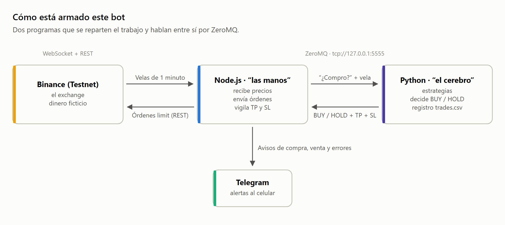

### Vida de una operación, paso a paso

1. Llega una vela nueva de BTCUSDT por WebSocket.
2. Node.js le pregunta a Python: "¿compro?".
3. Python actualiza su ventana de precios y calcula las Bandas de Bollinger.
4. Si el precio cerró por debajo de la banda inferior, responde `BUY` con take profit y stop loss.
5. Node.js calcula la cantidad (≈ 15 USDT) y envía una orden limit de compra a Binance.
6. Python anota la operación como ABIERTA en `orders/trades.csv`.
7. Telegram avisa: "🚀 NUEVA COMPRA: BTCUSDT".
8. Con cada vela, Node.js compara el precio con el take profit y el stop loss.
9. Cuando el precio toca uno de los dos, Node.js envía una orden limit de venta.
10. Python marca la operación como CERRADA y Telegram avisa la ganancia o pérdida.

### El ciclo de vida de una estrategia cuantitativa

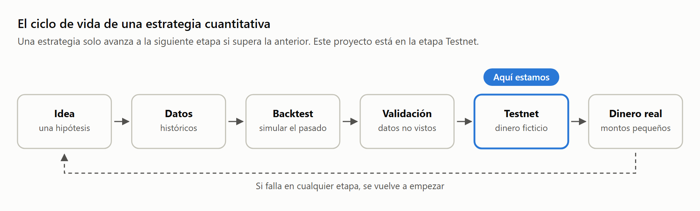

Este proyecto está en la etapa **Testnet**: opera con dinero ficticio. Es el lugar correcto para estar mientras se corrigen los problemas del backtest descritos en [matematica-del-bot.md](matematica-del-bot.md).

> **Aviso.** Los precios de la Testnet de Binance no siempre se parecen a los del mercado real: tiene poca liquidez y a veces precios muy distintos. Una estrategia que gana en Testnet no está demostrada para el mercado real; para eso hace falta un backtest correcto con datos reales y una prueba con cantidades pequeñas.

---

## 17. Glosario rápido

| Término | Significado |
|---|---|
| **Activo** | Lo que se compra o se vende (BTC, ETH, una acción…). |
| **Ask / Bid** | Mejor precio de venta / mejor precio de compra disponible. |
| **Backtest** | Simular una estrategia sobre datos históricos para ver cómo le habría ido. |
| **Drawdown** | Caída del capital desde su máximo anterior. |
| **Edge** | Ventaja estadística: una esperanza matemática positiva después de costos. |
| **Exchange** | Plataforma donde se compran y venden activos (Binance, Coinbase…). |
| **Liquidez** | Facilidad para comprar o vender sin mover el precio. |
| **Long / Short** | Apostar a la subida / a la bajada. |
| **Maker / Taker** | Quien deja una orden esperando en el libro / quien la ejecuta contra el libro. |
| **OHLC** | Apertura, máximo, mínimo y cierre de una vela. |
| **Overfitting** | Ajustar tanto una estrategia al pasado que deja de funcionar en el futuro. |
| **PnL** | *Profit and Loss*: ganancia o pérdida. |
| **R** | Cantidad arriesgada en una operación; unidad para medir resultados. |
| **Slippage** | Diferencia entre el precio esperado y el precio real de ejecución. |
| **Spot** | Mercado de contado: compras el activo real. |
| **Spread** | Diferencia entre el mejor ask y el mejor bid. |
| **Stop loss / Take profit** | Precio de salida para cortar pérdidas / para asegurar ganancias. |
| **Testnet** | Entorno de pruebas con dinero ficticio. |
| **Timeframe** | Temporalidad: cuánto tiempo representa cada vela. |
| **Volatilidad** | Cuánto se mueve el precio, normalmente medida con la desviación estándar de los retornos. |

---

**Siguiente paso:** con estos conceptos ya puedes leer [matematica-del-bot.md](matematica-del-bot.md), que explica fórmula por fórmula cómo decide este bot cuándo comprar y cuándo vender.
