# La matemática detrás del bot

Este documento explica, fórmula por fórmula, la matemática que usa el bot para intentar anticipar el mercado. Cada sección tiene el mismo formato: primero un párrafo con el **objetivo** de la fórmula y después el **desglose paso a paso**, con una oración por paso. Las fórmulas salen directamente del código; al final de cada sección se indica el archivo de origen.

Las fórmulas usan LaTeX. Se ven bien en la vista previa de Markdown de VS Code (`Ctrl+Shift+V`) y en GitHub.

## Tabla de contenido

Las partes están agrupadas por tema. Para seguirlas en el orden en que el bot hace las cuentas, empieza por la [Parte 8](#parte-8--el-recorrido-completo-paso-a-paso), que tiene el diagrama del recorrido completo.

- **[Notación común](#notación-común)**
- **[Parte 1 — Bloques básicos](#parte-1--bloques-básicos)**
  - [1. Media móvil simple (SMA)](#1-media-móvil-simple-sma)
  - [2. Desviación estándar móvil (muestral)](#2-desviación-estándar-móvil-muestral)
  - [3. Bandas de Bollinger](#3-bandas-de-bollinger)
- **[Parte 2 — Las estrategias (generación de señales)](#parte-2--las-estrategias-generación-de-señales)**
  - [4. Relación riesgo/beneficio y tasa de acierto mínima](#4-relación-riesgobeneficio-y-tasa-de-acierto-mínima)
  - [5. Reversión a la media (MeanReversionStrategy)](#5-reversión-a-la-media-meanreversionstrategy)
  - [6. Ruptura por volatilidad / seguimiento de tendencia (RollingVolatilityStrategy)](#6-ruptura-por-volatilidad--seguimiento-de-tendencia-rollingvolatilitystrategy)
  - [7. Reversión al VWAP (VWAPReversionStrategy)](#7-reversión-al-vwap-vwapreversionstrategy)
  - [8. Compresión de volatilidad (VolatilitySqueezeStrategy)](#8-compresión-de-volatilidad-volatilitysqueezestrategy)
  - [9. Arbitraje estadístico por z-score (StatisticalArbitrageStrategy)](#9-arbitraje-estadístico-por-z-score-statisticalarbitragestrategy)
  - [9 bis. Compra de capitulación (CapitulationStrategy)](#9-bis-compra-de-capitulación-capitulationstrategy)
- **[Parte 3 — Ejecución y gestión del dinero](#parte-3--ejecución-y-gestión-del-dinero)**
  - [10. Tamaño de la posición (Node.js)](#10-tamaño-de-la-posición-nodejs)
  - [11. Ganancia o pérdida de la operación (PnL en vivo)](#11-ganancia-o-pérdida-de-la-operación-pnl-en-vivo)
- **[Parte 4 — Backtesting y optimización](#parte-4--backtesting-y-optimización)**
  - [Los datos de entrenamiento: de qué fechas aprende el bot](#los-datos-de-entrenamiento-de-qué-fechas-aprende-el-bot)
  - [12. Simulador de capital (backtest)](#12-simulador-de-capital-backtest)
  - [13. Métricas de rendimiento](#13-métricas-de-rendimiento)
  - [14. Búsqueda en rejilla (*grid search*) y selección de estrategia](#14-búsqueda-en-rejilla-grid-search-y-selección-de-estrategia)
- **[Parte 5 — Machine Learning](#parte-5--machine-learning)**
  - [15. Etiquetado del objetivo (qué aprende XGBoost)](#15-etiquetado-del-objetivo-qué-aprende-xgboost)
  - [16. Variables de entrada (*features*) de XGBoost](#16-variables-de-entrada-features-de-xgboost)
    - [16.1 Retorno simple](#161-retorno-simple)
    - [16.2 Volatilidad de retornos (10 y 20 velas)](#162-volatilidad-de-retornos-10-y-20-velas)
    - [16.3 Distancia a la media de 20 velas](#163-distancia-a-la-media-de-20-velas)
    - [16.4 RSI de 14 periodos (*Relative Strength Index*)](#164-rsi-de-14-periodos-relative-strength-index)
    - [16.5 Cambio de volumen](#165-cambio-de-volumen)
  - [17. El modelo XGBoost (*gradient boosting* de árboles)](#17-el-modelo-xgboost-gradient-boosting-de-árboles)
  - [18. Validación del modelo (división 80/20 y *accuracy*)](#18-validación-del-modelo-división-8020-y-accuracy)
  - [19. Detector de regímenes con HMM (en desarrollo)](#19-detector-de-regímenes-con-hmm-en-desarrollo)
  - [20. Gestor de riesgo por aprendizaje por refuerzo (en desarrollo)](#20-gestor-de-riesgo-por-aprendizaje-por-refuerzo-en-desarrollo)
  - [21. Volatilidad histórica promedio (análisis exploratorio)](#21-volatilidad-histórica-promedio-análisis-exploratorio)
- **[Parte 6 — Cinco sugerencias para encontrar un margen (*edge*)](#parte-6--cinco-sugerencias-para-encontrar-un-margen-edge)**
  - [La idea de fondo: no adivinar el mercado, sino tener ventaja en promedio](#la-idea-de-fondo-no-adivinar-el-mercado-sino-tener-ventaja-en-promedio)
  - [Sugerencia 1 — Medir si el precio está "rebotando" o "siguiendo" (razón de varianzas)](#sugerencia-1--medir-si-el-precio-está-rebotando-o-siguiendo-razón-de-varianzas)
  - [Sugerencia 2 — Cuando sí oscila: operar el rango con un modelo Ornstein-Uhlenbeck](#sugerencia-2--cuando-sí-oscila-operar-el-rango-con-un-modelo-ornstein-uhlenbeck)
  - [Sugerencia 3 — Cuando no oscila: seguir la tendencia con salida dinámica](#sugerencia-3--cuando-no-oscila-seguir-la-tendencia-con-salida-dinámica)
  - [Sugerencia 4 — Patrones por horario (estacionalidad intradía)](#sugerencia-4--patrones-por-horario-estacionalidad-intradía)
  - [Sugerencia 5 — Subir la tasa de acierto con un filtro (triple barrera + *meta-labeling*)](#sugerencia-5--subir-la-tasa-de-acierto-con-un-filtro-triple-barrera--meta-labeling)
  - [Cómo encajan las cinco piezas](#cómo-encajan-las-cinco-piezas)
- **[Parte 7 — Cómo mide el bot la volatilidad del momento y cómo se ajusta a ella](#parte-7--cómo-mide-el-bot-la-volatilidad-del-momento-y-cómo-se-ajusta-a-ella)**
  - [22. Medir: la volatilidad de una ventana deslizante](#22-medir-la-volatilidad-de-una-ventana-deslizante)
  - [23. Ajustarse I: medir la distancia en sigmas (z-score)](#23-ajustarse-i-medir-la-distancia-en-sigmas-z-score)
  - [24. Ajustarse II: take profit y stop loss proporcionales a σ](#24-ajustarse-ii-take-profit-y-stop-loss-proporcionales-a-σ)
  - [25. Lo que todavía no se ajusta a la volatilidad](#25-lo-que-todavía-no-se-ajusta-a-la-volatilidad)
- **[Parte 8 — El recorrido completo, paso a paso](#parte-8--el-recorrido-completo-paso-a-paso)**
  - [Fase A — Antes de operar](#fase-a--antes-de-operar)
  - [Fase B — En vivo, con cada precio](#fase-b--en-vivo-con-cada-precio)

---

## Notación común

| Símbolo | Significado |
|---|---|
| $P_t$ | Precio de cierre de la vela $t$ (la vela actual). |
| $V_t$ | Volumen negociado en la vela $t$. |
| $n$ | Tamaño de la ventana: cuántas velas hacia atrás se miran (`window`). |
| $k$ | Multiplicador de desviaciones estándar (`std_dev_multiplier`). |
| $\mu_t$ | Media móvil de los últimos $n$ precios. |
| $\sigma_t$ | Desviación estándar móvil de los últimos $n$ precios. |
| $TP$, $SL$ | *Take profit* (precio objetivo de ganancia) y *stop loss* (precio de corte de pérdida). |
| $R$ | Riesgo por unidad: distancia en precio entre la entrada y el stop loss. |

---

# Parte 1 — Bloques básicos

Todas las estrategias del bot se apoyan en tres piezas: la media móvil, la desviación estándar móvil y las bandas que se construyen con ellas.

## 1. Media móvil simple (SMA)

**Objetivo.** La media móvil resume en un solo número el "precio normal" o "de equilibrio" de los últimos $n$ periodos. Elimina parte del ruido vela a vela y da un punto de referencia contra el cual medir si el precio actual está caro o barato. El bot la usa como centro de todas sus bandas, como precio objetivo en las estrategias de reversión y como stop loss en las de tendencia.

$$
\mu_t = \frac{1}{n}\sum_{i=0}^{n-1} P_{t-i}
$$

**Qué es cada símbolo:**

- $t$: la vela actual (la más reciente).
- $n$: tamaño de la ventana: cuántas velas se promedian (`window`).
- $i$: cuántas velas hacia atrás se mira: $i = 0$ es la actual, $i = 1$ la anterior, …, $i = n-1$ la más vieja.
- $P_{t-i}$: cierre de la vela que está $i$ velas antes de la actual. $P_t$ es el cierre actual, $P_{t-1}$ el de la vela anterior, $P_{t-2}$ el de dos velas atrás, etc.
- $\sum_{i=0}^{n-1}$: sumar lo que sigue para cada $i$ desde $0$ hasta $n-1$, es decir, sumar los $n$ cierres.
- $\mu_t$: la media resultante en la vela $t$.

> **Qué calcula:** el precio promedio de las últimas $n$ velas, es decir, el precio "normal" reciente.
>
> **Ejemplo:** con $n = 5$ y precios $100, 104, 98, 102, 96$: $\mu = (100 + 104 + 98 + 102 + 96)/5 = 500/5 = 100$. Esta misma serie se usa en los ejemplos de las secciones 2 a 8.

**Qué precio de la vela entra en la fórmula.** Cada vela resume un periodo (por ejemplo, 15 minutos) con cuatro precios: apertura, máximo, mínimo y cierre. $P_t$ es **solo el cierre**: el precio de la **última operación** que se hizo antes de que terminara ese periodo. La apertura, el máximo y el mínimo no se usan.

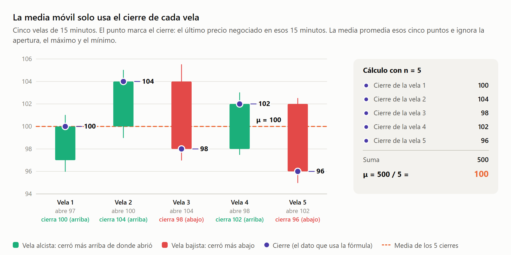

- **El cierre no es "de compra" ni "de venta".** Cada operación tiene siempre un comprador y un vendedor que se ponen de acuerdo en **un mismo precio** (ver la sección 3 de [introduccion-al-trading.md](introduccion-al-trading.md)). El cierre es el precio de esa última operación, y vale lo mismo para los dos lados.
- **El color tampoco indica compras o ventas.** Una vela verde no significa que hubo más compradores: solo dice que el cierre quedó **por encima** de la apertura. En una vela verde el cierre es el borde **superior** del cuerpo; en una roja, el borde **inferior** (el punto violeta de la figura).
- **Lo que sí distingue compras y ventas es el volumen.** Binance informa en cada vela qué parte del volumen la hicieron compradores "agresivos", que compraron al precio de venta disponible (`taker buy volume`). El bot no usa ese dato.
- **En vivo, el bot solo usa cierres definitivos.** Mientras la vela no termina, su "cierre" es provisional: es el último precio negociado hasta ese momento y cambia con cada operación. Desde el 2026-10-18 el bot espera a que la vela de 15 minutos cierre y solo entonces le pasa su cierre a la estrategia (sección 22); los precios provisionales solo sirven para vigilar el TP y el SL de una posición abierta.

**Desglose paso a paso**

1. Se guardan los últimos $n$ precios de cierre en una lista y, cuando llega uno nuevo, se descarta el más viejo (`price_history.pop(0)`).
2. El índice $i$ recorre desde $0$ (la vela actual) hasta $n-1$ (la vela más antigua de la ventana).
3. El símbolo $\sum$ indica que se suman los $n$ precios de la ventana.
4. Esa suma se divide entre $n$ para obtener el promedio aritmético.
5. Mientras la lista tenga menos de $n$ precios, la estrategia devuelve `HOLD` porque la media todavía no es confiable (fase de calentamiento).

**Qué significa "precio normal".** No es un precio oficial ni un dato que publique Binance: es una **referencia que calcula el propio bot**. La idea es que, en periodos cortos, el precio va y viene alrededor de un nivel, y ese nivel se estima con el promedio de los últimos precios. Si ETH cerró sus últimas 20 velas de 15 minutos (5 horas) en torno a 2 400, ese es su precio "normal" de ahora. Un precio de 2 330 está "barato" respecto a esa referencia y uno de 2 470, "caro". Que "normal" sea 2 400 depende por completo de cuántas velas se promedian ($n$) y de qué temporalidad tienen: con 20 velas de 1 día sería el precio "normal" del último mes, y podría ser muy distinto.

**Cómo obtenerla en Binance.** Hay tres formas:

1. **En el gráfico de la web o de la app.** Al abrir un par (por ejemplo, ETH/USDT) en modo velas, Binance ya dibuja medias móviles con la etiqueta **MA(7)**, **MA(25)** y **MA(99)**. Cada una es esta misma fórmula con $n = 7$, $25$ y $99$ velas de la temporalidad elegida arriba del gráfico (1m, 15m, 1h…). Para ver la del bot, hay que editar el indicador MA (en los ajustes del gráfico) y poner, por ejemplo, $n = 20$ con la temporalidad de 15 minutos.
2. **Calcularla con la API de velas.** El endpoint público `GET /api/v3/klines` devuelve las últimas velas; el cierre es el quinto campo de cada una (índice 4). Es lo mismo que hace `pre_seed_engine` en [server.py](../binance-research/server.py), que además descarta la última vela si todavía no cerró:

   ```python
   import requests

   url = "https://api.binance.com/api/v3/klines"
   velas = requests.get(url, params={"symbol": "ETHUSDT", "interval": "15m", "limit": 20}).json()
   cierres = [float(v[4]) for v in velas]
   mu = sum(cierres) / len(cierres)   # media de las últimas 20 velas de 15 minutos
   ```

   La última vela de la respuesta es la que **todavía no cerró**, así que su "cierre" es el precio actual. Para usar solo velas cerradas, se pide `limit=21` y se descarta la última.
3. **El endpoint `GET /api/v3/avgPrice`.** Devuelve un precio promedio que calcula Binance sobre los **últimos 5 minutos**. Es útil como referencia rápida, pero no sirve para el bot: la ventana es fija y no se puede elegir $n$ ni la temporalidad.

*Origen:* `series.mean()` en todas las clases de [quantitative_strategies/](../binance-research/quantitative_strategies/).

## 2. Desviación estándar móvil (muestral)

**Objetivo.** La desviación estándar mide cuánto se dispersan los precios alrededor de su media, es decir, la **volatilidad** reciente. Un $\sigma$ grande significa que el precio se mueve mucho y un $\sigma$ pequeño que el mercado está tranquilo. El bot la usa como "regla de medir" que se adapta al mercado: una caída de 100 USD puede ser enorme en un día tranquilo y normal en un día agitado.

$$
\sigma_t = \sqrt{\frac{1}{n-1}\sum_{i=0}^{n-1}\left(P_{t-i}-\mu_t\right)^2}
$$

**Qué es cada símbolo:**

- $P_{t-i} - \mu_t$: distancia de cada cierre de la ventana a la media (sección 1).
- $(\cdot)^2$: esa distancia elevada al cuadrado, para que no importe el signo.
- $n - 1$: se divide entre una vela menos que el tamaño de la ventana (corrección de Bessel).
- $\sqrt{\cdot}$: raíz cuadrada, que devuelve el resultado a USDT.
- $\sigma_t$: desviación estándar en la vela $t$: la volatilidad reciente.

> **Qué calcula:** cuánto se alejan, en promedio, los precios de la ventana de su media: la volatilidad reciente, en USDT.
>
> **Ejemplo:** con la serie anterior ($\mu = 100$), las distancias son $0, +4, -2, +2, -4$; sus cuadrados, $0, 16, 4, 4, 16$, suman $40$. Entonces $\sigma = \sqrt{40/4} = \sqrt{10} \approx 3.16$ USDT.

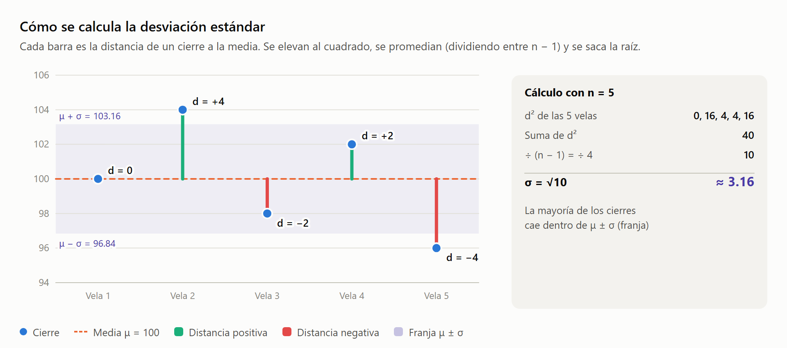

**Desglose paso a paso**

1. A cada precio de la ventana se le resta la media $\mu_t$ para saber qué tan lejos está del centro.
2. Cada diferencia se eleva al cuadrado para que las distancias negativas no cancelen a las positivas y para penalizar más las desviaciones grandes.
3. Se suman los $n$ cuadrados.
4. La suma se divide entre $n-1$ y no entre $n$ (corrección de Bessel), que es lo que hace `pandas.Series.std()` por defecto para estimar sin sesgo la varianza de una muestra.
5. El resultado es la varianza, y su raíz cuadrada devuelve la medida a las mismas unidades que el precio (USDT).

*Origen:* `series.std()` en todas las estrategias.

## 3. Bandas de Bollinger

**Objetivo.** Las bandas convierten la media y la volatilidad en un "canal" de precios considerados normales. Si los precios siguieran una distribución normal, con $k=2$ alrededor del 95 % de ellos caería dentro del canal, así que tocar un borde sería un evento estadísticamente raro. El bot interpreta salir por abajo como "demasiado barato" (reversión) y salir por arriba como "arranca una tendencia" (ruptura).

$$
U_t = \mu_t + k\,\sigma_t \qquad\qquad L_t = \mu_t - k\,\sigma_t
$$

**Qué es cada símbolo:**

- $U_t$: banda superior (*upper*).
- $L_t$: banda inferior (*lower*).
- $k$: multiplicador: cuántas desviaciones estándar se suman o restan (`std_dev_multiplier`).
- $k\,\sigma_t$: distancia de cada banda a la media.

> **Qué calcula:** el techo y el piso del rango de precios que se consideran normales.
>
> **Ejemplo:** con $\mu = 100$, $\sigma = 3.16$ y $k = 2$: $U = 100 + 6.32 = 106.32$ y $L = 100 - 6.32 = 93.68$. Un precio de 93 está fuera del canal por abajo y uno de 107, por arriba.

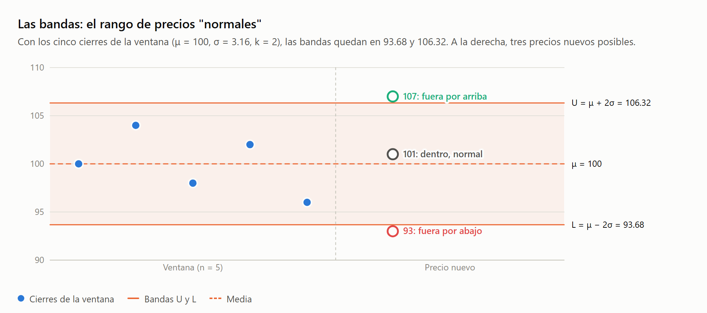

**Desglose paso a paso**

1. Se calcula la media $\mu_t$ de la ventana (sección 1).
2. Se calcula la desviación estándar $\sigma_t$ de la misma ventana (sección 2).
3. Se multiplica $\sigma_t$ por $k$ para decidir qué tan ancho es el canal: un $k$ mayor da menos señales, pero más "extremas".
4. La banda superior $U_t$ se obtiene sumando ese ancho a la media.
5. La banda inferior $L_t$ se obtiene restándolo.
6. El optimizador prueba valores de $k$ entre $0.8$ y $3.2$ y se queda con la zona de la rejilla que mejor funcionó en los 6 meses anteriores (sección 14).

> **Advertencia.** Los retornos de las criptomonedas tienen "colas gordas": los movimientos extremos son mucho más frecuentes que en una distribución normal. Por eso el "95 %" es solo una referencia y no una probabilidad real.

---

# Parte 2 — Las estrategias (generación de señales)

## 4. Relación riesgo/beneficio y tasa de acierto mínima

**Objetivo.** Antes de ver las estrategias conviene entender la idea que comparten: no hace falta acertar siempre, sino que lo que se gana cuando se acierta compense lo que se pierde cuando se falla. Cada estrategia define un riesgo $R$ (distancia al stop loss) y una recompensa $b\cdot R$ (distancia al take profit). Con eso se puede calcular qué porcentaje mínimo de aciertos necesita una estrategia para no perder dinero.

$$
E = p\,(b\,R) - (1-p)\,R \quad\Longrightarrow\quad E = 0 \iff p^{*} = \frac{1}{1+b}
$$

**Qué es cada símbolo:**

- $E$: esperanza: lo que se gana en promedio por operación.
- $p$: probabilidad de acertar (que el precio toque primero el TP).
- $1 - p$: probabilidad de fallar (que toque primero el SL).
- $R$: riesgo: lo que se pierde si se toca el stop loss.
- $b$: múltiplo de recompensa: al acertar se gana $b \cdot R$.
- $p^{*}$: tasa de acierto mínima, la que deja $E = 0$.
- $\iff$: "si y solo si".

> **Qué calcula:** cuánto se gana en promedio por operación ($E$) y qué porcentaje de aciertos hace falta para no perder ($p^{*}$).
>
> **Ejemplo:** con $R = 10$ USDT y $b = 2$ (se gana 20 o se pierde 10), $p^{*} = 1/3 \approx 33.3\,\%$. Si se acierta el 40 %, $E = 0.4 \times 20 - 0.6 \times 10 = +2$ USDT por operación.

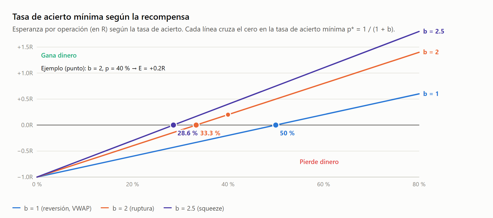

**Desglose paso a paso**

1. $p$ es la probabilidad de que el precio llegue primero al take profit y $1-p$ la de que llegue primero al stop loss.
2. Cuando se gana, se gana $b\cdot R$, donde $b$ es el múltiplo de recompensa (1 en reversión a la media, 2 en tendencia y 2.5 en squeeze).
3. Cuando se pierde, se pierde $R$.
4. La esperanza $E$ es el promedio ponderado de ambos resultados.
5. Igualando $E$ a cero y despejando $p$ se obtiene la tasa de acierto de equilibrio $p^{*}$.
6. Con $b=1$ hace falta acertar más del 50 %, con $b=2$ más del 33.3 % y con $b=2.5$ más del 28.6 %.

## 5. Reversión a la media (`MeanReversionStrategy`)

**Objetivo.** Esta estrategia apuesta a que, cuando el precio cae de forma anormal por debajo de su media, tiende a "rebotar" de vuelta hacia ella, como una liga estirada. Compra cuando el precio rompe la banda inferior y pone el objetivo de ganancia justo en la media. Funciona bien en mercados laterales y mal en caídas sostenidas, donde el precio puede seguir bajando sin volver.

$$
\text{BUY si } P_t < L_t = \mu_t - k\sigma_t
$$

**Qué es cada símbolo:**

- $P_t$: cierre actual.
- $L_t$: banda inferior (sección 3).
- $\text{BUY}$: señal de compra.

> **Qué calcula:** si el precio cayó por debajo del piso del canal, es decir, si está "demasiado barato".
>
> **Ejemplo:** con $L = 93.68$, un precio de $93$ cumple $93 < 93.68$: hay señal de compra. Con $95$ no la hay.

$$
TP = \mu_t,\qquad R = TP - P_t,\qquad SL = P_t - R,\qquad \text{se descarta si } R < 0.005\,P_t
$$

**Qué es cada símbolo:**

- $TP$: *take profit*: precio al que se vende con ganancia.
- $SL$: *stop loss*: precio al que se vende con pérdida.
- $R$: riesgo: distancia entre la entrada y el TP (y también hasta el SL).
- $0.005\,P_t$: el 0.5 % del precio actual, el riesgo mínimo aceptado.

> **Qué calcula:** dónde vender con ganancia, cuánto se arriesga y dónde cortar la pérdida.
>
> **Ejemplo:** comprando a $93$ con $\mu = 100$: $TP = 100$, $R = 100 - 93 = 7$ y $SL = 93 - 7 = 86$. El filtro pide $R \ge 0.005 \times 93 = 0.465$; como $7 > 0.465$, la operación sigue.

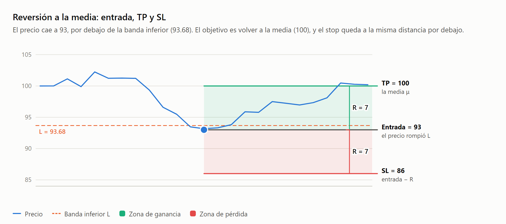

**Desglose paso a paso**

1. Se calcula la banda inferior $L_t$ con la ventana y el multiplicador optimizados.
2. Si el precio actual está por debajo de $L_t$, el precio se considera estadísticamente "sobrevendido" y se genera una señal de compra.
3. El take profit se fija en la media $\mu_t$, porque la hipótesis es que el precio volverá a ella.
4. El riesgo $R$ se define como la distancia entre la entrada y la media.
5. El stop loss se coloca a la misma distancia $R$, pero por debajo de la entrada, así que la relación es 1:1 ($b=1$).
6. Si $R$ es menor que el 0.5 % del precio, la operación se descarta, porque las comisiones y el spread se comerían la ganancia.

**Ejemplo.** Con $\mu=100$, $\sigma=2$ y $k=2$, la banda inferior es $L=96$. Si el precio cae a $95$, entonces $TP=100$, $R=5$ y $SL=90$.

*Origen:* [mean_reversion.py](../binance-research/quantitative_strategies/mean_reversion.py).

## 6. Ruptura por volatilidad / seguimiento de tendencia (`RollingVolatilityStrategy`)

**Objetivo.** Es la idea opuesta a la anterior: si el precio rompe con fuerza la banda **superior**, se asume que empezó una tendencia alcista y que el impulso continuará. Por eso compra en la ruptura, usa la media como "red de seguridad" y busca una ganancia del doble del riesgo. En `ml_results.json` aparece con el nombre `TrendFollowing`.

$$
\text{BUY si } P_t > U_t = \mu_t + k\sigma_t
$$

**Qué es cada símbolo:**

- $P_t$: cierre actual.
- $U_t$: banda superior (sección 3).

> **Qué calcula:** si el precio rompió el techo del canal, señal de que puede empezar una tendencia.
>
> **Ejemplo:** con $U = 106.32$, un precio de $107$ cumple $107 > 106.32$: hay señal de compra.

$$
SL = \mu_t,\qquad R = P_t - \mu_t,\qquad TP = P_t + 2R
$$

**Qué es cada símbolo:**

- $SL = \mu_t$: el stop se pone en la media.
- $R$: riesgo: distancia entre la entrada y la media.
- $2R$: la ganancia buscada, el doble del riesgo.

> **Qué calcula:** el stop en la media, el riesgo y un objetivo al doble del riesgo.
>
> **Ejemplo:** comprando a $107$ con $\mu = 100$: $SL = 100$, $R = 7$ y $TP = 107 + 14 = 121$.

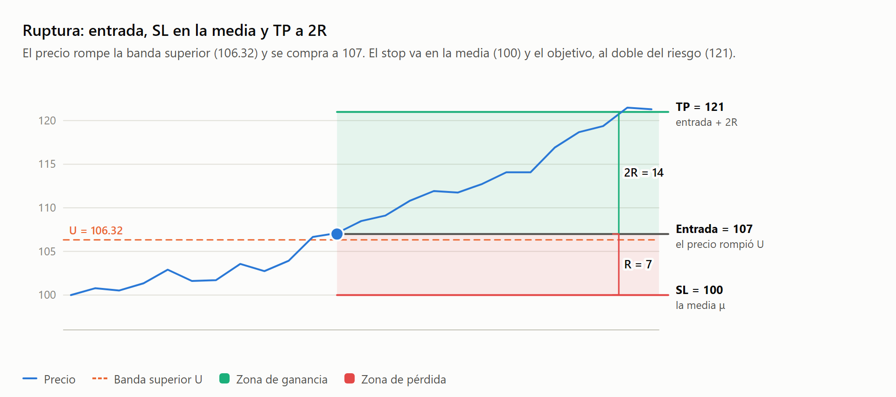

**Desglose paso a paso**

1. Se calcula la banda superior $U_t$.
2. Si el precio actual supera $U_t$, se interpreta como una ruptura alcista y se compra.
3. El stop loss se coloca en la media $\mu_t$, porque si el precio vuelve al centro la ruptura habrá fallado.
4. El riesgo $R$ es la distancia entre la entrada y la media, que siempre es mayor que $k\sigma_t$, porque el precio está por encima de la banda.
5. El take profit se pone a dos veces el riesgo por encima de la entrada ($b=2$), así que basta con acertar más del 33.3 % de las veces (sección 4).
6. A diferencia de la reversión a la media, esta estrategia no tiene filtro de riesgo mínimo.

*Origen:* [rolling_volatility.py](../binance-research/quantitative_strategies/rolling_volatility.py).

## 7. Reversión al VWAP (`VWAPReversionStrategy`)

**Objetivo.** El VWAP (*Volume Weighted Average Price*) es una media en la que cada precio pesa según el volumen negociado. Los precios a los que se movió mucho dinero cuentan más, porque reflejan mejor dónde está el "consenso" real del mercado. La estrategia es una reversión a la media, pero usa el VWAP como centro en lugar de la media simple.

$$
VWAP_t = \frac{\sum_{i=0}^{n-1} P_{t-i}\,V_{t-i}}{\sum_{i=0}^{n-1} V_{t-i}}
$$

**Qué es cada símbolo:**

- $V_{t-i}$: volumen negociado en la vela que está $i$ velas antes de la actual.
- $P_{t-i}\,V_{t-i}$: precio por volumen: aproximadamente, el dinero negociado en esa vela.
- $\sum$ de arriba: dinero total negociado en la ventana.
- $\sum$ de abajo: volumen total de la ventana.
- $VWAP_t$: precio promedio ponderado por volumen.

> **Qué calcula:** el precio promedio de la ventana, donde cada precio pesa según cuánto se negoció.
>
> **Ejemplo:** con los precios $100, 104, 98, 102, 96$ y volúmenes $1, 3, 1, 1, 4$: $(100 + 312 + 98 + 102 + 384)/10 = 996/10 = 99.6$. Queda por debajo de la media simple (100) porque en 96 se negoció mucho.

$$
L_t = VWAP_t - k\,\sigma_t,\qquad \text{BUY si } P_t < L_t,\qquad TP = VWAP_t,\quad R = TP - P_t,\quad SL = P_t - R
$$

**Qué es cada símbolo:**

- $L_t$: banda inferior, ahora medida desde el VWAP.
- $\sigma_t$: desviación estándar de los precios (sin ponderar por volumen).

> **Qué calcula:** lo mismo que la reversión a la media, pero con el VWAP como centro.
>
> **Ejemplo:** $L = 99.6 - 2 \times 3.16 = 93.28$. Con un precio de $93$: compra, $TP = 99.6$, $R = 6.6$ y $SL = 86.4$.

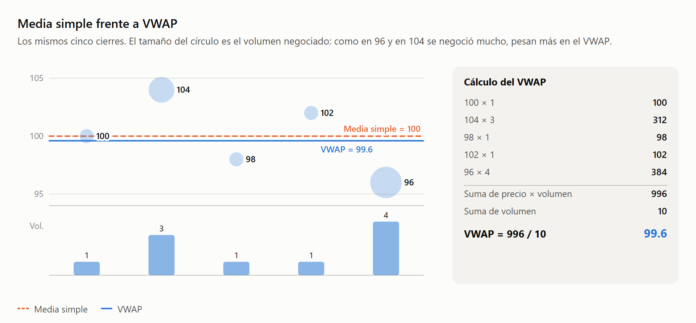

**Desglose paso a paso**

1. Para cada vela de la ventana se multiplica el precio por su volumen, lo que da el dinero negociado ($PV$).
2. Se suman todos los $PV$ de la ventana.
3. Se suma todo el volumen de la ventana.
4. Al dividir lo primero entre lo segundo se obtiene el precio promedio ponderado por volumen.
5. Si el volumen total es cero, la división no está definida y la estrategia devuelve `HOLD`.
6. La banda inferior se calcula restando $k\sigma_t$ al VWAP, donde $\sigma_t$ es la desviación estándar de los precios (no ponderada).
7. Desde aquí, el TP, el SL y el filtro del 0.5 % son idénticos a los de la reversión a la media (sección 5).

> **Desde el 2026-10-18 el VWAP usa el volumen real.** En vivo, `strategy_engine.py` le pasa a todas las estrategias la vela cerrada completa (`close` y `volume`, el volumen de 15 minutos que manda Node.js), y el backtest (`simulate_live` y su versión rápida) hace lo mismo con el volumen de cada vela de los CSV. Por eso `VWAP` ya no coincide con `MeanReversion`: en la sección 14 sus resultados son distintos en las cuatro monedas.
>
> **Antes del 2026-10-18** el optimizador le pasaba a la estrategia solo el precio y el motor en vivo no le pasaba el volumen, así que $V = 1$ y $VWAP = \frac{\sum P_i}{n} = \mu_t$: el `ml_results.json` de entonces mostraba en BTCUSDT resultados idénticos para `MeanReversion` y `VWAP`.

*Origen:* [vwap_strategy.py](../binance-research/quantitative_strategies/vwap_strategy.py).

## 8. Compresión de volatilidad (`VolatilitySqueezeStrategy`)

**Objetivo.** Los mercados alternan periodos de calma con periodos de explosión, y la volatilidad tiende a volver a su nivel promedio. Esta estrategia detecta cuándo el mercado está "dormido" (bandas muy estrechas) y se queda esperando: cuando el precio rompe hacia arriba después de esa calma, entra a favor de la explosión. Como espera movimientos grandes, pide una recompensa de 2.5 veces el riesgo.

$$
BW_t = \frac{U_t - L_t}{\mu_t} = \frac{2k\,\sigma_t}{\mu_t}
$$

**Qué es cada símbolo:**

- $BW_t$: ancho de banda (*band width*) en la vela $t$.
- $U_t - L_t$: distancia entre las dos bandas, en USDT.
- $\div\,\mu_t$: dividir entre la media lo convierte en porcentaje del precio.

> **Qué calcula:** el ancho del canal como porcentaje del precio: cuánta volatilidad hay, comparable entre monedas.
>
> **Ejemplo:** con $\sigma = 3.16$, $k = 2$ y $\mu = 100$: $BW = 12.64/100 = 12.6\,\%$. Si el mercado se calma y $\sigma$ baja a 1, $BW = 4/100 = 4\,\%$.

$$
\text{armado si } BW_t < \theta \;(\theta = 0.05);\qquad \text{BUY si armado y } P_t > U_t
$$

**Qué es cada símbolo:**

- $\theta$: umbral de compresión: 0.05, es decir, 5 %.
- "armado": estado de espera: la estrategia ya vio un mercado dormido y espera la ruptura.

> **Qué calcula:** si el mercado está "dormido" (canal estrecho) y, después, si el precio rompe hacia arriba.
>
> **Ejemplo:** con $BW = 12.6\,\%$ no se arma. Con $BW = 4\,\% < 5\,\%$ se arma; si luego el precio pasa a $103$ y $U = 102$, se compra.

$$
SL = \mu_t,\qquad R = P_t - \mu_t,\qquad TP = P_t + 2.5R,\qquad \text{se descarta si } R < 0.005\,P_t
$$

**Qué es cada símbolo:**

- $R$: riesgo: distancia entre la entrada y la media.
- $2.5R$: la ganancia buscada, 2.5 veces el riesgo.

> **Qué calcula:** el stop en la media y un objetivo a 2.5 veces el riesgo.
>
> **Ejemplo:** comprando a $103$ con $\mu = 100$: $SL = 100$, $R = 3$ y $TP = 103 + 7.5 = 110.5$. El filtro pide $R \ge 0.515$, así que se cumple.

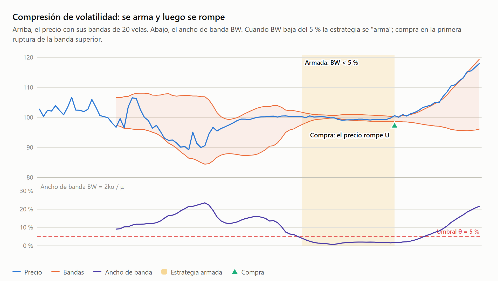

**Desglose paso a paso**

1. Se calculan las bandas superior e inferior como en la sección 3.
2. El ancho de banda $BW_t$ es la distancia entre las bandas dividida entre la media, lo que lo convierte en un porcentaje comparable entre monedas de precios muy distintos.
3. Al simplificar, $BW_t = 2k\cdot(\sigma_t/\mu_t)$, es decir, el ancho depende del coeficiente de variación $\sigma/\mu$.
4. Si $BW_t$ baja de $\theta = 5\%$, se considera que hay un "squeeze" y la estrategia queda "armada".
5. En una vela posterior, si la estrategia está armada y el precio supera la banda superior, se genera la compra y se desarma.
6. El stop loss va en la media, porque si el precio regresa al centro la ruptura fue falsa.
7. El take profit se coloca a $2.5R$, así que alcanza con acertar más del 28.6 % de las veces.
8. Igual que en la reversión, se descartan las operaciones con un riesgo menor al 0.5 % del precio.

*Origen:* [volatility_squeeze.py](../binance-research/quantitative_strategies/volatility_squeeze.py). El optimizador nunca cambia $\theta$, así que siempre vale 0.05.

## 9. Arbitraje estadístico por z-score (`StatisticalArbitrageStrategy`)

**Objetivo.** Dos activos muy relacionados, como ETH y BTC, suelen moverse juntos, así que su cociente de precios debería mantenerse relativamente estable. Si ese cociente se aleja demasiado de su promedio, uno de los dos está "barato" respecto al otro, y la estrategia apuesta a que la relación volverá a la normalidad. El **z-score** mide ese alejamiento en unidades de desviación estándar.

$$
S_t = \frac{P^{B}_t}{P^{A}_t}
\qquad
z_t = \frac{S_t - \mu_S}{\sigma_S}
\qquad
\text{BUY } B \text{ si } z_t < -z^{*}\;(z^{*}=2)
$$

**Qué es cada símbolo:**

- $P^{A}_t$: precio actual del activo A (BTC).
- $P^{B}_t$: precio actual del activo B (ETH).
- $S_t$: cociente entre ambos: cuántos BTC vale un ETH.
- $\mu_S$, $\sigma_S$: media y desviación estándar de los últimos $n$ cocientes.
- $z_t$: z-score: a cuántas desviaciones estándar está el cociente de su media.
- $z^{*}$: umbral para comprar (2).

> **Qué calcula:** cuánto vale ETH medido en BTC y a cuántas sigmas está ese valor de su promedio.
>
> **Ejemplo:** con BTC a 60 000 y ETH a 2 370, $S = 2370/60000 = 0.0395$. Si su promedio es $0.042$ y $\sigma_S = 0.001$, $z = (0.0395 - 0.042)/0.001 = -2.5 < -2$: ETH está barato frente a BTC y se compra.

$$
SL = 0.99\,P^{B}_t,\qquad TP = 1.02\,P^{B}_t
$$

**Qué es cada símbolo:**

- $0.99\,P^{B}_t$: 1 % por debajo del precio de entrada de ETH.
- $1.02\,P^{B}_t$: 2 % por encima.

> **Qué calcula:** un stop 1 % por debajo y un objetivo 2 % por encima del precio de entrada.
>
> **Ejemplo:** comprando ETH a 2 370: $SL = 0.99 \times 2370 = 2346.3$ y $TP = 1.02 \times 2370 = 2417.4$.

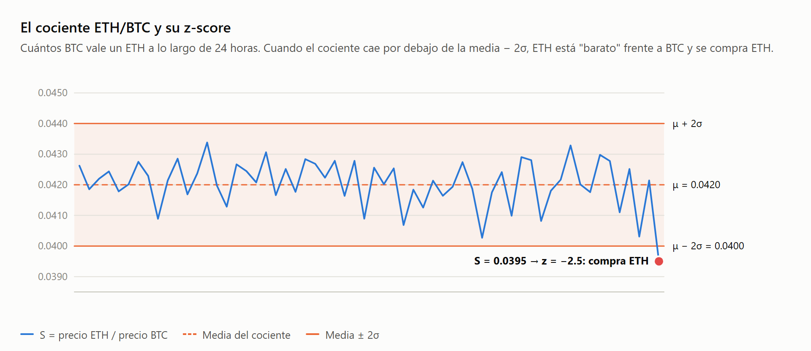

**Desglose paso a paso**

1. Se guarda el último precio conocido de cada activo (A = BTC y B = ETH por defecto).
2. Se calcula el *spread* como el cociente $S_t = P^B_t / P^A_t$ (cuántos BTC vale un ETH).
3. Se guardan los últimos $n$ valores del spread (96 por defecto, es decir, 24 horas en velas de 15 minutos).
4. Se calculan la media $\mu_S$ y la desviación estándar $\sigma_S$ de esa historia.
5. Si $\sigma_S = 0$, el z-score no está definido y se devuelve `HOLD`.
6. El z-score resta la media al spread actual y divide entre la desviación estándar, así que indica a cuántas "sigmas" está el spread de su centro.
7. Si $z_t < -2$, ETH está anormalmente barato frente a BTC y se compra ETH.
8. El stop loss se fija a un 1 % por debajo y el take profit a un 2 % por encima, con una relación de 2:1.

> **Nota.** Esta estrategia no está conectada a `strategy_engine.py`, así que hoy no opera. Además, un arbitraje de pares real compraría el activo barato **y** vendería en corto el caro; aquí solo se compra una de las dos patas.

*Origen:* [statistical_arbitrage.py](../binance-research/quantitative_strategies/statistical_arbitrage.py).

## 9 bis. Compra de capitulación (`CapitulationStrategy`)

**Objetivo.** Las cuatro estrategias anteriores no tienen ventaja medible: su tasa de acierto es la que da la geometría del TP/SL ([agente-rl-y-esperanza-positiva.md](agente-rl-y-esperanza-positiva.md), sección 2). Esta estrategia prueba la única idea con evidencia para un bot solo largo en spot: comprar la **sobrerreacción tras una caída extrema con volumen climático** (práctica 5 de ese documento) y salir con la geometría X5 de la [estrategia v3](estrategia-v3-hacia-el-80.md) (sección 2.10). Es la versión **solo con velas spot**: la v3 usa además datos de futuros, que el bot no puede leer en vivo.

$$
\sigma_t = \text{std}\big(r_{t-n+1}, \dots, r_t\big),\quad r_j = \frac{P_j}{P_{j-1}} - 1,
\qquad
D_t = \frac{P_t}{P_{t-4}} - 1
$$

**Qué es cada símbolo:**

- $r_j$: retorno simple de la vela $j$.
- $\sigma_t$: desviación muestral de los últimos $n$ retornos (volatilidad de una vela).
- $D_t$: caída de las últimas 4 velas (1 hora con velas de 15 min).

$$
\text{BUY si } D_t < -k\,\sigma_t\sqrt{4}\quad\text{y}\quad v_t \ge 2\,\bar v_t
$$

**Qué es cada símbolo:**

- $k$: multiplicador de la rejilla: cuántas desviaciones de una hora tiene que caer el precio.
- $v_t$, $\bar v_t$: volumen de la vela y media del volumen de las últimas $n$ velas (incluida la actual).

$$
s_d = \sigma_t\sqrt{N_d},\qquad TP = P_t\,(1 + 0.7\,s_d),\qquad SL = P_t\,(1 - 1.75\,s_d),\qquad \text{se descarta si } P_t - SL < 0.005\,P_t
$$

- $s_d$: volatilidad diaria estimada con la ventana.
- $N_d$: velas por día: 96 con velas de 15 min (24 con 1 h y 6 con 4 h, en los estudios de `ml_evaluator.py --interval`).
- La relación es $b = 0.7/1.75 = 0.4$: el azar ya acierta ≈ 71 %. Solo hay ventaja si gana más que eso después de costos.

> **Ejemplo:** con $\sigma = 0.4\,\%$, $k = 2.5$ y $P_{t-4} = 100$, hace falta $D < -2.5 \times 0.4 \times 2 = -2\,\%$. Si $P_t = 97.5$ y el volumen de la vela es 2.3 veces la media, se compra. $s_d = 0.4 \times 9.80 = 3.92\,\%$: $TP = 97.5 \times 1.0274 = 100.17$ y $SL = 97.5 \times 0.9314 = 90.81$.

**Desglose paso a paso**

1. Se guardan los últimos $n + 1$ cierres y los últimos $n$ volúmenes.
2. Se calculan los $n$ retornos simples y su desviación muestral $\sigma_t$.
3. Se mide la caída de la última hora $D_t$ y se compara con $k$ desviaciones de una hora ($\sigma_t\sqrt 4$).
4. Además, la vela tiene que traer al menos el doble del volumen medio: una caída sin volumen no es capitulación.
5. TP y SL se fijan en múltiplos de la volatilidad diaria, como la salida X5 de la v3, pero **sin la barrera de 96 h**: el bot solo sale por TP o SL.
6. Las constantes (4 velas, volumen 2×, 0.7 y 1.75) son fijas; el optimizador solo elige $n$ y $k$, igual que en las demás.

*Origen:* [capitulation.py](../binance-research/quantitative_strategies/capitulation.py). Versión rápida con paridad exacta en `fast_backtest.FastSymbol` (`ret_std`, `vol_mean`).

---

# Parte 3 — Ejecución y gestión del dinero

## 10. Tamaño de la posición (Node.js)

**Objetivo.** Una vez que Python da la señal, Node.js tiene que decidir **cuánto** comprar. El bot usa una regla fija: invierte siempre unos 15 USDT por operación y ajusta la cantidad a los decimales que Binance acepta para cada moneda. Así limita la exposición por operación de una forma muy simple.

$$
q = \frac{\left\lfloor \dfrac{15}{P_{entrada}}\cdot 10^{d} \right\rfloor}{10^{d}},
\qquad d = \begin{cases}5 & \text{si BTCUSDT}\\ 3 & \text{en otro caso}\end{cases}
$$

**Qué es cada símbolo:**

- $q$: cantidad de monedas a comprar.
- $15$: presupuesto por operación, en USDT.
- $P_{entrada}$: precio de compra.
- $d$: decimales que acepta Binance para esa moneda (5 en BTC, 3 en las demás).
- $10^{d}$: multiplicar por $10^d$ corre la coma $d$ lugares; dividir la devuelve.
- $\lfloor \cdot \rfloor$: "piso": redondea hacia abajo al entero (6.25 → 6).

> **Qué calcula:** cuántas monedas se compran con unos 15 USDT, redondeando hacia abajo a los decimales que acepta Binance.
>
> **Ejemplo:** ETH a 2 400 con $d = 3$: $15/2400 = 0.00625$; por $10^3$ da $6.25$; el piso da $6$; entre $10^3$, $q = 0.006$ ETH, que cuestan $14.40$ USDT (el redondeo dejó 0.60 USDT sin usar).

$$
\text{Riesgo real en USDT} = q\,(P_{entrada} - SL)
$$

**Qué es cada símbolo:**

- $P_{entrada} - SL$: cuánto baja el precio por moneda hasta tocar el stop.
- $q$: cantidad de monedas compradas.

> **Qué calcula:** cuántos dólares se pierden si se toca el stop loss.
>
> **Ejemplo:** con $q = 0.006$ ETH, entrada en 2 400 y $SL = 2352$: $0.006 \times 48 = 0.288$ USDT.

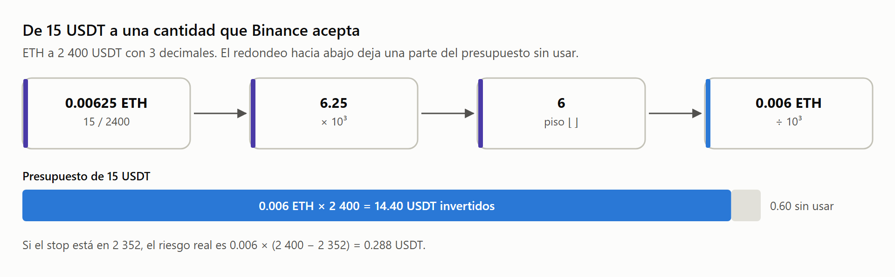

**Desglose paso a paso**

1. Se dividen 15 USDT entre el precio de entrada para obtener la cantidad "ideal" de monedas.
2. Esa cantidad se multiplica por $10^{d}$ para desplazar la coma $d$ posiciones.
3. La función piso $\lfloor\cdot\rfloor$ elimina los decimales sobrantes, redondeando siempre hacia abajo para no gastar más de 15 USDT.
4. Se divide de nuevo entre $10^{d}$ para volver a la escala original.
5. El riesgo real de la operación en dólares es la cantidad multiplicada por la distancia al stop loss.

**Ejemplo.** Con BTC a 60 000 USDT: $15/60000 = 0.00025$ BTC. Si el stop loss está un 1 % por debajo, el riesgo real es de solo $0.15$ USDT.

> **Actualización (2026-10-19).** La compra ya no usa la fórmula de arriba: es una orden a mercado **por importe** (`quoteOrderQty` = 15.00 USDT, el `NOTIONAL_USDT` de [optimize.py](../binance-research/optimize.py) que Python le pasa a Node.js al conectarse) y Binance calcula la cantidad redondeando hacia abajo al `stepSize` de la moneda: con BTC a 88 000 compra 0.00017 BTC (14.96 USDT). Si el par no admite compras por importe, se usa $q = 15/P$ redondeado hacia abajo al `stepSize` (`floorToStep`) y se comprueba el mínimo de Binance. La cantidad, el precio medio y las comisiones que se registran son los ejecutados de verdad (respuesta `FULL`). **Antes** de enviar la orden se escribe en el ledger una fila `PENDING` con su `newClientOrderId` (columna `client_order_id`): al confirmarse, esa misma fila pasa a `OPEN`; si Binance la rechaza o no se ejecutó, pasa a `CANCELLED`. Si la respuesta no llega, o Binance dice que la orden no existe (puede aparecer tarde: `-1007`), es una **compra dudosa**: la fila sigue `PENDING`, la moneda no abre otra compra, se guardan los precios que llegan y se vuelve a consultar con ellos (sin respuesta, cada 5 s; tras cada «no existe», a los 10, 30 y 90 s, unos 2 minutos en total). Si aparece ejecutada, se adopta y esos precios se revisan contra su TP y su SL; si sigue sin existir tras la última consulta, pasa a `CANCELLED`. Las demás monedas siguen con normalidad. Al arrancar, cada fila `PENDING` se consulta una vez (todas a la vez y sin esperas): si la compra se ejecutó justo antes de que el proceso muriera, se adopta como posición abierta; si no se puede saber todavía, sigue el mismo esquema en segundo plano, sin retrasar la conexión del WebSocket. `PENDING` y `CANCELLED` no son operaciones y no entran en el resumen. La fórmula con $d = 5$ o $3$ describe la versión anterior; el riesgo real sigue siendo $q\,(P_{entrada} - SL)$.

*Origen:* `openPosition` en [ws-client.ts](../src/api/ws-client.ts) y `marketBuy` en [rest-client.ts](../src/api/rest-client.ts) (antes, `evaluateNewTrade`).

## 11. Ganancia o pérdida de la operación (PnL en vivo)

**Objetivo.** Cuando el precio toca el take profit o el stop loss, Node.js cierra la posición y calcula cuánto se ganó o perdió para enviarlo por Telegram. Es la contabilidad básica de una compra en *spot*.

$$
\text{Cierre si } P_t \ge TP \;\text{ o }\; P_t \le SL,
\qquad
PnL = (P_{salida} - P_{entrada})\cdot q
$$

**Qué es cada símbolo:**

- $P_t \ge TP$: el precio actual llegó o superó el take profit.
- $P_t \le SL$: el precio actual llegó o cayó por debajo del stop loss.
- $P_{salida}$: precio al que se vendió.
- $PnL$: ganancia o pérdida (*profit and loss*) en USDT.

> **Qué calcula:** cuándo se cierra la posición y cuánto se ganó o perdió en dólares.
>
> **Ejemplo:** con $q = 0.006$ ETH comprados a 2 400 y $TP = 2448$: si llega un precio de 2 450, se cierra y $PnL = 50 \times 0.006 = +0.30$ USDT. Si en cambio cae a 2 350 ($\le SL$), $PnL = -50 \times 0.006 = -0.30$ USDT.

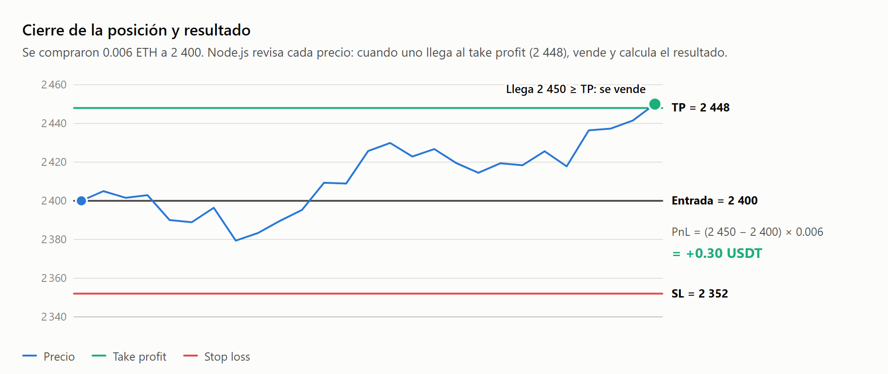

**Desglose paso a paso**

1. Con cada vela que llega, se compara el precio actual con el TP y el SL de la posición abierta.
2. Si el precio llegó o superó el TP, se cierra con ganancia, y si llegó o cayó por debajo del SL, se cierra con pérdida.
3. La diferencia entre el precio de salida y el de entrada es la ganancia por moneda.
4. Esa diferencia se multiplica por la cantidad $q$ para obtener el resultado total en USDT.

> **Actualización (2026-10-19).** El PnL que registra el bot ya es **neto y real**, con el precio medio y las comisiones de cada orden ejecutada:
>
> $$PnL = \text{USDT recibidos} + q_{res}\,P_{salida} - \text{USDT pagados} - \text{comisiones}$$
>
> - La comisión que Binance cobra en la moneda comprada ya viene descontada de la cantidad que se vende, así que no se resta dos veces. Las comisiones en USDT y en BNB (valoradas al precio de BNB en ese momento) sí se restan.
> - $q_{res}$ (residuo) es lo que queda en la cuenta sin poder venderse por estar por debajo del `stepSize` o del mínimo de Binance. Con la comisión cobrada en la moneda base, lo neto nunca es múltiplo del paso y siempre queda casi un paso entero: en BTC, 0.00001 BTC ≈ 0.9 USDT, un 6 % de una posición de 15 USDT. Sigue siendo del usuario, así que se valora al precio medio de la venta (columna `residual_quantity` del ledger) en vez de contarse como pérdida.
> - La venta es una orden a mercado y puede completarse en varios tramos (orden llenada en parte, saldo insuficiente o estado desconocido, que se consulta antes de volver a vender); el PnL los suma todos. Si Binance dice que una venta enviada no existe (puede aparecer tarde), es una **venta dudosa**: no se reenvía hasta consultarla a los 10, 30 y 90 s (unos 2 minutos), ni siquiera si el precio cae más bajo el SL; si aparece, cuenta como vendida y no se vende dos veces. Si la posición entera queda por debajo del mínimo de Binance (polvo), se cierra en el ledger sin venta y sin PnL.
> - Si Binance rechaza la venta por un filtro (`-1013`, `NOTIONAL` o `LOT_SIZE`), solo se da por polvo si, valorada con su precio medio (`GET /api/v3/avgPrice`, el que usa Binance para juzgar las órdenes a mercado), no llega al mínimo con un 1 % de margen. Si es vendible, se reintenta con espera creciente (5, 10, 20, 40 y 60 s) y se avisa por Telegram desde el tercer rechazo; ante `LOT_SIZE` se vuelven a leer los filtros del par.
> - Al arrancar, cada posición abierta del ledger se verifica en Binance: que la compra exista y se ejecutara, si ya se vendió (en todo o en parte) mientras el bot estaba parado y si hay saldo. Si Binance no responde, la posición no se vende ni se ajusta hasta poder verificarla.
> - El TP y el SL se siguen vigilando con cada precio del WebSocket. La fórmula de arriba, sin comisiones, describe la versión anterior; el backtest (sección 12) descuenta 0.12 % por lado.

*Origen:* `manageExistingPosition`, `closePosition`, `finishClose` y `syncStateFromLedger` en [ws-client.ts](../src/api/ws-client.ts) y `netPnl` en [execution.ts](../src/api/execution.ts).

---

# Parte 4 — Backtesting y optimización

## Los datos de entrenamiento: de qué fechas aprende el bot

**Objetivo.** Todo lo que sigue (backtest, métricas, búsqueda de parámetros y XGBoost) depende de qué historia de precios se le muestra al bot. Desde el 2026-10-19, `ml_evaluator.py` usa **toda** la historia descargada, de tres maneras: los meses de **desarrollo**, con los que se elige y se pone a prueba cada estrategia; una **validación final** al final de la historia, que no se usa para elegir nada y solo puede vetar una estrategia que pierda dinero en ella; y los **6 meses más recientes** (incluyen la validación final), con los que se eligen los parámetros que se cargan en vivo. Esta sección explica de dónde sale cada periodo y cuántas velas representa.

$$
N_{\text{velas}} = \text{días} \times 24 \times 4 = \text{días} \times 96
$$

**Qué es cada símbolo:**

- $\text{días}$: cuántos días tiene el periodo.
- $24$: horas de un día.
- $4$: velas de 15 minutos que caben en una hora.
- $N_{\text{velas}}$: total de velas del periodo.

> **Qué calcula:** cuántas velas de 15 minutos caben en un periodo (cada hora tiene 4).
>
> **Ejemplo:** del 2023-01-01 al 2026-10-14 hay 1 383 días, así que $1383 \times 96 = 132\,768$ velas. En los archivos hay 132 763 por moneda, porque el 2023-03-24 faltan 5 velas (una hora y cuarto sin datos en Binance).

| Etapa | Periodo (ejecución del 2026-10-19) | Velas por moneda | Archivo |
|---|---|---|---|
| **Descarga** | Del **1 de enero de 2023** al día anterior a ejecutar `server.py` (hasta el 14 de octubre de 2026) | 132 763 | [download_data.py](../binance-research/download_data.py) |
| **Carga** | Todos los CSV de 15 min (meses completos y días sueltos del mes en curso), en una sola serie ordenada | 132 763 | `load_history` en [fast_backtest.py](../binance-research/fast_backtest.py) |
| **Desarrollo (*walk-forward*)** | Del 2023-01-01 al 2026-08-31: **38 pliegues**; cada uno entrena con 6 meses y prueba con el mes siguiente (pruebas de 2023-07 a 2026-08) | 128 539 (≈ 17 500 de entrenamiento y ≈ 2 900 de prueba por pliegue) | [walk_forward.py](../binance-research/walk_forward.py) |
| **Validación final (reservada)** | Del **2026-09-01 al 2026-10-14**: el último mes completo y los días del mes en curso | 4 224 | [walk_forward.py](../binance-research/walk_forward.py) |
| **Parámetros en vivo** | Los 6 meses más recientes: del 2026-04-15 al 2026-10-14 | 17 568 | [walk_forward.py](../binance-research/walk_forward.py) |
| **XGBoost: entrenamiento (80 %) y prueba (20 %)** | El último mes completo (septiembre de 2026), como antes. No se usa en vivo ni en la selección | ≈ 2 300 y ≈ 570 | [xgboost_classifier.py](../binance-research/machine_learning_strategies/xgboost_classifier.py) |
| **Análisis exploratorio** | Toda la descarga (2023 → hoy) | ≈ 132 000 | [analyze_data.py](../binance-research/analyze_data.py) |
| **Arranque en vivo** | Las últimas velas **cerradas de 15 minutos** del mismo mercado que el WebSocket (máx. ventana + 20, mínimo 100) | ≥ 100 | `pre_seed_engine` en [server.py](../binance-research/server.py) |

**Desglose paso a paso**

1. Al arrancar, `server.py` llama a `sync_historical_data`, que descarga velas de **15 minutos** del mercado *spot* de Binance para las cuatro monedas, desde el `2023-01-01` hasta **ayer**. Lo hace como máximo una vez al día (`data/.last_sync`).
2. La biblioteca `binance_historical_data` guarda **un CSV por mes** (carpeta `monthly`) y un CSV por día del mes en curso (carpeta `daily`).
3. `load_history` lee **todos** esos CSV, pasa a milisegundos los `open_time` que Binance publica en microsegundos desde 2025, descarta duplicados y los ordena: queda una sola serie de 132 763 velas por moneda.
4. La validación final se calcula sola en cada ejecución: es el último mes completo más los días del mes en curso. En la ejecución del 2026-10-19 va del 2026-09-01 al 2026-10-14 (44 días, $44 \times 96 = 4\,224$ velas).
5. Todo lo anterior es desarrollo. El primer mes de prueba es 2023-07, porque antes hacen falta 6 meses de entrenamiento; el último es 2026-08. Son 38 meses de prueba fuera de muestra por moneda y estrategia (sección 14).
6. Los parámetros que se cargan en vivo se eligen con el mismo procedimiento, pero con los 6 meses que terminan en la última vela descargada (del 2026-04-15 al 2026-10-14).
7. XGBoost sigue usando solo el último archivo mensual, cortado en 80 % y 20 % (sección 18). Su resultado no se usa en vivo ni influye en la selección.
8. En vivo no se usa la historia descargada: `pre_seed_engine` pide las últimas velas cerradas de 15 minutos (al menos 100) para llenar la ventana de la estrategia antes de empezar.

> **Por qué importa.** Hasta el 2026-10-18 el optimizador veía **un solo mes** (septiembre de 2026, 2 880 velas) y probaba 1 196 configuraciones sobre él. Las estrategias elegidas ganaban todas en septiembre, pero del 1 al 14 de octubre tres de las cuatro monedas perdieron: ETH (reversión a la media) acertó 3 de 10, SOL (*squeeze*) 1 de 6 y DOGE (ruptura) 2 de 5. Un mes muestra un único "estado de ánimo" del mercado; con 38 meses de prueba que el optimizador no vio, la selección mide si la estrategia funciona fuera de los datos con los que se ajustó.
>
> **Nota:** la carpeta `binance-research/data/` está en `.gitignore`. Las fechas exactas de cada ejecución quedan guardadas en el bloque `_protocolo` de `ml_results.json`.

## 12. Simulador de capital (backtest)

**Objetivo.** Para elegir los mejores parámetros, el bot "reproduce" el pasado vela por vela como si estuviera operando y lleva la cuenta del capital. Así puede comparar cientos de configuraciones sin arriesgar dinero. Desde el 2026-10-18 el simulador hace **exactamente lo mismo que el bot en vivo**: invierte unos 15 USDT por operación, vigila el TP y el SL con el máximo y el mínimo de cada vela y descuenta comisiones.

$$
q = \frac{15}{P_e},
\qquad
P_s = \begin{cases}
SL & \text{si } L_t \le SL \[2pt]
TP & \text{si } H_t \ge TP
\end{cases},
\qquad
PnL = q\,(P_s - P_e) - q\,(P_e + P_s)\,c,
\qquad
C \leftarrow C + PnL
$$

**Qué es cada símbolo:**

- $q$: cantidad de monedas compradas con 15 USDT.
- $P_e$: precio de entrada (el cierre de la vela de señal).
- $P_s$: precio de salida. Si la vela **abre** ya por debajo del SL o por encima del TP, la salida es la apertura.
- $L_t$, $H_t$: mínimo y máximo de la vela $t$. Si una vela toca las dos barreras, cuenta el SL (supuesto conservador).
- $c$: costo por lado, 0.12 % (0.10 % de comisión y 0.02 % de deslizamiento).
- $C$: capital simulado, que empieza en $C_0 = 1000$.

> **Qué calcula:** la ganancia o pérdida neta de cada operación y cómo cambia el capital simulado.
>
> **Ejemplo:** ETH entra a 2 400 con TP 2 424 y SL 2 376, así que $q = 15/2400 = 0.00625$. Si toca el TP: $0.00625 \times 24 - 0.00625 \times 4824 \times 0.0012 = 0.150 - 0.036 = +0.114$ USDT. Si toca el SL: $-0.150 - 0.036 = -0.186$ USDT. Con un TP y un SL a la misma distancia, las comisiones bastan para que haya que acertar más de la mitad de las veces.

**Desglose paso a paso**

1. El capital inicial se fija en 1 000 USDT.
2. Se recorren las velas de 15 minutos en orden cronológico (apertura, máximo, mínimo, cierre y volumen).
3. Si hay una posición abierta, se mira primero si la vela toca el SL o el TP, con su mínimo y su máximo. Las barreras se vigilan desde la vela **siguiente** a la entrada.
4. Se le pasa la vela a la estrategia **siempre**, también con una posición abierta: su ventana nunca se congela, igual que en vivo.
5. Si la estrategia da señal, no hay posición y la vela no es la misma en la que se acaba de cerrar otra operación, se compra al cierre con 15 USDT.
6. Al cerrar, se calcula el PnL neto con la fórmula de arriba y se suma al capital. Si es mayor que 0, la operación cuenta como ganadora.
7. Después de cada cierre se guarda el capital en la curva $C_0, C_1, \dots, C_N$, que luego se usa para las métricas.

**Paridad con el bot en vivo.** Con 13 056 velas por moneda (junio a octubre de 2026), el simulador y el bot en vivo reproducido sin conexión (Node y Python reales) abrieron y cerraron las mismas operaciones en las mismas velas, en las 4 monedas. Las dos diferencias que quedan son de la realidad, no del código: en vivo el precio se ve cada ~2 s, así que un toque muy rápido de la barrera puede no verse, y la venta sale al precio del momento, no exactamente al TP o al SL.

> **Antes del 2026-10-18** el simulador pagaba siempre $2 \times 15$ USD al ganar y restaba 15 al perder, solo miraba cierres, no descontaba comisiones y congelaba la ventana con una posición abierta. Por eso los parámetros de entonces no se parecían a lo que hacía el bot en vivo. La sección 13 usa como ejemplo ilustrativo una curva de ese estilo ($1000 \to 1030 \to 1015 \dots$); las fórmulas de las métricas no cambiaron.

**Versión rápida (2026-10-19).** La selección de la sección 14 necesita simular 299 parejas $(n, k)$ por estrategia sobre 132 763 velas. `simulate_live` con las clases reales tarda ≈ 0.3 s por mes y pareja, así que [fast_backtest.py](../binance-research/fast_backtest.py) hace las mismas cuentas con *numpy*: calcula la media y la desviación de todas las ventanas de una vez, con el mismo orden de sumas que `pandas`, y después avanza de operación en operación. Como la estrategia ve todas las velas, sus señales no dependen de las operaciones y se pueden calcular de antemano. Antes de usarla, `ml_evaluator.py` comprueba que da **exactamente** las mismas operaciones que `simulate_live` (mismas velas de entrada y salida, mismos precios y el mismo PnL hasta el último bit); si no, se detiene sin escribir nada. También tiene un **modo tramo** para los meses de prueba de la sección 14: una estrategia nueva, precargada con $\max(n + 20,\ 100)$ velas, que solo abre durante el mes (o desde la vela siguiente a la salida de la operación del mes anterior, si sigue abierta) y sigue cada operación hasta su salida; se compara contra `simulate_live` corrido sobre ese mismo tramo con la clase real. La cadena completa de meses del walk-forward con esa regla de una posición por moneda también se comprobó contra `simulate_live` mes a mes en los 16 pares (3 830 operaciones OOS y las de la validación final): idéntica. En las pruebas del 2026-10-19 (299 casos y 45 318 operaciones: 4 monedas, 4 estrategias, parámetros extremos y al azar, tramos de 1, 2 y 3 meses, la historia completa y 93 casos en modo tramo, 41 de ellos con los meses de prueba reales del walk-forward) el Jaccard de las operaciones fue 1.0 y el PnL idéntico en todos. Sobre la historia completa, una pareja tarda ≈ 0.1–0.25 s en vez de 14 s (95 s con VWAP).

*Origen:* `simulate_live` en [optimize.py](../binance-research/optimize.py) (referencia) y `FastSymbol.simulate` en [fast_backtest.py](../binance-research/fast_backtest.py) (la que usa `ml_evaluator.py`; prueba completa con `python fast_backtest.py`).

## 13. Métricas de rendimiento

**Objetivo.** Con la curva de capital ya simulada, hace falta resumir con números qué tan buena fue la estrategia. Estas métricas miden la rentabilidad total, la frecuencia de aciertos, la relación entre lo ganado y lo perdido y, sobre todo, el peor bache que habría que aguantar. Combinadas en un *score*, permiten ordenar las configuraciones de mejor a peor.

$$
WR = \frac{W}{W+L}\cdot 100
\qquad
PnL = C_N - C_0
\qquad
PF = \frac{G^{+}}{G^{-}}
\qquad
EP = \frac{PnL}{W+L}
$$

**Qué es cada símbolo:**

- $W$: operaciones ganadoras (*wins*).
- $L$: operaciones perdedoras (*losses*). Aquí no es la banda inferior.
- $WR$: tasa de acierto (*win rate*), en %.
- $C_N$: capital al final de las $N$ operaciones.
- $G^{+}$: ganancia bruta: la suma de todas las ganancias.
- $G^{-}$: pérdida bruta: la suma de todas las pérdidas, en positivo.
- $PF$: *profit factor*: cuánto se ganó por cada dólar perdido.
- $EP$: *expected payoff*: ganancia media por operación.

> **Qué calcula:** el porcentaje de aciertos, la ganancia total, cuánto se ganó por cada dólar perdido y la ganancia media por operación.
>
> **Ejemplo:** con una curva ilustrativa $1000, 1030, 1015, 1000, 1030, 1060, 1045$ (3 ganadas de +30 y 3 perdidas de −15): $WR = 50\,\%$, $G^{+} = 90$, $G^{-} = 45$, $PnL = 1045 - 1000 = 45$, $PF = 90/45 = 2$ y $EP = 45/6 = 7.5$.

$$
\text{Pico}_j = \max_{i\le j} C_i,\qquad
DD_j = \frac{\text{Pico}_j - C_j}{\text{Pico}_j},\qquad
MDD = \max_j DD_j
$$

**Qué es cada símbolo:**

- $C_i$: capital después de la operación $i$.
- $\max_{i \le j}$: el mayor valor entre la operación 0 y la $j$.
- $\text{Pico}_j$: el capital más alto alcanzado hasta la operación $j$.
- $DD_j$: *drawdown*: cuánto se cayó desde ese pico, en proporción.
- $MDD$: *máximo drawdown*: la peor de esas caídas.

> **Qué calcula:** la peor caída desde un máximo previo: el bache más grande que habría que aguantar.
>
> **Ejemplo:** en la curva $1000, 1030, 1015, 1000, 1030, 1060, 1045$, el pico 1 030 cae hasta 1 000: $30/1030 = 2.91\,\%$. Después, de 1 060 a 1 045 solo cae $1.42\,\%$. Entonces $MDD = 2.91\,\%$.

$$
\text{Score} = PnL - 10\cdot MDD_{\%},\qquad \text{solo se acepta si } W+L > 5
$$

**Qué es cada símbolo:**

- $MDD_{\%}$: máximo drawdown en puntos porcentuales (2.91 % cuenta como 2.91).
- $10$: castigo de 10 USD por cada punto de drawdown.
- $W + L > 5$: se exigen al menos 6 operaciones.

> **Qué calcula:** una nota única que premia la ganancia y castiga los baches.
>
> **Ejemplo:** $\text{Score} = 45 - 10 \times 2.91 = 15.9$. Como hubo 6 operaciones ($> 5$), la configuración se acepta; con 5 o menos, se descartaría.

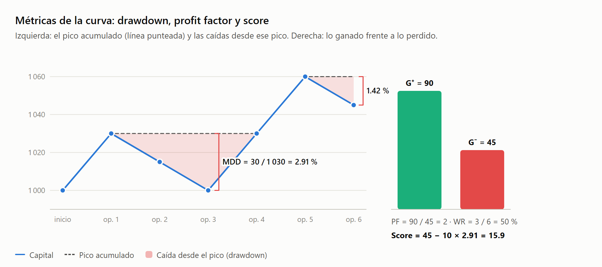

**Desglose paso a paso**

1. La tasa de acierto $WR$ divide las operaciones ganadoras $W$ entre el total $W+L$ y lo expresa como porcentaje.
2. El $PnL$ es la diferencia entre el capital final y el inicial.
3. El *profit factor* $PF$ divide la ganancia bruta $G^{+}$ entre la pérdida bruta $G^{-}$, así que un valor mayor que 1 significa que se ganó más de lo que se perdió.
4. El *expected payoff* $EP$ reparte el PnL entre el número de operaciones para saber cuánto deja cada una en promedio.
5. Para el *drawdown*, se recorre la curva de capital guardando el máximo alcanzado hasta cada punto (el "pico").
6. En cada punto se calcula qué porcentaje se ha perdido desde ese pico.
7. El *máximo drawdown* $MDD$ es la peor de esas caídas, es decir, el mayor bache que se habría sufrido.
8. El *score* resta al PnL 10 USD por cada punto porcentual de drawdown, así que penaliza las estrategias rentables pero muy accidentadas.
9. Las configuraciones con 5 operaciones o menos se descartan, porque son demasiado pocas para sacar conclusiones. En la selección *walk-forward* (sección 14), que mira 6 meses en vez de uno, el mínimo es de 30 operaciones en el entrenamiento.

**Ejemplo real del simulador anterior** (BTCUSDT, `MeanReversion` en el `ml_results.json` de antes del 2026-10-18, que pagaba +30 o −15 fijos): 17 operaciones con 58.82 % de acierto son $W=10$ y $L=7$. Entonces $G^{+}=10\cdot30=300$, $G^{-}=7\cdot15=105$, $PnL=195$, $PF=300/105=2.86$ y $EP=195/17=11.47$, que coincidía exactamente con el archivo de entonces.

*Origen:* `calculate_metrics` en [optimize.py](../binance-research/optimize.py).

## 14. Búsqueda en rejilla (*grid search*) y selección de estrategia

**Objetivo.** Las estrategias tienen dos "perillas", la ventana $n$ y el multiplicador $k$, y no se sabe de antemano qué valores funcionan para cada moneda. La búsqueda en rejilla prueba todas las combinaciones de un rango. El riesgo es el **sobreajuste**: si se prueban cientos de combinaciones sobre los mismos datos, alguna sale bien por pura suerte. Por eso, desde el 2026-10-19, la búsqueda se repite mes a mes y se juzga con meses que el optimizador no vio (*walk-forward*): una estrategia solo se carga en vivo si su resultado **fuera de muestra** (OOS, *out-of-sample*) gana dinero neto de costos, la ganancia es estadísticamente distinta de cero y no pierde dinero en la validación final.

$$
n \in \{8, 12, 16, \dots, 96\}\;(23\text{ valores}),\qquad
k \in \{0.8, 1.0, \dots, 3.2\}\;(13\text{ valores})
$$

**Qué es cada símbolo:**

- $\in$: "pertenece a" o "toma valores en".
- $\{8, 12, \dots, 96\}$: ventanas que se prueban, de 4 en 4.
- $\{0.8, 1.0, \dots, 3.2\}$: multiplicadores que se prueban, de 0.2 en 0.2.

> **Qué calcula:** todas las combinaciones de ventana y multiplicador que se prueban.
>
> **Ejemplo:** $23 \times 13 = 299$ backtests por estrategia y $4 \times 299 = 1\,196$ por moneda en cada entrenamiento. Antes la rejilla salía de `np.arange(0.8, 3.2, 0.2)`, que por redondeo daba 13 valores (no 12) del tipo `1.5999999999999999`; ahora se redondean a 2 decimales, los mismos que se cargan en vivo.

$$
S(n,k) = PnL_{\text{ent}}(n,k) - 10\cdot MDD_{\%}(n,k),
\qquad
\bar S(n,k) = \frac{1}{|V(n,k)|}\sum_{(n',k')\in V(n,k)} S(n',k'),
\qquad
(n^{*}, k^{*}) = \arg\max_{N_{\text{ent}}(n,k)\,\ge\,30}\ \bar S(n,k)
$$

**Qué es cada símbolo:**

- $S(n,k)$: el *score* de la sección 13, calculado solo con las operaciones que entran y salen dentro del entrenamiento (6 meses).
- $V(n,k)$: la celda y sus vecinas en la rejilla ($n \pm 4$ y $k \pm 0.2$). Son 9 celdas, o menos en los bordes; $|V|$ es cuántas son.
- $\bar S(n,k)$: el *score* promedio de esa zona. Premia las "mesetas" (zonas donde varias combinaciones parecidas funcionan) frente a los picos aislados.
- $N_{\text{ent}}(n,k)$: operaciones en el entrenamiento. Solo se pueden elegir celdas con al menos 30 (unas 5 por mes).
- $\arg\max$: "la pareja que hace máximo"; $(n^{*}, k^{*})$ es la pareja elegida. Si su $PnL_{\text{ent}}$ es $\le 0$, ese mes la estrategia **no opera**.

> **Qué calcula:** la pareja del centro de la mejor zona de la rejilla, usando solo el entrenamiento.
>
> **Ejemplo** (la figura de abajo): en ETHUSDT con `MeanReversion`, para operar octubre de 2023 se entrena de abril a septiembre. La celda $(40, 2.8)$ es el pico, con $S = -1.02$, pero sus 8 vecinas valen entre $-5.53$ y $-2.86$, así que $\bar S = -3.67$. Gana la meseta $(84, 3.2)$: $S = -1.29$ y, como está en el borde, $\bar S$ promedia 6 celdas: $-2.30$. En octubre, el pico habría hecho 16 operaciones con $-0.68$ USDT y la meseta hizo 5 con $-0.76$: elegir la zona no garantiza ganar; solo evita apostar por un pico que sus vecinas no confirman.

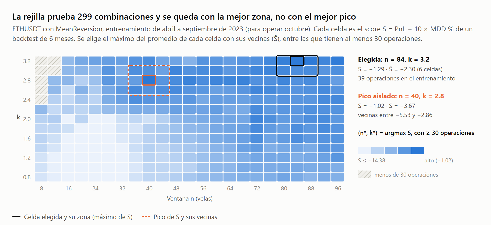

$$
\text{OOS} = \bigcup_{M = \text{2023-07}}^{\text{2026-08}} \text{ops}\big(M;\ n^{*}_{M}, k^{*}_{M}\big),
\qquad
(n^{*}_{M}, k^{*}_{M}) \text{ elegido con } [\,M - 6\text{ meses},\ M\,)
$$

**Qué es cada símbolo:**

- $M$: mes de prueba. Hay 38, de 2023-07 a 2026-08.
- $[\,M - 6\text{ meses},\ M\,)$: el entrenamiento de ese mes; termina justo donde empieza la prueba.
- $\text{ops}(M;\ n^{*}_{M}, k^{*}_{M})$: las operaciones que **entran** durante $M$ con la pareja elegida para $M$. Cada mes se simula aparte, como lo viviría el bot al arrancar con parámetros nuevos: una estrategia **nueva**, precargada con las $\max(n + 20,\ 100)$ velas anteriores (como `pre_seed_engine`), **sin** la posición que hubiera quedado abierta del mes anterior. Las operaciones que siguen abiertas al terminar el mes se siguen hasta su salida real, salvo las que saldrían dentro de la validación final.
- $\bigcup$: se juntan los 38 meses. El resultado OOS es el del procedimiento completo, "re-optimizar cada mes y operar el siguiente", que es justo lo que se haría en vivo.

> **Qué calcula:** cómo le habría ido al procedimiento de selección con meses que no vio al elegir.
>
> **Ejemplo:** ETHUSDT con `MeanReversion`. Para marzo de 2024 (entrenamiento de septiembre de 2023 a febrero de 2024) elige $(84, 3.0)$, que dentro de muestra hizo 31 operaciones y $+6.50$ USDT; en marzo hace 16 operaciones y gana $+1.10$. Para abril elige $(84, 3.2)$ ($+5.48$ en entrenamiento) y pierde $-2.45$. Para diciembre de 2025 la mejor meseta, $(12, 2.6)$, pierde $-5.70$ en entrenamiento, así que ese mes no opera. Sumando los 38 meses: 273 operaciones, 48.4 % de acierto y $-7.29$ USDT.

$$
d_j = \sum_{\text{ops. que cierran el día } j} PnL,
\qquad
t = \frac{\bar d}{s_d / \sqrt{D}},
\qquad
p = P\left(T_{D-1} \ge t\right),
\qquad
\text{pasa si } p < \frac{0.05}{16} = 0.003125
$$

**Qué es cada símbolo:**

- $d_j$: PnL neto (USDT) de las operaciones OOS que cierran el día $j$. Solo cuentan los días con operaciones.
- $D$: cuántos días tienen operaciones.
- $\bar d$, $s_d$: media y desviación estándar muestral de los $d_j$.
- $t$: cuántos errores estándar está la ganancia media por día por encima de 0. Se agrupa por día porque las operaciones de un mismo día no son independientes.
- $T_{D-1}$: distribución *t* de Student con $D-1$ grados de libertad; $p$ es la probabilidad de ver un $t$ así de alto si la estrategia no tuviera ventaja (una cola).
- $16$: pares (moneda, estrategia) que se prueban. Al probar 16 a la vez, la exigencia se divide entre 16 (corrección de Bonferroni) para que la probabilidad de aprobar alguno por pura suerte siga siendo del 5 %.

> **Qué calcula:** si la ganancia fuera de muestra es lo bastante grande y estable como para no ser suerte.
>
> **Ejemplo:** SOLUSDT con `MeanReversion` (el mejor OOS): 200 operaciones en $D = 173$ días y $+4.09$ USDT. $\bar d = 0.0237$, $s_d = 0.592$ y $t = 0.0237 / (0.592/\sqrt{173}) = 0.53$, así que $p = 0.30$. Para pasar haría falta $p < 0.003125$, es decir, $t \ge 2.77$: más de 5 veces más ganancia por día con el mismo ruido.

**Desglose paso a paso**

1. Para cada moneda, estrategia y pareja $(n,k)$ se simula **una vez** toda la historia (sección 12, versión rápida con paridad exacta). Con esa simulación se miden los entrenamientos.
2. Para cada mes de prueba $M$, cada pareja se mide solo con sus operaciones del entrenamiento $[\,M-6\text{ meses},\ M\,)$, y se calculan $S$ y $\bar S$.
3. Se elige $(n^{*}, k^{*})$, la mejor meseta entre las celdas con al menos 30 operaciones. Si su PnL de entrenamiento no es positivo, ese mes no se opera.
4. El mes $M$ se simula aparte con $(n^{*}, k^{*})$: estrategia nueva precargada, entradas solo durante $M$ y cada operación seguida hasta su salida. Como en el bot, hay una sola posición por moneda: si la operación de un mes anterior sigue abierta, el mes $M$ no abre otra hasta la vela siguiente a su salida (la estrategia ve esas velas, pero su señal se ignora), y la validación final hereda la que siga abierta al terminar el desarrollo. Repitiendo los pasos 2 a 4 para los 38 meses se obtiene el OOS de la estrategia.
5. La estrategia **pasa el walk-forward** para la moneda solo si su OOS cumple las cuatro condiciones: al menos 30 operaciones, PnL neto $> 0$, al menos la mitad de los meses con operaciones en positivo y $p < 0.003125$. El protocolo se fijó antes de ver los resultados y no se ajustó después.
6. La validación final (2026-09-01 a 2026-10-14) repite los pasos 2 a 4 sobre ese periodo reservado. No elige parámetros ni estrategia, pero puede **vetar**: si una estrategia que pasa el walk-forward pierde dinero ($PnL < 0$) en la validación final, queda `rechazada` y no se carga en modo normal (el modo experimental sí puede cargarla, marcada).
7. Una estrategia queda `validada` si pasa el walk-forward, no la veta la validación final y tiene parámetros rentables en los 6 meses más recientes (pasos 2 y 3 sobre esos meses: son los que se cargan en vivo). Si una moneda tiene más de una validada, se queda la de mayor $t$.
8. `ml_evaluator.py` guarda todo en `ml_results.json`: el bloque `_protocolo` (con la regla del veto) y, por estrategia, `status` (`validada` o `rechazada`), `motivo`, `pasa_walk_forward`, los parámetros de vivo (`window`, `multiplier` y sus métricas en los 6 meses recientes), `oos`, `validacion_final` y una fila por pliegue. `strategy_engine.py` solo carga estrategias validadas que no pierden en la validación final y explica por consola por qué una moneda no opera.

**Resultados de la ejecución del 2026-10-19** (OOS: 2023-07 a 2026-08; validación final: 2026-09-01 a 2026-10-14; PnL en USDT con 15 USDT por operación, neto de costos):

| Moneda | Estrategia | Entrenamiento: WR / PnL por op. | OOS: ops / WR / PnL | Meses + | OOS: $t$ / $p$ | Validación final: ops / WR / PnL | Estado |
|---|---|---|---|---|---|---|---|
| BTCUSDT | MeanReversion | 57.1 % / +0.019 | 99 / 53.5 % / −1.49 | 42 % | −0.56 / 0.71 | 1 / 0 % / −0.23 | rechazada |
| BTCUSDT | TrendFollowing | 43.0 % / +0.061 | 303 / 33.0 % / −8.56 | 21 % | −1.23 / 0.89 | 11 / 55 % / +0.77 | rechazada |
| BTCUSDT | VWAP | 61.0 % / +0.019 | 96 / 49.0 % / −4.59 | 31 % | −1.76 / 0.96 | 0 / — / 0.00 | rechazada |
| BTCUSDT | VolatilitySqueeze | 39.5 % / +0.071 | 339 / 31.0 % / −7.76 | 41 % | −1.11 / 0.87 | 16 / 38 % / −1.21 | rechazada |
| ETHUSDT | MeanReversion | 57.8 % / +0.054 | 243 / 49.4 % / −6.74 | 50 % | −0.84 / 0.80 | 6 / 33 % / −0.16 | rechazada |
| ETHUSDT | TrendFollowing | 41.4 % / +0.085 | 222 / 29.3 % / −15.32 | 29 % | −2.34 / 0.99 | 14 / 29 % / −3.05 | rechazada |
| ETHUSDT | VWAP | 56.9 % / +0.048 | 145 / 44.8 % / −5.76 | 39 % | −1.19 / 0.88 | 10 / 30 % / −0.73 | rechazada |
| ETHUSDT | VolatilitySqueeze | 38.6 % / +0.075 | 298 / 27.9 % / −12.19 | 33 % | −1.44 / 0.92 | 12 / 25 % / −1.08 | rechazada |
| SOLUSDT | MeanReversion | 57.4 % / +0.091 | 200 / 49.5 % / +4.09 | 52 % | +0.53 / 0.30 | 5 / 0 % / −1.98 | rechazada |
| SOLUSDT | TrendFollowing | 43.7 % / +0.129 | 367 / 35.4 % / +0.92 | 53 % | +0.07 / 0.47 | 14 / 36 % / +0.19 | rechazada |
| SOLUSDT | VWAP | 57.9 % / +0.081 | 223 / 42.6 % / −10.78 | 36 % | −1.39 / 0.92 | 8 / 62 % / +0.37 | rechazada |
| SOLUSDT | VolatilitySqueeze | 38.2 % / +0.116 | 378 / 30.7 % / +2.06 | 49 % | +0.17 / 0.43 | 9 / 44 % / +0.06 | rechazada |
| DOGEUSDT | MeanReversion | 57.2 % / +0.129 | 160 / 48.8 % / −0.32 | 52 % | −0.04 / 0.51 | 9 / 22 % / −1.96 | rechazada |
| DOGEUSDT | TrendFollowing | 42.8 % / +0.204 | 208 / 33.6 % / +2.47 | 35 % | +0.19 / 0.42 | 2 / 50 % / −0.01 | rechazada |
| DOGEUSDT | VWAP | 55.6 % / +0.083 | 206 / 47.1 % / −7.02 | 38 % | −1.00 / 0.84 | 9 / 78 % / +1.83 | rechazada |
| DOGEUSDT | VolatilitySqueeze | 37.0 % / +0.073 | 343 / 29.7 % / −5.74 | 36 % | −0.55 / 0.71 | 11 / 45 % / +0.23 | rechazada |

"Entrenamiento" es lo que prometía el optimizador: el acierto y el PnL por operación de cada pareja elegida **dentro** de sus 6 meses, en los meses que se operaron. "Meses +" es el porcentaje de meses con operaciones que terminaron en positivo.

> **Qué muestra la tabla.** Dentro de muestra, las 16 parejas ganan dinero por operación; fuera de muestra, 12 de 16 pierden y ninguna se acerca a $p < 0.003125$ (el mejor $p$ es 0.30). Es el sobreajuste medido: la rejilla siempre encuentra algo que funcionó en los 6 meses anteriores, pero eso no se repite el mes siguiente. Ninguna llega al veto de la validación final, porque ninguna pasa el walk-forward. Con 3 o 12 meses de entrenamiento (control que no decide nada) tampoco pasa ninguna: el mejor $p$ es 0.268 con 3 meses y 0.457 con 12.
>
> **Qué carga el bot en vivo: ninguna estrategia.** Las 4 monedas quedan en pausa y `strategy_engine.py` explica el motivo de cada una al arrancar. Es un resultado válido: con estas cuatro estrategias y costos de 0.12 % por lado, no hay evidencia de ventaja. Para ver al bot operar en la **testnet** existe un modo explícito, desactivado por defecto: `ALLOW_UNVALIDATED_STRATEGIES=1` en el `.env` carga en cada moneda la estrategia con mejor PnL OOS entre las que tienen parámetros rentables en los 6 meses recientes, marcada como **NO VALIDADA**. Con los resultados de arriba serían `VolatilitySqueeze` $(96, 2.0)$ en BTC, `VWAP` $(84, 2.6)$ en ETH, `VolatilitySqueeze` $(64, 3.2)$ en SOL y `TrendFollowing` $(12, 2.8)$ en DOGE; las de BTC, ETH y DOGE perdieron en la validación final (la de SOL ganó +0.06 USDT en 9 operaciones). Con `BINANCE_MARKET=mainnet` el modo se ignora. Lo esperable en ese modo es perder dinero.

*Origen:* [walk_forward.py](../binance-research/walk_forward.py), [ml_evaluator.py](../binance-research/machine_learning_strategies/ml_evaluator.py), [fast_backtest.py](../binance-research/fast_backtest.py) y `load_best_strategies` en [strategy_engine.py](../binance-research/strategy_engine.py). La figura sale de [graficos.html](graficos/graficos.html) con los datos de ese pliegue.

### 14.1 Filtros de entrada (desde el 2026-10-22)

Tres reglas de [agente-rl-y-esperanza-positiva.md](agente-rl-y-esperanza-positiva.md) (sugerencias 3, 5 y 6) se aplican **igual** en el evaluador (al elegir $n$ y $k$ y al probar cada mes) y en el bot en vivo. Se configuran en `config.py`; `None` desactiva cada una.

$$
\text{BUY se toma} \iff P_t - SL \ge 0.015\,P_t \;\;\land\;\; \exists\,Y \ne X,\ s \in [t-48,\ t-1]:\ \text{BUY}_{X\text{-regla}}(Y, s) \;\;\land\;\; \sum_{j=1}^{12} \text{PnL}^{\text{sombra}}_{M-j} > 0
$$

**Qué es cada símbolo:**

- $P_t - SL \ge 0.015\,P_t$: **riesgo mínimo** del 1.5 %. Con un SL a 0.5 % el costo de ida y vuelta (0.24 %) se come casi media $R$.
- $\text{BUY}_{X\text{-regla}}(Y, s)$: la **misma regla** de la moneda $X$ (misma estrategia, mismos $n$ y $k$) aplicada a otra moneda $Y$ del roster dio BUY en la vela $s$. Es la **co-señal**: solo se entra si el movimiento es de mercado, no de una sola moneda. La vela actual $t$ no cuenta, porque en vivo la de otra moneda puede no haber llegado todavía.
- $\text{PnL}^{\text{sombra}}_{M-j}$: lo que habría dado el walk-forward de ese par en el mes $M - j$ aunque no se operara. Es el **interruptor de momentum**: el mes $M$ se opera solo si la suma de los 12 meses anteriores es positiva. Apagado, la estrategia sigue en sombra y se vuelve a encender sola.

> **Ejemplo:** SOL con MeanReversion ($n = 16$, $k = 3.0$) da BUY a las 14:00 con el SL a 2.1 %. El riesgo pasa (2.1 % ≥ 1.5 %). La misma regla aplicada a ETH dio BUY a las 09:30 (dentro de las 12 h previas): hay co-señal. Si el PnL en sombra de SOL-MeanReversion en los últimos 12 meses es +3.2 USDT, el interruptor está encendido y se compra.

**Diario de señales.** Cada BUY de una estrategia, abierto o bloqueado, se guarda en `orders/signals.csv` con el motivo (`decision`, `reason`). Sirve para medir después si los filtros ayudan: el resultado de las bloqueadas se puede simular con las velas.

**Velas de 1 hora y testnet (desde el 2026-10-22).** El bot opera con velas de **1 h** (`KLINE_INTERVAL` en `config.py`, que Node recibe en el handshake): fue la temporalidad en la que los filtros dejaron la esperanza casi en cero (−0.03 % por operación frente a −0.15 % con 15 min). Con velas de 1 h, las 48 velas de la co-señal son 48 h. En la testnet, `TESTNET_IGNORE_MOMENTUM=1` hace que el interruptor apagado no bloquee (el diario lo anota como `momentum apagado, ignorado en testnet`) para juntar resultados reales; el modo experimental elige entonces cada estrategia por su PnL OOS **sin** interruptor. En mainnet el interruptor siempre se respeta.

*Origen:* [strategy_filters.py](../binance-research/strategy_filters.py) (backtest), [strategy_engine.py](../binance-research/strategy_engine.py) (vivo), [test_filters.py](../binance-research/test_filters.py) (mismas señales en los dos).

---

# Parte 5 — Machine Learning

## 15. Etiquetado del objetivo (qué aprende XGBoost)

**Objetivo.** Un modelo de aprendizaje supervisado necesita ejemplos con la "respuesta correcta". Aquí la pregunta que se le enseña al modelo es: *¿subirá el precio más de un 1 % en las próximas 3 horas?* Cada vela histórica recibe un 1 (sí) o un 0 (no) mirando hacia el futuro.

$$
r^{fut}_t = \frac{P_{t+12}}{P_t} - 1,
\qquad
y_t = \begin{cases} 1 & \text{si } r^{fut}_t > 0.01 \\ 0 & \text{en otro caso} \end{cases}
$$

**Qué es cada símbolo:**

- $P_{t+12}$: cierre 12 velas **después** de la actual (3 horas más tarde).
- $r^{fut}_t$: retorno futuro: cuánto subió o bajó en esas 12 velas.
- $y_t$: etiqueta de la vela $t$: 1 o 0.
- $0.01$: 1 %.

> **Qué calcula:** la "respuesta correcta" de cada vela: 1 si el precio sube más de 1 % en las 12 velas siguientes (3 horas).
>
> **Ejemplo:** si ahora vale 2 400 y 12 velas después vale 2 430, $r = 2430/2400 - 1 = 1.25\,\% > 1\,\%$, así que $y = 1$. Si vale 2 415, $r = 0.625\,\%$ y $y = 0$.

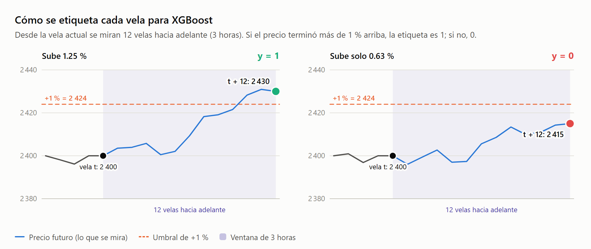

**Desglose paso a paso**

1. Para cada vela $t$ se busca el precio 12 velas más adelante, que con velas de 15 minutos equivale a 3 horas.
2. Se divide ese precio futuro entre el actual y se resta 1 para obtener el retorno porcentual.
3. Si ese retorno supera el 1 %, la vela se etiqueta como 1 (buena oportunidad de compra).
4. En cualquier otro caso, incluidas las subidas pequeñas y las bajadas, se etiqueta como 0.

*Origen:* [ml_evaluator.py](../binance-research/machine_learning_strategies/ml_evaluator.py), "FASE 2".

## 16. Variables de entrada (*features*) de XGBoost

**Objetivo.** El modelo no ve el precio en bruto, sino "pistas" calculadas a partir de él que describen el estado del mercado: cuánto se movió, qué tan volátil está, qué tan lejos está de su media, si está sobrecomprado o sobrevendido y si el volumen se disparó. Con esas pistas, el modelo intenta descubrir patrones que anticipen la etiqueta $y_t$.

### 16.1 Retorno simple

$$
r_t = \frac{P_t}{P_{t-1}} - 1
$$

**Qué es cada símbolo:**

- $P_{t-1}$: cierre de la vela anterior.
- $r_t$: retorno: cambio porcentual respecto a la vela anterior.

> **Qué calcula:** el cambio porcentual del precio respecto a la vela anterior.
>
> **Ejemplo:** de 2 400 a 2 406: $r = 2406/2400 - 1 = 0.0025 = +0.25\,\%$.

1. Se divide el precio actual entre el de la vela anterior.
2. Se resta 1 para expresar el cambio como porcentaje (por ejemplo, 0.002 es +0.2 %).

### 16.2 Volatilidad de retornos (10 y 20 velas)

$$
\text{vol}^{(m)}_t = \operatorname{std}\left(r_{t-m+1}, \dots, r_t\right),\qquad m \in \{10, 20\}
$$

**Qué es cada símbolo:**

- $m$: cuántos retornos se usan (10 o 20).
- $r_{t-m+1}, \dots, r_t$: los últimos $m$ retornos.
- $\operatorname{std}$: desviación estándar.
- $\text{vol}^{(m)}_t$: volatilidad de los retornos con ventana $m$.

> **Qué calcula:** qué tanto varían los retornos recientes: la volatilidad medida en porcentaje, no en dólares.
>
> **Ejemplo:** si los últimos 10 retornos alternan $+0.2\,\%$ y $-0.2\,\%$, su desviación estándar es $\approx 0.21\,\%$ por vela.

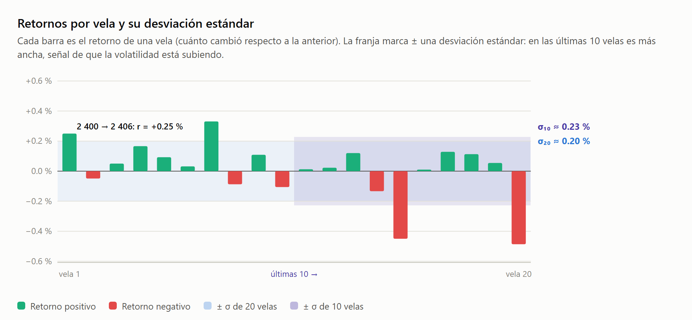

1. Se toman los últimos $m$ retornos simples.
2. Se calcula su desviación estándar muestral, igual que en la sección 2 pero sobre retornos y no sobre precios.
3. Al tener dos ventanas (10 y 20), el modelo puede notar si la volatilidad está subiendo o bajando.

### 16.3 Distancia a la media de 20 velas

$$
d_t = \frac{P_t - SMA_{20,t}}{SMA_{20,t}}
$$

**Qué es cada símbolo:**

- $SMA_{20,t}$: media simple de los últimos 20 cierres.
- $d_t$: distancia del precio a esa media, en proporción.

> **Qué calcula:** qué tan lejos está el precio de su media de 20 velas, en porcentaje.
>
> **Ejemplo:** con $P = 2400$ y media de 2 450: $d = -50/2450 = -2.04\,\%$ (el precio está un 2 % por debajo de lo normal).

1. Se calcula la media simple de los últimos 20 precios.
2. Se resta esa media al precio actual para saber si está por encima o por debajo.
3. Se divide entre la media para expresar la distancia como porcentaje y poder compararla entre monedas.

### 16.4 RSI de 14 periodos (*Relative Strength Index*)

$$
\Delta_t = P_t - P_{t-1},\qquad
G_t = \frac{1}{14}\sum_{i=0}^{13}\max(\Delta_{t-i}, 0),\qquad
L_t = \frac{1}{14}\sum_{i=0}^{13}\max(-\Delta_{t-i}, 0)
$$

**Qué es cada símbolo:**

- $\Delta_t$: cambio de precio entre la vela actual y la anterior.
- $\max(\Delta, 0)$: se queda con las subidas; las bajadas cuentan como 0.
- $\max(-\Delta, 0)$: se queda con las bajadas en positivo; las subidas cuentan como 0.
- $G_t$: ganancia media de las últimas 14 velas.
- $L_t$: pérdida media de las últimas 14 velas. Aquí no es la banda inferior.

> **Qué calcula:** la subida media y la bajada media de las últimas 14 velas.
>
> **Ejemplo:** si en 14 velas hubo 8 subidas que suman $+28$ y 6 bajadas que suman $-14$: $G = 28/14 = 2$ y $L = 14/14 = 1$.

$$
RS_t = \frac{G_t}{L_t + 10^{-9}},\qquad
RSI_t = 100 - \frac{100}{1 + RS_t}
$$

**Qué es cada símbolo:**

- $RS_t$: fuerza relativa: ganancia media entre pérdida media.
- $10^{-9}$: un número diminuto que evita dividir entre cero.
- $RSI_t$: índice de fuerza relativa, de 0 a 100.

> **Qué calcula:** la fuerza de las subidas frente a las bajadas, en una escala de 0 a 100.
>
> **Ejemplo:** con $G = 2$ y $L = 1$: $RS = 2$ y $RSI = 100 - 100/3 \approx 66.7$ (más compradores que vendedores, sin llegar a sobrecompra). Si no hubiera ninguna bajada, $RS$ sería enorme y el RSI casi 100.

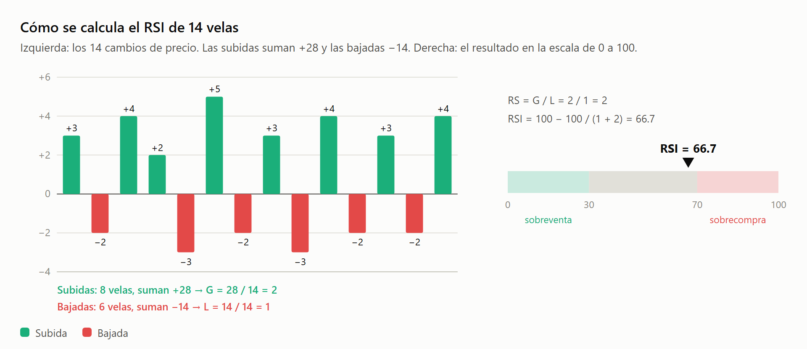

1. Se calcula el cambio de precio $\Delta_t$ entre cada vela y la anterior.
2. Las subidas se quedan con su valor y las bajadas se ponen en cero, y se promedian las últimas 14 para obtener la ganancia media $G_t$.
3. Las bajadas se toman en valor positivo y las subidas se ponen en cero, y se promedian para obtener la pérdida media $L_t$.
4. La fuerza relativa $RS_t$ divide la ganancia media entre la pérdida media, sumando $10^{-9}$ para no dividir entre cero.
5. La transformación $100 - 100/(1+RS)$ comprime el resultado a una escala de 0 a 100.
6. Por convención, un RSI mayor que 70 indica sobrecompra y uno menor que 30 indica sobreventa.
7. Esta versión usa una media simple (RSI de Cutler) y no el suavizado exponencial de Wilder que muestran la mayoría de las plataformas, así que los valores pueden diferir un poco de los de TradingView.

### 16.5 Cambio de volumen

$$
\Delta V_t = \frac{V_t}{V_{t-1}} - 1
$$

**Qué es cada símbolo:**

- $V_t$: volumen de la vela actual.
- $V_{t-1}$: volumen de la vela anterior.
- $\Delta V_t$: cambio porcentual del volumen.

> **Qué calcula:** cuánto cambió el volumen respecto a la vela anterior.
>
> **Ejemplo:** de 120 a 300 BTC negociados: $\Delta V = 300/120 - 1 = 1.5 = +150\,\%$, una entrada fuerte de dinero.

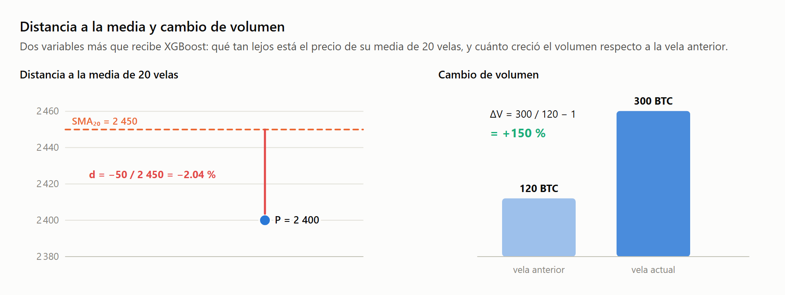

1. Se divide el volumen actual entre el de la vela anterior y se resta 1.
2. Un valor grande indica una entrada súbita de dinero, que suele acompañar a los movimientos fuertes.

*Origen:* `extract_features` en [xgboost_classifier.py](../binance-research/machine_learning_strategies/xgboost_classifier.py).

## 17. El modelo XGBoost (*gradient boosting* de árboles)

**Objetivo.** XGBoost construye muchos árboles de decisión pequeños, uno tras otro, y cada árbol nuevo intenta corregir los errores que dejaron los anteriores. Al final suma las "opiniones" de los 100 árboles y las convierte en una probabilidad de que la vela termine en 1 (subida mayor al 1 %). Es uno de los algoritmos más usados con datos tabulares porque captura relaciones no lineales entre las variables.

**Predicción**

$$
F_M(x) = \sum_{m=1}^{M} \eta\, f_m(x),\qquad
\hat p = \frac{1}{1 + e^{-F_M(x)}},\qquad
\hat y = \begin{cases}1 & \hat p > 0.5\\ 0 & \text{en otro caso}\end{cases}
$$

**Qué es cada símbolo:**

- $x$: las variables de una vela (sección 16).
- $f_m(x)$: lo que "opina" el árbol número $m$ sobre esa vela.
- $M$: número de árboles (100).
- $\eta$: tasa de aprendizaje (0.05): cuánto pesa cada árbol.
- $F_M(x)$: puntaje total, sin límites (*log-odds*).
- $e$: número de Euler, ≈ 2.718.
- $\hat p$: probabilidad estimada de que la vela termine en 1.
- $\hat y$: predicción final: 1 o 0.

> **Qué calcula:** la suma de las opiniones de todos los árboles, convertida en probabilidad de que el precio suba más de 1 %.
>
> **Ejemplo:** si los 100 árboles dan en promedio $0.16$, $F = 100 \times 0.05 \times 0.16 = 0.8$ y $\hat p = 1/(1 + e^{-0.8}) \approx 0.69$. Como $0.69 > 0.5$, el modelo predice 1.

**Función de pérdida (*log loss*) con regularización**

$$
\mathcal{L} = \sum_{i}\Big[-y_i\ln \hat p_i - (1-y_i)\ln(1-\hat p_i)\Big] + \sum_{m}\Omega(f_m),
\qquad
\Omega(f) = \gamma T + \tfrac{1}{2}\lambda \sum_{j=1}^{T} w_j^2
$$

**Qué es cada símbolo:**

- $\mathcal{L}$: pérdida total que el modelo intenta minimizar.
- $y_i$: etiqueta real de la vela $i$ (1 o 0).
- $\hat p_i$: probabilidad que el modelo le dio a esa vela.
- $\ln$: logaritmo natural.
- $\Omega(f)$: castigo por complejidad del árbol $f$.
- $T$: número de hojas del árbol.
- $w_j$: peso (valor de salida) de la hoja $j$.
- $\gamma$: castigo por cada hoja.
- $\lambda$: castigo por pesos grandes.

> **Qué calcula:** qué tan mal predice el modelo (lo que intenta minimizar), más un castigo por árboles complicados.
>
> **Ejemplo:** si la vela subió ($y = 1$) y el modelo dijo $\hat p = 0.9$, la pérdida es $-\ln 0.9 \approx 0.11$; si dijo $\hat p = 0.1$, es $-\ln 0.1 \approx 2.30$, veinte veces más. Un árbol con 4 hojas de pesos $0.2, -0.1, 0.3, -0.2$, con $\gamma = 0$ y $\lambda = 1$, suma $\Omega = \tfrac12 \times 0.18 = 0.09$.

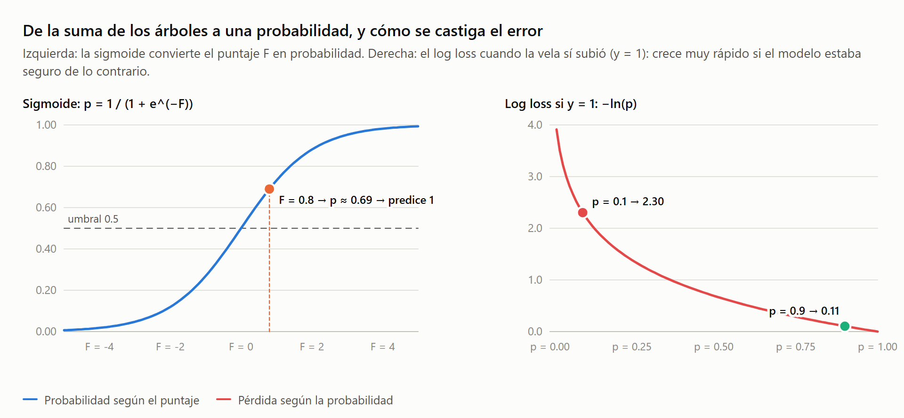

**Construcción de cada árbol (aproximación de segundo orden)**

$$
g_i = \hat p_i - y_i,\qquad
h_i = \hat p_i (1-\hat p_i),\qquad
w_j^{*} = -\frac{\sum_{i\in j} g_i}{\sum_{i \in j} h_i + \lambda}
$$

**Qué es cada símbolo:**

- $g_i$: gradiente: el error con signo en la vela $i$ (negativo si el modelo se quedó corto).
- $h_i$: curvatura: qué tan cerca de 0.5 estaba la predicción (máxima con $\hat p = 0.5$).
- $i \in j$: las velas que caen en la hoja $j$.
- $w^{*}_j$: peso óptimo de la hoja $j$.

> **Qué calcula:** cuánto se equivoca el modelo en cada vela ($g$), qué tan seguro estaba ($h$) y el peso que corrige mejor esos errores en una hoja ($w^{*}$).
>
> **Ejemplo:** una hoja con 3 velas, todas con $\hat p = 0.5$ y etiquetas $1, 1, 0$: $g = -0.5, -0.5, +0.5$ (suma $-0.5$) y $h = 0.25$ cada una (suma $0.75$). Con $\lambda = 1$: $w^{*} = 0.5/1.75 \approx 0.29$, que empuja la predicción hacia 1.

$$
\text{Ganancia} = \frac{1}{2}\left[\frac{G_I^2}{H_I+\lambda} + \frac{G_D^2}{H_D+\lambda} - \frac{(G_I+G_D)^2}{H_I+H_D+\lambda}\right] - \gamma
$$

**Qué es cada símbolo:**

- $G_I$, $H_I$: suma de $g$ y de $h$ de las velas que van a la rama izquierda.
- $G_D$, $H_D$: lo mismo para la rama derecha.
- último término: el nodo sin partir (las dos ramas juntas).
- $\gamma$: costo de agregar una hoja.

> **Qué calcula:** cuánto mejora la pérdida al partir un nodo en dos ramas.
>
> **Ejemplo:** si la rama izquierda tiene dos velas con $y = 1$ ($G_I = -1$, $H_I = 0.5$) y la derecha dos con $y = 0$ ($G_D = 1$, $H_D = 0.5$), con $\lambda = 1$ y $\gamma = 0$: $\tfrac12\,[1/1.5 + 1/1.5 - 0/2] \approx 0.67 > 0$, así que conviene partir.

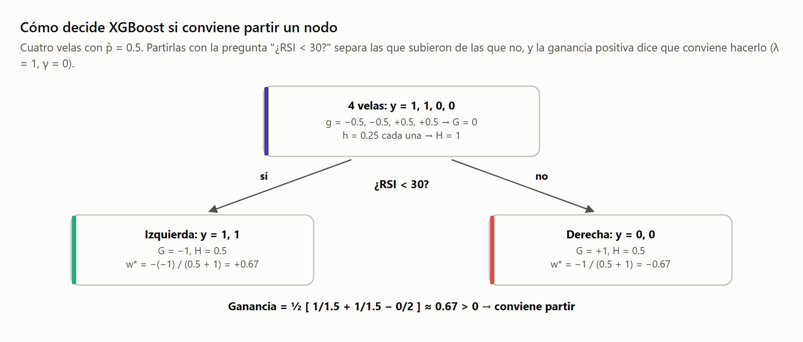

**Desglose paso a paso**

1. Cada árbol $f_m$ toma las variables de la sección 16 y, haciendo preguntas del tipo "¿RSI < 30?", asigna la vela a una hoja con un peso numérico $w_j$.
2. El modelo usa $M = 100$ árboles (`n_estimators=100`).
3. Cada árbol tiene como máximo 4 niveles de profundidad (`max_depth=4`) para que no memorice los datos.
4. La salida de cada árbol se multiplica por la tasa de aprendizaje $\eta = 0.05$, de modo que cada árbol corrige solo un poco y el aprendizaje es gradual.
5. La suma $F_M(x)$ de todos los árboles es un puntaje sin límites (*log-odds*).
6. La función sigmoide $1/(1+e^{-F})$ convierte ese puntaje en una probabilidad entre 0 y 1.
7. Si la probabilidad supera 0.5, el modelo predice 1 y, si no, predice 0.
8. El *log loss* castiga mucho las predicciones que estaban muy seguras y resultaron equivocadas, y es lo que el modelo intenta minimizar.
9. El término $\Omega$ penaliza los árboles con muchas hojas ($\gamma T$) y con pesos muy grandes ($\lambda w^2$), lo que reduce el sobreajuste.
10. Para construir el árbol $m$, se calcula para cada ejemplo el gradiente $g_i$ (cuánto se equivocó el modelo hasta ahora) y la curvatura $h_i$ (qué tan segura era su predicción).
11. El peso óptimo de cada hoja $w_j^{*}$ sale de minimizar una aproximación de Taylor de segundo orden de la pérdida, y es el gradiente acumulado dividido entre la curvatura acumulada más $\lambda$.
12. Para decidir dónde partir un nodo, se prueban cortes posibles y se elige el que más reduce la pérdida, medido por la fórmula de "ganancia" que compara la rama izquierda ($I$), la derecha ($D$) y el nodo sin partir.

*Origen:* [xgboost_classifier.py](../binance-research/machine_learning_strategies/xgboost_classifier.py). Las fórmulas internas son las del algoritmo XGBoost (Chen y Guestrin, 2016).

## 18. Validación del modelo (división 80/20 y *accuracy*)

**Objetivo.** Para saber si el modelo aprendió algo útil o solo memorizó, hay que examinarlo con datos que nunca vio. Con las velas del último mes completo (Parte 4, "Los datos de entrenamiento"), el bot entrena con el 80 % más antiguo y evalúa con el 20 % más reciente, respetando el orden temporal. La métrica que usa es la *accuracy*, es decir, el porcentaje de aciertos.

$$
\text{Train} = \{x_1,\dots,x_{\lfloor 0.8N\rfloor}\},\qquad
\text{Test} = \{x_{\lfloor 0.8N\rfloor+1},\dots,x_N\},\qquad
\text{Accuracy} = \frac{1}{|\text{Test}|}\sum_{i\in \text{Test}} \mathbb{1}[\hat y_i = y_i]
$$

**Qué es cada símbolo:**

- $x_i$: la vela $i$ con sus variables.
- $N$: número total de velas.
- $\lfloor 0.8N \rfloor$: el 80 % de $N$, redondeado hacia abajo: el índice de corte.
- $\lvert\text{Test}\rvert$: cuántas velas hay en la prueba.
- $\mathbb{1}[\cdot]$: indicador: vale 1 si lo de adentro se cumple y 0 si no.
- $\hat y_i$, $y_i$: predicción del modelo y etiqueta real.

> **Qué calcula:** qué velas se usan para entrenar, cuáles para examinar y qué porcentaje de aciertos tuvo el modelo en el examen.
>
> **Ejemplo:** con $N = 2880$ velas: se entrena con las primeras $\lfloor 0.8 \times 2880 \rfloor = 2304$ y se examina con las últimas 576. Si acierta 470 de 576, $\text{Accuracy} = 81.6\,\%$.

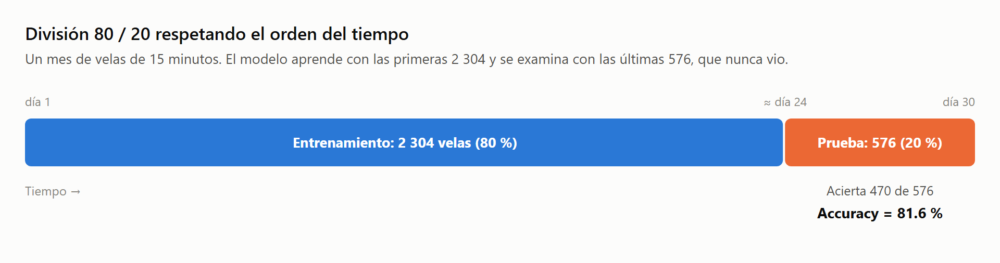

**Desglose paso a paso**

1. Se eliminan las primeras filas que no tienen todas las variables calculadas (el RSI y las volatilidades necesitan historia).
2. Se corta la serie en el índice $\lfloor 0.8N \rfloor$ sin mezclar el orden, para no "ver el futuro".
3. El modelo se entrena solo con la parte antigua.
4. Se predice sobre la parte reciente y se cuenta en cuántas velas acertó.
5. La función indicadora $\mathbb{1}[\cdot]$ vale 1 si la predicción coincide con la etiqueta real y 0 si no.
6. La accuracy es el promedio de esos aciertos.

> **Cuidado con la accuracy.** Si solo el 10 % de las velas sube más del 1 % en 3 horas, un modelo que **siempre** dice "0" tendría un 90 % de accuracy sin servir para nada. En problemas desbalanceados conviene medir la *precision* (de las veces que dijo "compra", cuántas acertó) y el *recall*. En la ejecución del 2026-10-19 (septiembre de 2026) la accuracy fue de 96.7 %, 92.1 %, 84.8 % y 83.0 % en BTC, ETH, SOL y DOGE, prácticamente lo mismo que decir siempre "0": en esos últimos días solo alrededor del 3 %, 8 %, 15 % y 17 % de las velas eran 1.
>
> Además, el modelo se entrena pero **no se guarda en disco ni se usa en vivo**: `predict_signal_quality` nunca se llama desde `server.py` ni `strategy_engine.py`. Hoy XGBoost no filtra ninguna operación real.

## 19. Detector de regímenes con HMM (en desarrollo)

**Objetivo.** El mercado alterna "regímenes" que no se ven directamente, como "lateral y tranquilo" o "en tendencia y volátil", y cada estrategia funciona bien solo en algunos de ellos. Un Modelo Oculto de Markov (*Hidden Markov Model*) intenta deducir en qué régimen estamos a partir de lo único observable: los retornos. La idea es usarlo para activar la reversión a la media en mercados laterales y el seguimiento de tendencia en mercados con dirección.

**Lo que ya está implementado: retornos logarítmicos**

$$
\ell_t = \ln\!\left(\frac{P_t}{P_{t-1}}\right)
$$

**Qué es cada símbolo:**

- $\ln$: logaritmo natural.
- $\ell_t$: retorno logarítmico de la vela $t$.

> **Qué calcula:** el retorno en escala logarítmica, que se puede sumar entre velas.
>
> **Ejemplo:** de 2 400 a 2 424: $\ln(1.01) \approx +0.00995$. De vuelta a 2 400: $\ln(2400/2424) \approx -0.00995$. Los dos se cancelan exactamente, cosa que no pasa con los retornos simples (+1 % y −0.99 %).

**Lo que falta implementar (`TODO` en el código): HMM gaussiano**

$$
\Pr(s_t = j \mid s_{t-1} = i) = A_{ij},
\qquad
\ell_t \mid s_t = j \;\sim\; \mathcal{N}(\mu_j, \sigma_j^2)
$$

**Qué es cada símbolo:**

- $s_t$: régimen oculto en la vela $t$ (0 = lateral, 1 = tendencia o volátil).
- $\Pr(\,\cdot \mid \cdot\,)$: probabilidad de lo de la izquierda "dado que" ocurrió lo de la derecha.
- $A_{ij}$: probabilidad de pasar del régimen $i$ al $j$ en una vela.
- $\sim$: "se distribuye como".
- $\mathcal{N}(\mu_j, \sigma_j^2)$: distribución normal con la media y la varianza del régimen $j$.

> **Qué calcula:** la probabilidad de cambiar de régimen y cómo son los retornos en cada uno.
>
> **Ejemplo:** con $A_{00} = 0.95$, si hoy el mercado está lateral, hay 95 % de probabilidad de que siga lateral en la próxima vela. Si el régimen lateral tiene $\sigma_0 = 0.2\,\%$ y el volátil $\sigma_1 = 1\,\%$, un retorno de $1.5\,\%$ es casi imposible en el primero (7.5 sigmas) y normal en el segundo (1.5 sigmas): el modelo concluye que estamos en el régimen volátil.

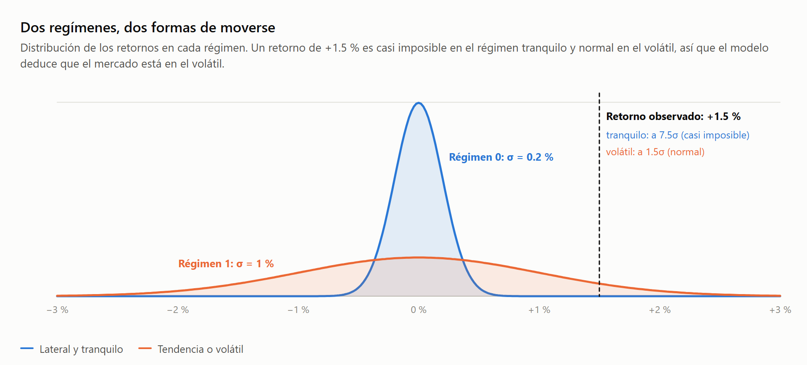

**Cómo leer el gráfico** (datos simulados, 130 velas; los fondos de color son el régimen real, que el modelo no conoce):

1. **Panel 1, el precio.** En las velas 0–49 y 95–129 el precio apenas se mueve: mercado lateral. En las velas 50–94 sube con saltos grandes: tendencia volátil.
2. **Panel 2, el retorno de cada vela.** Es lo único que recibe el modelo. En el régimen lateral, casi todas las barras caben en la franja azul de ±0.4 % (dos veces $\sigma_0 = 0.2\,\%$). En el régimen volátil, las barras se salen de la franja hacia arriba y hacia abajo; eso es lo que significa $\sigma_1 = 1\,\%$. La vela 52 (+1.5 %) es el ejemplo de arriba: estaría a 7.5 sigmas si el mercado siguiera tranquilo, así que esa explicación deja de ser creíble.
3. **Panel 3, la conclusión del modelo.** Es la probabilidad de estar en el régimen 1 dados los retornos. Sube casi a 100 % justo cuando empiezan las barras grandes y baja a 0 % cuando vuelven a ser pequeñas. Hacia la vela 85 cae a ~55 % porque hubo varias velas seguidas con retornos pequeños, que también encajan en el régimen tranquilo. El modelo duda, pero como $A_{11}$ es alto (los regímenes duran), no cambia de opinión por unas pocas velas.

El modelo no mira si el precio sube o baja, sino el **tamaño** de los retornos. Por eso agrupa "tendencia" y "volátil" en un mismo régimen: los dos producen barras grandes en el panel 2.

**Desglose paso a paso**

1. Se calcula el retorno logarítmico, que tiene la ventaja de que los retornos de varias velas se pueden sumar y de ser simétrico entre subidas y bajadas.
2. Se supone que existe un estado oculto $s_t$ con dos valores posibles: 0 (lateral) y 1 (tendencia o alta volatilidad).
3. La matriz de transición $A$ indica la probabilidad de pasar de un régimen a otro de una vela a la siguiente, y suele tener valores altos en la diagonal porque los regímenes son persistentes.
4. En cada régimen, los retornos siguen una distribución normal con su propia media $\mu_j$ y su propia volatilidad $\sigma_j$.
5. El algoritmo de Baum–Welch (una variante de *Expectation-Maximization*) estimaría $A$, $\mu_j$ y $\sigma_j$ a partir de la historia.
6. El algoritmo de Viterbi encontraría la secuencia de regímenes más probable y, con ella, el régimen actual.

*Origen:* [hmm_regime.py](../binance-research/machine_learning_strategies/hmm_regime.py). Hoy `predict_regime` siempre devuelve 0. [regime_classifier.py](../binance-research/machine_learning_strategies/regime_classifier.py) es un esqueleto con el mismo propósito.

## 20. Gestor de riesgo por aprendizaje por refuerzo (en desarrollo)

**Objetivo.** En lugar de reglas fijas de TP y SL, un agente de aprendizaje por refuerzo aprendería, jugando millones de partidas simuladas, cuándo conviene mantener, cerrar o mover el stop de una operación abierta. Recibiría una recompensa al ganar dinero y un castigo al sufrir pérdidas o drawdown. Por ahora solo están definidos el estado que observaría y la regla del *trailing stop*.

$$
u_t = \frac{P_t - P_{entrada}}{P_{entrada}},
\qquad
\text{estado} = (u_t,\ \text{velas en la operación}),
\qquad
SL_{nuevo} = 0.99\,P_t
$$

**Qué es cada símbolo:**

- $u_t$: ganancia no realizada de la posición, en proporción.
- $P_{entrada}$: precio al que se compró.
- $\text{estado}$: lo que "ve" el agente para decidir.
- $SL_{nuevo}$: nuevo stop, 1 % por debajo del precio actual.

> **Qué calcula:** la ganancia no realizada de la posición abierta y dónde quedaría un stop que sigue al precio.
>
> **Ejemplo:** comprando a 2 400, con el precio en 2 460: $u = 60/2400 = 2.5\,\%$. El *trailing stop* quedaría en $0.99 \times 2460 = 2435.4$, por encima de la entrada: la operación ya no puede terminar en pérdida.

**Objetivo de PPO previsto (aún no implementado)**

$$
L^{CLIP}(\theta) = \mathbb{E}_t\Big[\min\big(\rho_t(\theta)\,\hat A_t,\ \operatorname{clip}(\rho_t(\theta), 1-\epsilon, 1+\epsilon)\,\hat A_t\big)\Big],
\qquad
\rho_t(\theta) = \frac{\pi_\theta(a_t\mid s_t)}{\pi_{\theta_{old}}(a_t\mid s_t)}
$$

**Qué es cada símbolo:**

- $\theta$: parámetros de la política nueva; $\theta_{old}$, los de la anterior.
- $\pi_\theta(a_t \mid s_t)$: probabilidad de que la política elija la acción $a_t$ en el estado $s_t$.
- $\rho_t$: cuántas veces más (o menos) probable es esa acción con la política nueva.
- $\hat A_t$: ventaja: si la acción salió mejor (+) o peor (−) de lo esperado.
- $\epsilon$: límite de cambio permitido (por ejemplo, 0.2).
- $\operatorname{clip}(x, a, b)$: recorta $x$ para que quede entre $a$ y $b$.
- $\mathbb{E}_t$: promedio sobre todas las decisiones.

> **Qué calcula:** cuánto se permite cambiar la política del agente en cada actualización.
>
> **Ejemplo:** con $\epsilon = 0.2$, si la política nueva hace una buena acción ($\hat A = +1$) 1.5 veces más probable ($\rho = 1.5$), la mejora cuenta solo como $\min(1.5, 1.2) = 1.2$: se recorta para no cambiar demasiado de golpe.

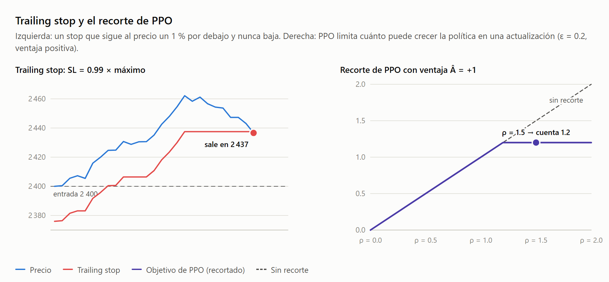

**Desglose paso a paso**

1. La ganancia no realizada $u_t$ mide, en porcentaje, cuánto se gana o se pierde ahora mismo con la posición abierta.
2. El estado combina esa ganancia con el tiempo que lleva abierta la operación.
3. El agente elegiría entre tres acciones: mantener, cerrar ya o mover el stop.
4. Si eligiera mover el stop, este se colocaría un 1 % por debajo del precio actual (*trailing stop*) para asegurar parte de la ganancia.
5. En PPO, $\pi_\theta$ es la política (la probabilidad de elegir cada acción en cada estado), y $\rho_t$ compara la política nueva con la anterior.
6. La ventaja $\hat A_t$ estima si una acción fue mejor o peor de lo esperado.
7. El recorte (`clip`) impide que la política cambie demasiado en una sola actualización, lo que estabiliza el aprendizaje.

*Origen:* [rl_agent.py](../binance-research/machine_learning_strategies/rl_agent.py). Hoy siempre devuelve `HOLD_POSITION`.

## 21. Volatilidad histórica promedio (análisis exploratorio)

**Objetivo.** Antes de diseñar estrategias, conviene saber cuánto se mueve típicamente cada moneda por vela. Este script calcula la desviación estándar de los retornos de toda la historia descargada, lo que da una idea del "tamaño normal" de los movimientos. Sirve, por ejemplo, para juzgar si un take profit del 1 % es realista en 3 horas.

$$
\bar\sigma = \operatorname{std}\left(r_1, r_2, \dots, r_N\right)\cdot 100,\qquad r_t = \frac{P_t}{P_{t-1}} - 1
$$

**Qué es cada símbolo:**

- $r_1, \dots, r_N$: los retornos de todas las velas de la historia.
- $N$: número de velas.
- $\cdot\,100$: pasa el resultado a porcentaje.
- $\bar\sigma$: volatilidad histórica promedio por vela.

> **Qué calcula:** cuánto se mueve típicamente la moneda en una vela, en porcentaje.
>
> **Ejemplo:** si $\bar\sigma = 0.35\,\%$ por vela de 15 minutos, en 12 velas (3 horas) el movimiento típico es $0.35 \times \sqrt{12} \approx 1.2\,\%$. Un objetivo de 1 % en 3 horas es, por lo tanto, realista.

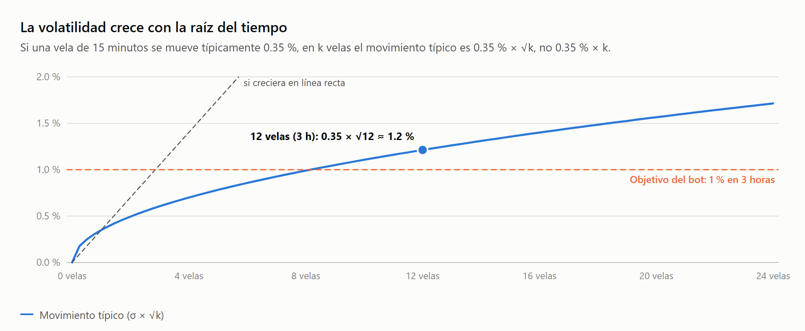

**Desglose paso a paso**

1. Se cargan y ordenan cronológicamente todas las velas de 15 minutos de la moneda.
2. Se calcula el retorno simple de cada vela respecto a la anterior.
3. Se calcula la desviación estándar de todos esos retornos.
4. Se multiplica por 100 para expresarla en porcentaje por periodo.

*Origen:* [analyze_data.py](../binance-research/analyze_data.py).

---

# Parte 6 — Cinco sugerencias para encontrar un margen (*edge*)

## La idea de fondo: no adivinar el mercado, sino tener ventaja en promedio

No hace falta saber hacia dónde irá el precio en cada momento. Basta con encontrar **situaciones que se repiten** en las que, si compras y vendes siempre con la misma regla, te quedas con un margen positivo **en promedio** después de muchas operaciones. Un casino funciona así: no sabe quién ganará la siguiente mano, pero sabe que con miles de manos la ventaja estadística juega a su favor.

$$
E = p\,(b\,R) - (1-p)\,R - c
\qquad\Longrightarrow\qquad
p^{*} = \frac{1 + c/R}{1 + b}
$$

**Qué es cada símbolo:**

- $c$: costos de ida y vuelta (comisiones y spread), en las mismas unidades que $R$.
- $c / R$: qué parte del riesgo se va en costos.
- $p^{*}$: tasa de acierto mínima una vez descontados los costos.

> **Qué calcula:** la ganancia esperada descontando costos, y la tasa de acierto mínima que exigen esos costos.
>
> **Ejemplo:** con $b = 1$ y costos $c = 0.2\,\%$: si se busca $R = 0.5\,\%$, $p^{*} = (1 + 0.4)/2 = 70\,\%$; si se busca $R = 2\,\%$, $p^{*} = (1 + 0.1)/2 = 55\,\%$. Buscar movimientos pequeños obliga a acertar muchísimo.

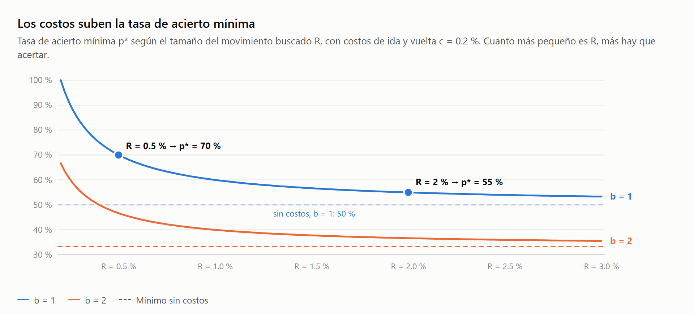

1. $E$ es la ganancia esperada por operación, que es lo único que importa a largo plazo.
2. $p$ es la tasa de acierto, $b\cdot R$ lo que se gana al acertar y $R$ lo que se pierde al fallar (sección 4).
3. $c$ son los costos de ida y vuelta: alrededor del 0.2 % del monto en Binance spot (0.1 % al comprar y 0.1 % al vender), más el spread.
4. $p^{*}$ es la tasa de acierto mínima para no perder dinero una vez descontados los costos.
5. Si el margen buscado $R$ es pequeño comparado con $c$, el cociente $c/R$ crece y la barra $p^{*}$ sube mucho: **los patrones con movimientos diminutos no sirven aunque sean reales.**

**Lo que dicen los datos.** Tienes razón en que el mercado no es puro caos: hay periodos en que el precio "rebota" dentro de un rango, periodos en que "sigue" en una dirección y horarios en que se comporta distinto. Pero esos patrones son **débiles** (aciertos del 52–58 %, no del 80 %), **cambian con el tiempo** y **se debilitan** cuando muchos los explotan. Por eso las cinco sugerencias siguen el mismo orden: **primero medir si el patrón existe ahora, después operarlo solo cuando el margen supere los costos.**

---

## Sugerencia 1 — Medir si el precio está "rebotando" o "siguiendo" (razón de varianzas)

**Qué patrón busca.** La sensación de que el precio "se la pasa subiendo y bajando" se puede medir. Si después de una subida suele venir una bajada, el precio **oscila** y conviene comprar abajo y vender arriba. Si después de una subida suele venir otra subida, el precio **persiste** y conviene seguir la tendencia. Si no pasa ni lo uno ni lo otro, es ruido y conviene no operar.

$$
\rho(k) = \operatorname{Corr}(r_t,\ r_{t-k})
\qquad\qquad
VR(q) = \frac{\operatorname{Var}\!\left(r_t + r_{t-1} + \dots + r_{t-q+1}\right)}{q\cdot \operatorname{Var}(r_t)}
$$

**Qué es cada símbolo:**

- $k$: retraso en velas. Aquí no es el multiplicador de las bandas.
- $\operatorname{Corr}$: correlación, de −1 a +1.
- $q$: cuántas velas se juntan en un bloque.
- $r_t + \dots + r_{t-q+1}$: retorno acumulado de un bloque de $q$ velas.
- $\operatorname{Var}$: varianza (desviación estándar al cuadrado).

> **Qué calcula:** si los movimientos se repiten ($VR > 1$), se cancelan ($VR < 1$) o son aleatorios ($VR \approx 1$).
>
> **Ejemplo:** si la varianza de una vela es 1 y la de la suma de 4 velas es 2.8, $VR(4) = 2.8/(4 \times 1) = 0.7 < 1$: el precio oscila. Un $\rho(1) = -0.15$ dice lo mismo: tras una subida suele venir una pequeña bajada.

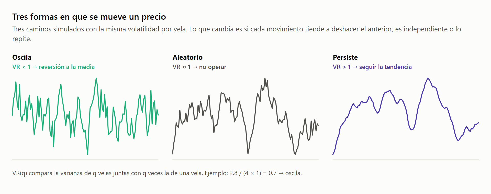

1. La autocorrelación $\rho(k)$ mide si el retorno de hoy se parece al de hace $k$ velas: si es negativa, el precio tiende a "devolver" lo que movió.
2. La razón de varianzas $VR(q)$ compara la variación de un bloque de $q$ velas con $q$ veces la variación de una sola vela.
3. Si el precio fuera totalmente aleatorio, las variaciones se sumarían sin más y $VR(q) \approx 1$.
4. Si $VR(q) < 1$, los movimientos se cancelan entre sí: el precio **oscila** y es terreno de la reversión a la media.
5. Si $VR(q) > 1$, los movimientos se acumulan: el precio **persiste** y es terreno del seguimiento de tendencia.
6. La prueba de Lo-MacKinlay da un estadístico $z$ para saber si la diferencia con 1 es real o casualidad (con $|z| > 2$ se toma en serio).

**Cómo aplicarlo.** Calcular $VR(q)$ en una ventana móvil (por ejemplo, las últimas 500 velas) para cada moneda y temporalidad (1m, 15m, 1h y 4h). Con eso, el bot sabría **cuándo** activar `MeanReversion`, cuándo `TrendFollowing` y cuándo quedarse quieto, en vez de elegir una estrategia fija para siempre. Es la medición que convierte la intuición de "aquí hay un patrón" en un número.

## Sugerencia 2 — Cuando sí oscila: operar el rango con un modelo Ornstein-Uhlenbeck

**Qué patrón busca.** Si la sugerencia 1 indica que el precio oscila, el modelo de Ornstein-Uhlenbeck (OU) describe exactamente eso: un precio que se aleja de su centro y es "jalado" de vuelta con cierta fuerza. A diferencia de las bandas de Bollinger actuales, el OU dice **qué tan rápido** vuelve el precio y **qué tan lejos** suele alejarse, así que permite calcular el margen esperado antes de entrar.

$$
X_t - X_{t-1} = a + \beta\,X_{t-1} + \varepsilon_t
\quad\Longrightarrow\quad
\kappa = -\ln(1+\beta),\qquad
\mu = -\frac{a}{\beta},\qquad
t_{1/2} = \frac{\ln 2}{\kappa},\qquad
\sigma_{eq} = \frac{\sigma_\varepsilon}{\sqrt{1-(1+\beta)^2}}
$$

**Qué es cada símbolo:**

- $X_t$: logaritmo del precio (o el residuo de un par).
- $a$, $\beta$: coeficientes que salen de la regresión.
- $\varepsilon_t$: ruido aleatorio de cada vela; $\sigma_\varepsilon$ es su desviación estándar.
- $\kappa$: fuerza del "resorte" que devuelve el precio al centro.
- $\mu$: centro de equilibrio. Aquí no es la media móvil.
- $t_{1/2}$: vida media: velas que tarda en recorrer la mitad del camino de vuelta.
- $\sigma_{eq}$: distancia típica al centro cuando el precio oscila.

> **Qué calcula:** el centro del rango, qué tan fuerte vuelve el precio a él, en cuántas velas y qué tan lejos suele alejarse.
>
> **Ejemplo:** si la regresión da $a = 10$, $\beta = -0.1$ y $\sigma_\varepsilon = 1$: $\mu = 100$, $\kappa = -\ln 0.9 \approx 0.105$, $t_{1/2} = 0.693/0.105 \approx 6.6$ velas y $\sigma_{eq} = 1/\sqrt{1 - 0.81} \approx 2.29$. Se compraría en $100 - 2 \times 2.29 \approx 95.4$ y se vendería en 100.

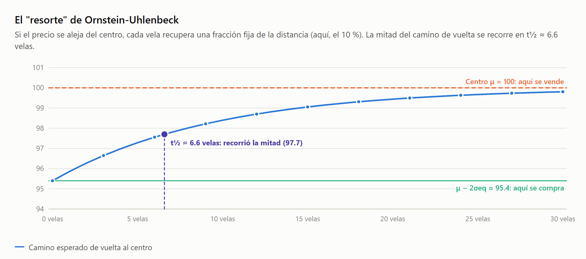

1. $X_t$ es el logaritmo del precio (o el residuo de un par de monedas, como ETH contra BTC).
2. Se hace una regresión lineal del cambio de precio contra el precio anterior para obtener $a$ y $\beta$.
3. Si $\beta$ es negativo y significativo (prueba ADF), hay reversión: cuanto más alto está el precio, más tiende a bajar, y viceversa.
4. $\kappa$ es la fuerza del "resorte" que devuelve el precio a su centro.
5. $\mu$ es el centro de equilibrio hacia el que vuelve el precio.
6. La vida media $t_{1/2}$ es el número de velas que tarda en cerrarse la mitad de la distancia al centro.
7. $\sigma_{eq}$ es la distancia típica a la que el precio se aleja del centro cuando oscila.

**Cómo aplicarlo.** Comprar en $\mu - k\,\sigma_{eq}$ y vender en $\mu$, con un margen esperado de $k\,\sigma_{eq}$. Antes de operar, se exige que ese margen sea varias veces mayor que los costos $c$, y se cierra la operación si pasan unas $3\,t_{1/2}$ velas sin volver (señal de que el rango se rompió). Si $t_{1/2}$ es enorme o $\beta$ no es significativo, no hay rango que operar.

## Sugerencia 3 — Cuando no oscila: seguir la tendencia con salida dinámica

**Qué patrón busca.** Las criptomonedas tienen un patrón de **momentum** bien documentado en la literatura académica: lo que subió en los últimos días tiende a seguir subiendo un poco más. Aquí el margen no sale de acertar mucho, sino de que las ganancias de las tendencias largas son mucho mayores que las pérdidas pequeñas: se acierta un 35–40 % de las veces, pero con un $b$ grande.

$$
s_t = \operatorname{signo}\!\left(\ln\frac{P_t}{P_{t-L}}\right),
\qquad
ATR_t = \frac{1}{n}\sum_{i=0}^{n-1}\max\!\big(H_{t-i}-L_{t-i},\ |H_{t-i}-C_{t-i-1}|,\ |L_{t-i}-C_{t-i-1}|\big)
$$

**Qué es cada símbolo:**

- $L$ en $P_{t-L}$: cuántas velas hacia atrás se compara (por ejemplo, 24 horas).
- $\operatorname{signo}$: +1 si lo de adentro es positivo y −1 si es negativo.
- $s_t$: señal de dirección.
- $H$, $L$ dentro del ATR: máximo y mínimo de cada vela (aquí $L$ es el mínimo, *low*).
- $C_{t-i-1}$: cierre de la vela anterior.
- $\lvert\cdot\rvert$: valor absoluto (la distancia sin signo).
- $ATR_t$: *Average True Range*: tamaño promedio de las últimas $n$ velas, incluidos los saltos entre velas.

> **Qué calcula:** la dirección reciente del precio ($s$) y el tamaño típico de una vela, incluidos los saltos entre velas (ATR).
>
> **Ejemplo:** si el precio pasó de 2 300 a 2 400, $\ln(2400/2300) \approx +0.043$ y $s = +1$. Una vela con $H = 2410$, $L = 2390$ y cierre anterior 2 370 tiene rango verdadero $\max(20, 40, 20) = 40$, porque abrió con un salto; si las últimas 3 velas tienen 30, 25 y 35, $ATR_3 = 30$.

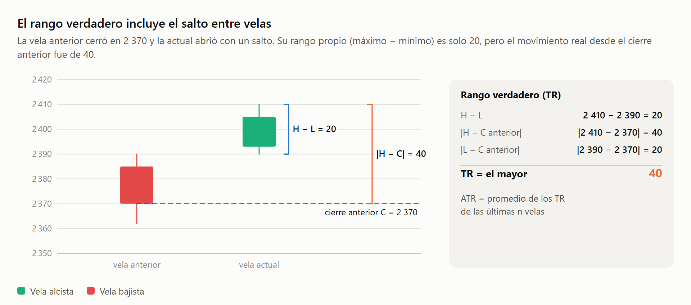

$$
SL_t = \max_{\text{desde la entrada}}(H) - m\cdot ATR_t
$$

**Qué es cada símbolo:**

- $\max_{\text{desde la entrada}}(H)$: el máximo más alto desde que se compró.
- $m$: cuántos ATR de distancia (entre 2 y 3).

> **Qué calcula:** un stop que sube detrás del precio a una distancia proporcional a la volatilidad.
>
> **Ejemplo:** si el máximo desde la entrada es 2 480, $m = 3$ y $ATR = 30$: $SL = 2480 - 90 = 2390$. Si el máximo sube a 2 520, el stop sube a 2 430.

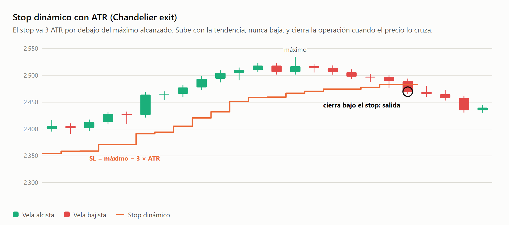

1. La señal $s_t$ es $+1$ si el precio subió en las últimas $L$ velas (por ejemplo, 24 horas o 7 días) y $-1$ si bajó.
2. En spot solo se compra cuando $s_t = +1$ y se queda fuera cuando $s_t = -1$.
3. El ATR (*Average True Range*) mide el tamaño típico de una vela usando el máximo $H$, el mínimo $L$ y el cierre anterior $C$, así que incluye los saltos entre una vela y la siguiente.
4. El stop se coloca $m$ veces el ATR por debajo del máximo alcanzado desde la entrada (*Chandelier exit*), con $m$ entre 2 y 3.
5. Como el máximo solo puede subir, el stop también sube y va asegurando ganancias mientras dure la tendencia.
6. No hay take profit fijo, así que una tendencia fuerte puede dar $5R$ o $10R$ y compensar varias pérdidas de $1R$.

**Cómo aplicarlo.** Reemplazar el $TP = P + 2R$ fijo de `TrendFollowing` por este stop dinámico. El `RLRiskManager` ya tenía prevista una acción de *trailing stop*, así que esto la implementa con una regla clara en vez de un modelo por entrenar.

## Sugerencia 4 — Patrones por horario (estacionalidad intradía)

**Qué patrón busca.** El mercado cripto opera las 24 horas, pero no se comporta igual a todas horas. La volatilidad y la dirección cambian con la apertura de Europa y de Estados Unidos, con los pagos de *funding* de los futuros (00:00, 08:00 y 16:00 UTC) y con el bajo volumen de los fines de semana. Estos patrones son de los más estables porque dependen de horarios humanos, que no cambian.

$$
\bar r_h = \frac{1}{N_h}\sum_{t\,:\,\text{hora}(t)=h} r_t,
\qquad
t_h = \frac{\bar r_h}{s_h / \sqrt{N_h}},
\qquad
\bar\sigma_h = \operatorname{std}\{r_t : \text{hora}(t)=h\}
$$

**Qué es cada símbolo:**

- $h$: hora del día en UTC (0 a 23).
- $t : \text{hora}(t) = h$: "las velas cuya hora es $h$".
- $N_h$: cuántas velas hay en esa hora.
- $\bar r_h$: retorno promedio de esa hora.
- $s_h$: desviación estándar de esos retornos.
- $t_h$: estadístico t: si es grande, el promedio no es casualidad.
- $\bar\sigma_h$: volatilidad típica de esa hora.

> **Qué calcula:** el retorno promedio y la volatilidad de cada hora del día, y si ese promedio es real o casualidad ($t_h$).
>
> **Ejemplo:** si a las 14:00 UTC hay 500 velas con retorno medio $+0.02\,\%$ y desviación $0.4\,\%$: $t = 0.02/(0.4/\sqrt{500}) \approx 1.1$, muy por debajo de 3, así que ese "patrón" es ruido.

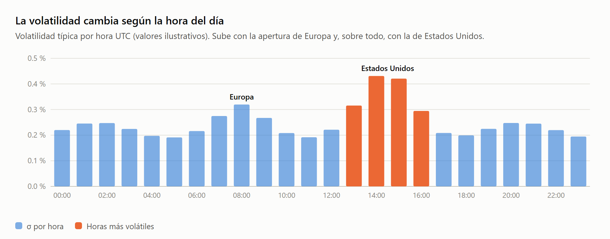

1. Se agrupan todas las velas históricas según la hora UTC en que ocurrieron (de 0 a 23).
2. Para cada hora $h$ se calcula el retorno promedio $\bar r_h$.
3. El estadístico $t_h$ divide ese promedio entre su error estándar para saber si es distinto de cero o solo ruido.
4. Como se prueban 24 horas a la vez, alguna saldrá "significativa" por azar, así que se exige $|t_h| > 3$ en lugar del habitual 2 (corrección de Bonferroni).
5. También se calcula la volatilidad por hora $\bar\sigma_h$, que suele ser mucho más estable que la dirección.

**Cómo aplicarlo.** Hay dos usos. El primero es operar solo, o con preferencia, en las horas con un retorno o una reversión significativos. El segundo, más robusto, es ajustar las bandas y los stops a la volatilidad típica de cada hora, para no confundir el ruido normal de la apertura de Nueva York con una ruptura. Se puede repetir el mismo análisis por día de la semana.

## Sugerencia 5 — Subir la tasa de acierto con un filtro (triple barrera + *meta-labeling*)

**Qué patrón busca.** No todas las señales de una estrategia son iguales: una banda inferior tocada con poco volumen un domingo de madrugada no es lo mismo que una tocada en plena caída de la apertura estadounidense. En lugar de pedirle a XGBoost que adivine el mercado, se le hace una pregunta mucho más fácil: **"dada esta señal concreta, ¿llegará primero al take profit o al stop loss?"**. Si filtra bien, sube $p$, y con eso el margen.

$$
y_i = \begin{cases}
1 & \text{si el precio toca primero } TP_i \\
0 & \text{si toca primero } SL_i \text{ o se agota el tiempo}
\end{cases}
\qquad\qquad
\text{operar solo si } \hat p_i > p^{*} = \frac{1 + c/R_i}{1 + b}
$$

**Qué es cada símbolo:**

- $i$: cada señal de compra de la historia.
- $TP_i$, $SL_i$: take profit y stop loss de esa señal.
- $y_i$: etiqueta: 1 si tocó primero el TP, 0 si no.
- $\hat p_i$: probabilidad que el modelo le da a esa señal.
- $R_i$: riesgo de esa señal.

> **Qué calcula:** la etiqueta de cada señal (¿llegó antes al TP o al SL?) y el umbral de probabilidad para aceptarla.
>
> **Ejemplo:** con $b = 1$ y $c/R = 0.2$: $p^{*} = 1.2/2 = 60\,\%$. Si el modelo da $\hat p = 0.65$ a una señal, se compra; si da $0.55$, se descarta.

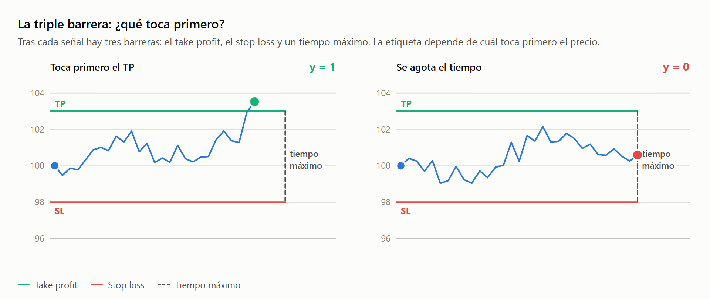

1. Se ejecuta la estrategia sobre la historia y se guardan **solo** las velas en las que dio señal de compra.
2. Para cada señal se mira hacia adelante y se anota qué barrera tocó primero: la del TP, la del SL o la del tiempo máximo.
3. Esa es la etiqueta $y_i$, que coincide exactamente con cómo opera el bot, a diferencia de la etiqueta actual ("¿sube 1 % en 3 horas?").
4. XGBoost aprende con las variables de la sección 16 más las de las sugerencias anteriores ($VR$, $t_{1/2}$, hora del día y, si se agrega, el desequilibrio entre compradores y vendedores del libro de órdenes).
5. En vivo, el modelo da una probabilidad $\hat p_i$ para cada señal nueva.
6. Solo se ejecuta la compra si $\hat p_i$ supera la tasa de acierto mínima $p^{*}$ calculada con costos.
7. Para medirlo sin engañarse, se usa validación *walk-forward*: entrenar con un periodo, probar con el siguiente, avanzar y repetir, y dejar entre ambos un hueco tan largo como el tiempo máximo de la operación.

**Cómo aplicarlo.** Es la evolución natural del `XGBoostClassifier` que ya existe: hay que cambiar la etiqueta, entrenarlo solo con las señales, guardarlo con `model.save_model()` y llamarlo desde `strategy_engine.py` antes de devolver un `BUY`.

---

## Cómo encajan las cinco piezas

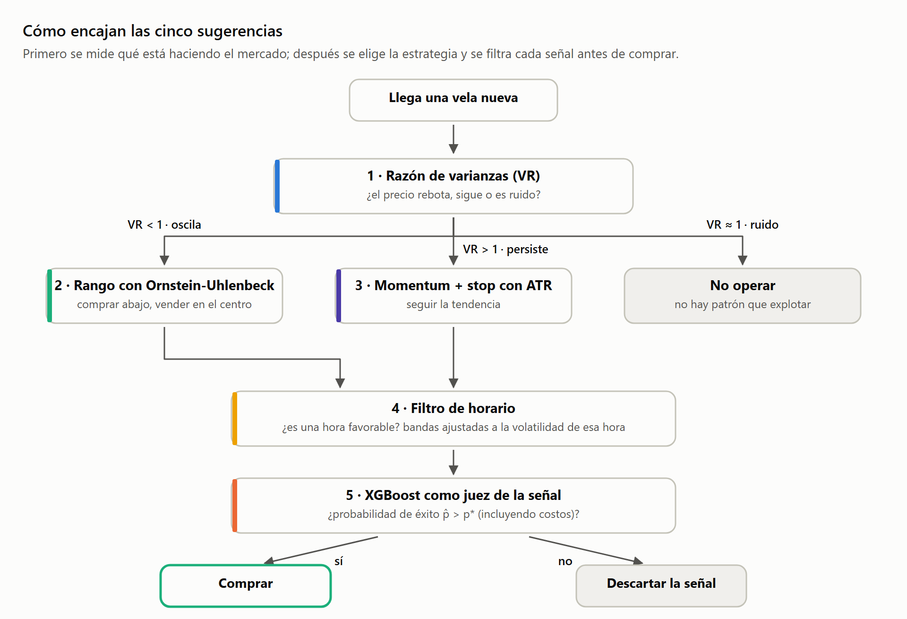

> **Nota final.** El margen real no viene de una fórmula mágica, sino de sumar varias ventajas pequeñas y no regalar dinero en costos ni en malas mediciones. Antes de implementar cualquiera de estas ideas, conviene arreglar el backtest (pagar el múltiplo $b$ real de cada estrategia, usar máximos y mínimos de vela, descontar comisiones y validar con datos no vistos). Si no, no habrá forma de saber si un patrón deja margen o solo lo parece.

---

# Parte 7 — Cómo mide el bot la volatilidad del momento y cómo se ajusta a ella

El bot no tiene una regla del tipo "si la volatilidad es alta, haz X". Lo que hace es más simple y más general: **mide la volatilidad reciente con $\sigma_t$ y expresa todas sus decisiones en unidades de $\sigma_t$**. Cuándo comprar, dónde poner el take profit y dónde poner el stop loss se miden "en sigmas", no en dólares. Así, la misma estrategia funciona en un mercado tranquilo y en uno agitado sin cambiar sus parámetros. Esta parte junta en un solo lugar las piezas que ya aparecieron en las secciones 2, 3, 5, 6 y 8, y explica también sus límites.

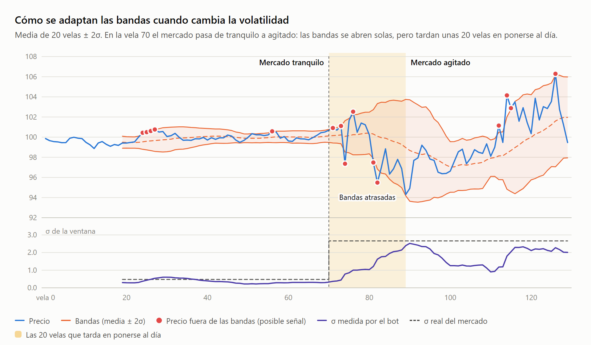

## 22. Medir: la volatilidad de una ventana deslizante

**Objetivo.** Para saber "cuánto se está moviendo el precio ahora", el bot mira solo las últimas $n$ muestras de precio y calcula su desviación estándar. Al llegar una muestra nueva, la más vieja sale de la ventana, así que $\sigma_t$ siempre describe el pasado reciente y no toda la historia. Es la misma fórmula de la sección 2; lo nuevo aquí es entender **qué periodo de tiempo cubre esa ventana**.

$$
\sigma_t = \sqrt{\frac{1}{n-1}\sum_{i=0}^{n-1}\left(P_{t-i}-\mu_t\right)^2}
\qquad\qquad
\text{tiempo cubierto} = n \times \Delta t
$$

**Qué es cada símbolo:**

- $\Delta t$: tiempo entre una muestra y la siguiente: 15 minutos, en el backtest y, desde el 2026-10-18, también en vivo (antes eran ~6 s en vivo).

> **Qué calcula:** qué periodo de tiempo describe la volatilidad medida.
>
> **Ejemplo:** con $n = 20$: $20 \times 15$ min $= 5$ horas, en el backtest y en vivo. Antes del 2026-10-18, en vivo eran $20 \times 6$ s $= 2$ minutos.

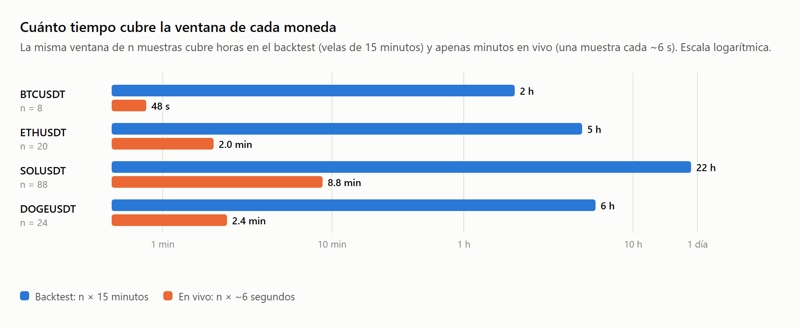

**Desglose paso a paso**

1. Cada estrategia guarda una lista con los últimos $n$ precios (`price_history`) y descarta el más viejo con `pop(0)` cuando llega uno nuevo.
2. Con esa lista se calcula $\sigma_t$ con `pd.Series(prices).std()`. Las $n$ muestras pesan igual: la de hace un instante cuenta lo mismo que la más vieja de la ventana.
3. $\sigma_t$ queda en USDT, no en porcentaje. Un $\sigma$ de 200 es mucho para ETH y poco para BTC, pero eso no importa porque el bot siempre lo compara con precios de la misma moneda.
4. $\Delta t$ es el tiempo entre una muestra y la siguiente, y desde el 2026-10-18 **es el mismo en el backtest y en vivo**: 15 minutos.
   - En el backtest (`ml_evaluator.py`, que simula con `fast_backtest.py`, idéntico a `simulate_live` de `optimize.py`), cada muestra es el cierre de una vela de 15 minutos de los CSV que baja `download_data.py` (`data_frequency="15m"`).
   - En vivo, Node.js se suscribe a `kline_15m` y solo le manda a Python las velas **cerradas** (`k.x`), una vez por vela. El TP y el SL se siguen vigilando con cada precio.
   - Al arrancar, `pre_seed_engine` precarga en cada moneda las últimas $\max(n + 20,\ 100)$ velas cerradas de 15 minutos (con la $n$ de **su** estrategia, la misma cantidad que simula el walk-forward) del mismo mercado que el WebSocket. Python descarta las velas repetidas por `open_time` y pide al REST las que falten (`fill_gap`). Si faltan más velas que esa precarga (bot o red caídos mucho tiempo), la estrategia de esa moneda se reinicia y se precarga de nuevo, como al arrancar.
5. La vela cerrada se manda también con una posición abierta, así que la ventana nunca se congela; el BUY de esa vela se ignora.

> **Antes del 2026-10-18** no era así: Node.js usaba `kline_1m` y le mandaba a Python una "foto" de la vela en curso cada ~6 s, la precarga eran 100 velas de 1 minuto y, con una posición abierta, la ventana se congelaba. Con los parámetros de entonces ($n = 8$ en BTC), la ventana cubría ~48 segundos en vivo frente a 2 horas en el backtest, así que el backtest no describía lo que hacía el bot. En una reproducción sin conexión de 13 056 velas por moneda, el bot corregido dio exactamente las mismas señales y operaciones que el backtest.

Hoy, en modo normal, el bot no carga ninguna estrategia (sección 14). Con los parámetros que cargaría el modo experimental, cada ventana cubre:

| Moneda | Estrategia (modo experimental) | $n$ | $k$ | Ventana ($n \times 15$ min, en el backtest y en vivo) |
|---|---|---|---|---|
| BTCUSDT | VolatilitySqueeze | 96 | 2.0 | 24 horas |
| ETHUSDT | VWAP | 84 | 2.6 | 21 horas |
| SOLUSDT | TrendFollowing | 56 | 3.0 | 14 horas |
| DOGEUSDT | TrendFollowing | 12 | 2.8 | 3 horas |

*Origen:* `series.std()` en [quantitative_strategies/](../binance-research/quantitative_strategies/), `handleMarketData` en [ws-client.ts](../src/api/ws-client.ts) y `pre_seed_engine` en [server.py](../binance-research/server.py).

## 23. Ajustarse I: medir la distancia en sigmas (z-score)

**Objetivo.** La pregunta que hace cada estrategia no es "¿cayó el precio 300 USDT?", sino "¿cayó el precio **más de lo normal para cómo se está moviendo ahora**?". Para eso se divide la distancia a la media entre $\sigma_t$. El resultado, el z-score, no tiene unidades: dice a cuántas "sigmas" está el precio de su media. Las bandas de Bollinger son solo otra forma de escribir la misma comparación.

$$
z_t = \frac{P_t - \mu_t}{\sigma_t}
\qquad\qquad
P_t < \mu_t - k\sigma_t \iff z_t < -k
\qquad\qquad
P_t > \mu_t + k\sigma_t \iff z_t > k
$$

**Qué es cada símbolo:**

- $z_t$: a cuántas desviaciones estándar está el precio de su media (negativo si está abajo).
- $\iff$: las dos condiciones son equivalentes: decir una es decir la otra.

> **Qué calcula:** a cuántas sigmas está el precio de su media.
>
> **Ejemplo:** con la serie de la sección 1 ($\mu = 100$, $\sigma = 3.16$) y un precio de 93: $z = -7/3.16 \approx -2.21 < -2$. Es la misma compra de la sección 5, vista en sigmas.

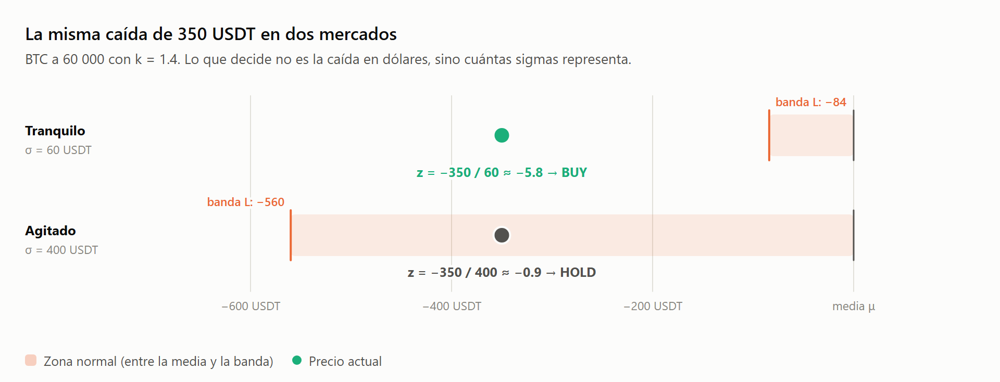

**Desglose paso a paso**

1. $P_t - \mu_t$ es cuánto se alejó el precio de su media, en USDT.
2. Al dividir entre $\sigma_t$, esa distancia se convierte en "número de sigmas".
3. La reversión a la media (sección 5) compra cuando $z_t < -k$, es decir, cuando el precio está más de $k$ sigmas por debajo de la media.
4. La ruptura (sección 6) compra cuando $z_t > k$, es decir, cuando el precio está más de $k$ sigmas por encima.
5. Como el umbral es $k$ y no un número de dólares, el mismo movimiento puede ser una señal en un mercado tranquilo y ruido en uno agitado.

**Ejemplo** (BTC a 60 000 USDT con $k = 1.4$, un valor ilustrativo). El precio cae 350 USDT por debajo de su media:

| Mercado | $\sigma_t$ | $k\sigma_t$ (distancia a la banda) | $z_t$ | Decisión |
|---|---|---|---|---|
| Tranquilo | 60 USDT | 84 USDT | $-350/60 \approx -5.8$ | **BUY**: es un movimiento extremo para ese mercado. |
| Agitado | 400 USDT | 560 USDT | $-350/400 \approx -0.9$ | **HOLD**: es un vaivén normal. Para comprar haría falta una caída de más de 560 USDT. |

## 24. Ajustarse II: take profit y stop loss proporcionales a σ

**Objetivo.** Una vez dentro de la operación, el bot también necesita que el stop loss no esté tan cerca que lo saque el ruido normal, ni tan lejos que arriesgue de más. Como el TP y el SL se calculan desde la media, y la entrada siempre está a más de $k\sigma_t$ de ella, **la distancia de riesgo $R$ crece sola con la volatilidad**.

$$
\text{Reversión: } R = \mu_t - P_t = |z_t|\,\sigma_t > k\,\sigma_t
\qquad\qquad
\text{Ruptura: } R = P_t - \mu_t = z_t\,\sigma_t > k\,\sigma_t
$$

**Qué es cada símbolo:**

- $\lvert z_t \rvert$: valor absoluto del z-score (el número de sigmas, sin signo).

> **Qué calcula:** que la distancia de riesgo es siempre al menos $k$ sigmas.
>
> **Ejemplo:** con $z = -2.21$ y $\sigma = 3.16$: $R = 2.21 \times 3.16 \approx 7$, igual que en la sección 5, y mayor que $k\sigma = 6.32$.

$$
\text{Filtro de la reversión y del squeeze: } R \ge 0.005\,P_t
\;\Longrightarrow\;
\sigma_t \ge \frac{0.005\,P_t}{|z_t|}
$$

**Qué es cada símbolo:**

- $\Longrightarrow$: "implica": de lo de la izquierda se deduce lo de la derecha.

> **Qué calcula:** la volatilidad mínima que exige el filtro del 0.5 %.
>
> **Ejemplo:** con $P = 93$ y $|z| = 2.21$: $\sigma \ge 0.005 \times 93/2.21 \approx 0.21$. Como $\sigma = 3.16$, se cumple de sobra.

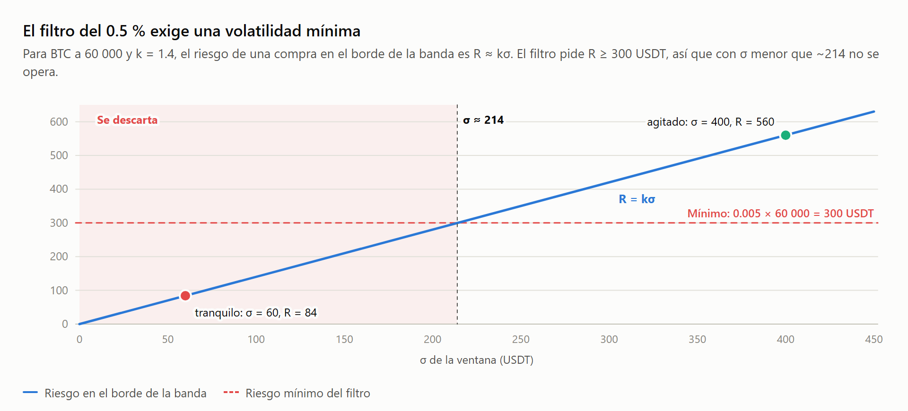

**Desglose paso a paso**

1. En la reversión, $R$ es la distancia de la entrada a la media. El TP queda a $+R$ y el SL a $-R$, así que ambos están a $|z_t|$ sigmas de la entrada.
2. En la ruptura, el SL está en la media (a $z_t$ sigmas por debajo) y el TP a $2R$ por encima.
3. En los dos casos $R$ es como mínimo $k\sigma_t$: si la volatilidad se duplica, la distancia al TP y al SL también se duplica.
4. La reversión y el squeeze descartan la operación si $R$ es menor que el 0.5 % del precio. Como $R = |z_t|\sigma_t$, eso equivale a pedir una volatilidad mínima.
5. Justo en el borde de la banda ($|z_t| \approx k$), la volatilidad mínima es $\sigma_t \ge 0.005\,P_t / k$. Con BTC a 60 000 y $k = 1.4$ da unos **214 USDT**. Con menos volatilidad, solo pasan movimientos mucho más extremos que la banda (en el ejemplo anterior, con $\sigma = 60$, hace falta $|z| \ge 5$).
6. La ruptura (`TrendFollowing`, la que el modo experimental cargaría en SOL y DOGE) **no tiene este filtro**: opera también con volatilidad muy baja, aunque el TP quede tan cerca que los costos (0.24 % ida y vuelta, sección 12) se coman la ganancia.
7. El squeeze (sección 8) es la única estrategia que mira el **nivel** de la volatilidad: queda armada cuando $2k\sigma_t/\mu_t < 5\%$, es decir, cuando la volatilidad relativa es baja.

**Ejemplo.** Siguiendo con el caso agitado, si el precio cae 600 USDT ($z = -1.5$, por debajo de la banda de 560), entonces $R = 600$, $TP = P_t + 600$ y $SL = P_t - 600$. En el mercado tranquilo, la compra de la sección 23 tenía $R = 350$: los stops se ajustaron a cada entorno sin cambiar ningún parámetro.

## 25. Lo que todavía no se ajusta a la volatilidad

**Objetivo.** Medir con $\sigma_t$ resuelve mucho, pero no todo. Estas son las piezas del bot que ignoran la volatilidad o la miden con retraso, y lo que se podría hacer en cada caso.

**1. El tamaño de la posición es fijo.** Node.js compra siempre ~15 USDT (sección 10). Como $R$ crece con $\sigma_t$, el dinero en riesgo también crece:

$$
\text{Riesgo en USDT} = q\,R \approx \frac{15}{P_t}\,R
\qquad\text{frente a la alternativa}\qquad
q = \frac{\text{Riesgo fijo en USDT}}{R}
$$

**Qué es cada símbolo:**

- $q$: cantidad de monedas.
- $\approx$: "aproximadamente igual" (por el redondeo de $q$).
- $\text{Riesgo fijo en USDT}$: lo que se decide perder como máximo en cada operación.

> **Qué calcula:** los dólares en riesgo con el tamaño fijo actual y la cantidad que fijaría el riesgo.
>
> **Ejemplo:** BTC a 60 000 con $R = 600$: hoy se arriesgan $15/60000 \times 600 = 0.15$ USDT. Para arriesgar siempre 0.10 USDT, $q = 0.10/600 \approx 0.000167$ BTC (unos 10 USDT de posición).

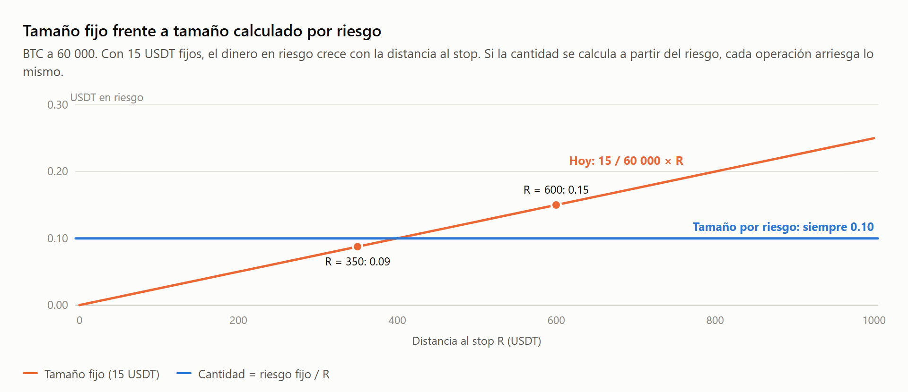

Con BTC a 60 000, la operación tranquila ($R = 350$) arriesga ~0.09 USDT y la agitada ($R = 600$) ~0.15 USDT. Con la fórmula de la derecha, que calcula la cantidad a partir del riesgo, cada operación arriesgaría lo mismo sin importar la volatilidad.

**2. La medición llega tarde.** En la ventana todas las muestras pesan igual, así que, cuando la volatilidad salta, $\sigma_t$ tarda hasta $n$ muestras en reflejarlo. Es la franja amarilla de la figura: las bandas siguen estrechas, el precio las atraviesa una y otra vez, y aparecen varias "señales" que en realidad son el nuevo nivel normal de ruido. Una alternativa estándar es la media móvil exponencial de la varianza (EWMA), que le da más peso a lo más reciente:

$$
\sigma_t^2 = \lambda\,\sigma_{t-1}^2 + (1-\lambda)\,r_t^2,\qquad r_t = \frac{P_t}{P_{t-1}} - 1,\qquad \lambda \approx 0.94
$$

**Qué es cada símbolo:**

- $\sigma_t^2$: varianza estimada ahora; $\sigma_{t-1}^2$, la de la vela anterior.
- $\lambda$: memoria: cuánto pesa la estimación anterior (0.94).
- $1 - \lambda$: cuánto pesa el retorno nuevo (0.06).
- $r_t$: retorno de la vela actual.

> **Qué calcula:** una volatilidad que da más peso a lo más reciente.
>
> **Ejemplo:** si la volatilidad venía en $1\,\%$ y llega un retorno de $3\,\%$: $\sigma^2 = 0.94 \times 0.0001 + 0.06 \times 0.0009 = 0.000148$, así que $\sigma \approx 1.22\,\%$. Con una sola vela subió un 22 %; una ventana de 20 velas habría subido un 18 % ($\sqrt{(19 \times 1 + 9)/20} \approx 1.18$). Con $\lambda = 0.94$ la diferencia es pequeña: la EWMA reacciona más o menos como una ventana de 17 velas ($1/(1-\lambda)$). Para que reaccione claramente antes hay que bajar $\lambda$ (por ejemplo, a 0.80), a cambio de una medición más ruidosa. Su otra ventaja es que no da saltos cuando un dato viejo sale de la ventana.

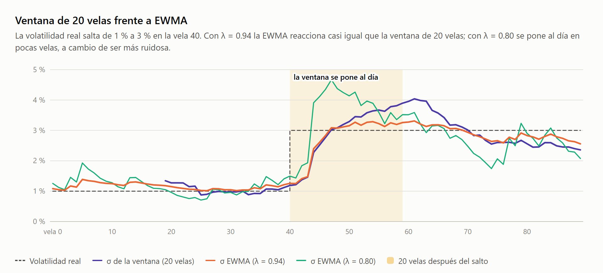

**3. Mide precios, no retornos.** $\sigma_t$ se calcula sobre los precios, así que una tendencia limpia también la infla, aunque no haya ningún "temblor". La desviación de los retornos (sección 16.2), en cambio, solo mide el temblor.

$$
\sigma_{\text{precios}} = a\,\sqrt{\frac{n\,(n+1)}{12}}
\qquad\qquad
\sigma_{\text{cambios}} = 0
$$

**Qué es cada símbolo:**

- $a$: cuánto sube el precio en cada vela, siempre lo mismo (una tendencia sin ruido).
- $n$: tamaño de la ventana.
- $\sigma_{\text{precios}}$: desviación estándar de los $n$ precios, la que usa hoy el bot.
- $\sigma_{\text{cambios}}$: desviación estándar de los cambios de precio entre velas.

> **Qué calcula:** cuánto "parece" moverse el precio para el bot cuando en realidad solo sigue una tendencia perfecta.
>
> **Ejemplo:** si el precio sube exactamente 1 USDT por vela ($a = 1$) durante 20 velas: $\sigma_{\text{precios}} = \sqrt{20 \times 21 / 12} \approx 5.9$ y las bandas con $k = 2$ se abren $\pm 11.8$ USDT. Todos los cambios valen +1, así que $\sigma_{\text{cambios}} = 0$. En tendencias fuertes, las bandas se abren por la tendencia y no por la volatilidad; medir sobre retornos lo evita.

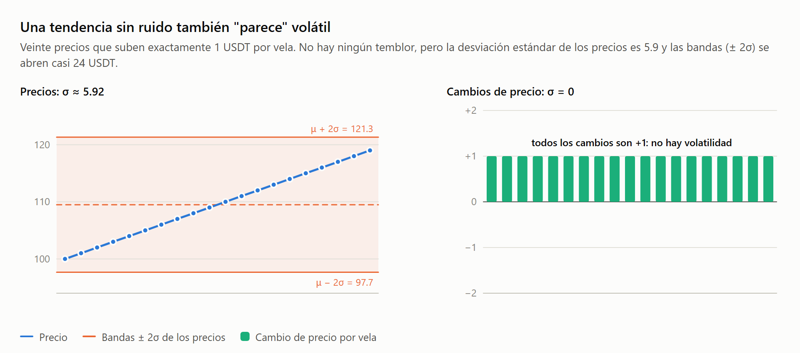

**4. La ventana ve menos de la mitad del movimiento posible.** Como cada precio se parece mucho al anterior, $n$ precios seguidos se dispersan poco comparado con lo que el precio puede llegar a moverse en esas mismas $n$ velas. Si el precio se mueve al azar (un buen modelo a corto plazo), las dos cantidades son:

$$
\mathbb{E}\big[\sigma_{\text{ventana}}^2\big] = \sigma_{\text{paso}}^2\,\frac{n+1}{6}
\qquad\qquad
\text{movimiento típico en } n \text{ velas} = \sigma_{\text{paso}}\,\sqrt{n}
$$

**Qué es cada símbolo:**

- $\sigma_{\text{paso}}$: cuánto se mueve típicamente el precio de una vela a la siguiente.
- $\sigma_{\text{ventana}}$: la desviación estándar de los $n$ precios de la ventana (la que calcula el bot).
- $\mathbb{E}[\cdot]$: valor esperado, es decir, el promedio si se repitiera muchas veces.
- $n$: tamaño de la ventana.

> **Qué calcula:** cuánto mide en promedio la ventana y cuánto se mueve de verdad el precio en ese mismo tiempo.
>
> **Ejemplo:** con $n = 8$, $\sigma_{\text{ventana}} \approx \sigma_{\text{paso}}\sqrt{9/6} \approx 1.22\,\sigma_{\text{paso}}$, mientras que en 8 velas el precio se mueve típicamente $\sqrt{8} \approx 2.83\,\sigma_{\text{paso}}$: la ventana ve un 43 %. Con $n = 88$, $3.85$ frente a $9.38$: un 41 %. La proporción es casi la misma para cualquier $n$ (tiende a $1/\sqrt{6} \approx 41\,\%$), así que **todas** las ventanas subestiman el movimiento en una proporción parecida, no solo las cortas. Las bandas con $k = 2$ no cubren "el 95 % de los movimientos" que sugiere la distribución normal (sección 3).

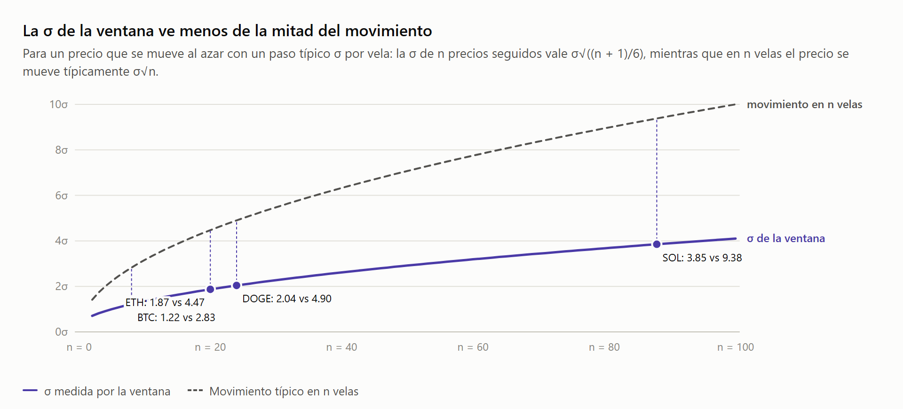

**5. La escala de tiempo no coincidía entre backtest y vivo** (sección 22). **Corregido el 2026-10-18** con la primera opción de abajo (velas cerradas de `kline_15m`). Era la limitación más importante. Para que en vivo $\sigma_t$ midiera lo mismo que en el backtest, había dos opciones: que Node.js solo mande a Python las velas **cerradas** (`kline.x === true`) de la temporalidad del backtest (`kline_15m`), o que Python agrupe las fotos en velas de 15 minutos antes de alimentar la ventana. En los dos casos, cada vela se arma así:

$$
O_T = P_{\text{primera}},\qquad
H_T = \max_{\tau \in [T,\,T+15)} P_\tau,\qquad
L_T = \min_{\tau \in [T,\,T+15)} P_\tau,\qquad
C_T = P_{\text{última}}
$$

**Qué es cada símbolo:**

- $T$: minuto en que empieza la vela (10:00, 10:15, 10:30…).
- $[T,\,T+15)$: los 15 minutos de la vela, desde $T$ hasta justo antes de $T + 15$.
- $P_\tau$: cada precio negociado en ese intervalo.
- $O_T$, $H_T$, $L_T$, $C_T$: apertura, máximo, mínimo y cierre de la vela.
- $C_T$: el único dato que entraría a la ventana, y solo cuando la vela termina.

> **Qué calcula:** una vela de 15 minutos a partir de todos los precios de esos 15 minutos, para que el bot en vivo vea lo mismo que en el backtest.
>
> **Ejemplo:** entre 10:00 y 10:15 llegan unas 150 fotos (una cada ~6 s). Antes del 2026-10-18 las 150 entraban a la ventana, así que con $n = 20$ la ventana cubría unos 2 minutos. Ahora solo entra el cierre de las 10:15, y $n = 20$ cubre 5 horas, igual que en el backtest.

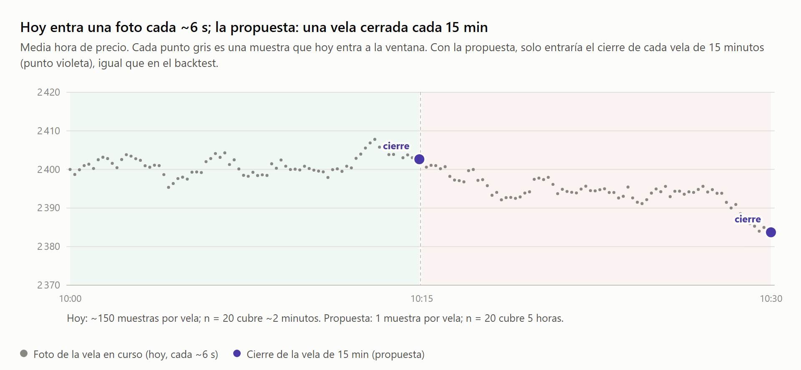

*Origen:* `evaluateNewTrade` y `handleMarketData` en [ws-client.ts](../src/api/ws-client.ts), estrategias en [quantitative_strategies/](../binance-research/quantitative_strategies/).

---

# Parte 8 — El recorrido completo, paso a paso

Las secciones de este documento están agrupadas **por tema** (bloques básicos, estrategias, ejecución, backtest, machine learning), no en el orden en que el bot hace las cuentas. Por ejemplo, el backtest (sección 12) se ejecuta **antes** que cualquier estrategia en vivo, y el tamaño de la posición (sección 10) se calcula **después** del take profit y el stop loss. Este diagrama ordena todas las fórmulas según el momento en que se usan.

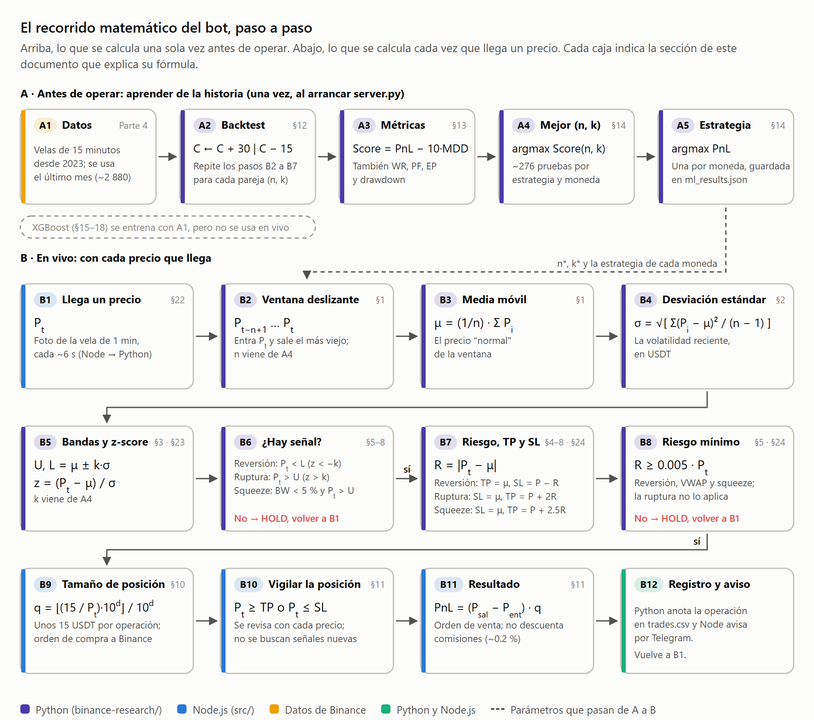

El proceso tiene dos fases:

- **Fase A, antes de operar.** Se ejecuta a mano con `python machine_learning_strategies/ml_evaluator.py` (unos 2 minutos) y deja el resultado en `ml_results.json`; al arrancar, `server.py` solo lo lee con `strategy_engine.py`. Usa la historia para decidir qué estrategia, qué ventana $n$ y qué multiplicador $k$ usará cada moneda, o si la moneda no opera.
- **Fase B, en vivo.** Se repite con cada precio que llega. Usa los $n$ y $k$ de la fase A para decidir si se compra, cuánto se compra y cuándo se vende.

## Fase A — Antes de operar

| Paso | Qué se calcula | Fórmula | Sección | Código |
|---|---|---|---|---|
| A1 | Se cargan todas las velas de 15 minutos y se separan el desarrollo (38 meses de prueba), la validación final y los 6 meses más recientes | $N_{\text{velas}} = \text{días} \times 96$ | Parte 4, "Los datos de entrenamiento" | [download_data.py](../binance-research/download_data.py), `load_history` en [fast_backtest.py](../binance-research/fast_backtest.py), `build_periods` en [walk_forward.py](../binance-research/walk_forward.py) |
| A2 | Se simula una vez toda la historia para cada pareja $(n, k)$, repitiendo vela por vela los pasos B2 a B7 como en vivo | $C \leftarrow C + PnL_{\text{neto}}$ | 12 | `FastSymbol.simulate` en [fast_backtest.py](../binance-research/fast_backtest.py) (paridad exacta con `simulate_live` de [optimize.py](../binance-research/optimize.py)) |
| A3 | Para cada mes de prueba, cada pareja se mide solo con sus 6 meses de entrenamiento | $S = PnL_{\text{ent}} - 10 \cdot MDD_{\%}$ | 13, 14 | `PairEvaluator.select` en [walk_forward.py](../binance-research/walk_forward.py) |
| A4 | Se elige la mejor meseta de la rejilla y se simula el mes siguiente con una estrategia nueva precargada; una posición por moneda, como el bot (no abre mientras siga abierta la del mes anterior); los 38 meses forman el OOS | $(n^{*}, k^{*}) = \arg\max \bar S$ | 14 | `run_folds` en [walk_forward.py](../binance-research/walk_forward.py) |
| A5 | Se valida cada estrategia con su OOS (la validación final solo puede vetarla) y se elige la de cada moneda, o ninguna | $t = \bar d / (s_d/\sqrt{D})$, $\;p < 0.05/16$ | 14 | `decide` en [walk_forward.py](../binance-research/walk_forward.py), [ml_evaluator.py](../binance-research/machine_learning_strategies/ml_evaluator.py) |
| A6 | Se eligen los parámetros en vivo con los 6 meses más recientes; el motor solo carga estrategias validadas | $(n^{*}, k^{*}) = \arg\max \bar S$ | 14 | `load_best_strategies` en [strategy_engine.py](../binance-research/strategy_engine.py) |

XGBoost (secciones 15 a 18) también se entrena en esta fase, con el último mes completo, pero ni la selección (A3 a A6) ni la fase B usan su predicción.

## Fase B — En vivo, con cada precio

| Paso | Qué se calcula | Fórmula | Sección | Código |
|---|---|---|---|---|
| B1 | Cierra una vela de 15 minutos (`k.x`); el TP/SL se vigila con cada precio | $P_t$ | 22 | `handleMarketData` en [ws-client.ts](../src/api/ws-client.ts) |
| B2 | Entra a la ventana y sale el precio más viejo | $P_{t-n+1}, \dots, P_t$ | 1, 22 | `price_history` en cada estrategia |
| B3 | Media móvil | $\mu_t = \frac{1}{n}\sum P_{t-i}$ | 1 | `series.mean()` |
| B4 | Desviación estándar | $\sigma_t = \sqrt{\frac{1}{n-1}\sum (P_{t-i} - \mu_t)^2}$ | 2 | `series.std()` |
| B5 | Bandas y distancia en sigmas | $U_t, L_t = \mu_t \pm k\sigma_t$, $\;z_t = \frac{P_t - \mu_t}{\sigma_t}$ | 3, 23 | cada estrategia |
| B6 | ¿Hay señal? Si no, `HOLD` y se espera el siguiente precio | $P_t < L_t$, $\;P_t > U_t$ o $BW_t < \theta$ y $P_t > U_t$ | 5 a 8 | `evaluate` de cada estrategia |
| B7 | Riesgo, take profit y stop loss | $R = \lvert P_t - \mu_t \rvert$, TP y SL según la estrategia | 4 a 8, 24 | `evaluate` de cada estrategia |
| B8 | Riesgo mínimo (reversión, VWAP y squeeze). Si no se cumple, `HOLD` | $R \ge 0.005\,P_t$ | 5, 24 | `evaluate` de cada estrategia |
| B9 | Fila `PENDING` en el ledger (con su `client_order_id`) y compra a mercado por importe (15 USDT); Binance fija la cantidad según su `stepSize`. Confirmada: la fila pasa a `OPEN`; inexistente en Binance: `CANCELLED` | $q \approx 15 / P_t$ | 10 | `openPosition` en [ws-client.ts](../src/api/ws-client.ts), `marketBuy` en [rest-client.ts](../src/api/rest-client.ts) |
| B10 | Vigilar la posición con cada precio | $P_t \ge TP$ o $P_t \le SL$ | 11 | `manageExistingPosition` en [ws-client.ts](../src/api/ws-client.ts) |
| B11 | Venta a mercado (en uno o varios tramos) y resultado neto de la operación; el residuo bajo el `stepSize` se valora al precio de venta | $PnL = \text{USDT recibidos} + q_{res}\,P_{salida} - \text{USDT pagados} - \text{comisiones}$ | 11 | `closePosition` y `finishClose` en [ws-client.ts](../src/api/ws-client.ts), `netPnl` en [execution.ts](../src/api/execution.ts) |
| B12 | Registro en `trades.csv` (se cierra solo la fila `OPEN` de esa moneda y `order_id`) y aviso por Telegram; se vuelve a B1. Al reiniciar, las compras `PENDING` se consultan en Binance (ejecutadas: se adoptan) y las posiciones abiertas se verifican antes de gestionarlas | — | 11 | [server.py](../binance-research/server.py), [ledger.py](../binance-research/ledger.py), `syncStateFromLedger` en [ws-client.ts](../src/api/ws-client.ts), [telegram-client.ts](../src/api/telegram-client.ts) |

**Orden de lectura sugerido.** Para seguir el recorrido en el documento, lee las secciones en este orden: "Los datos de entrenamiento", 12, 13 y 14 (fase A); después 22, 1, 2, 3 y 23 (pasos B1 a B5); 5 a 8, 4 y 24 (pasos B6 a B8); y por último 10 y 11 (pasos B9 a B11).
